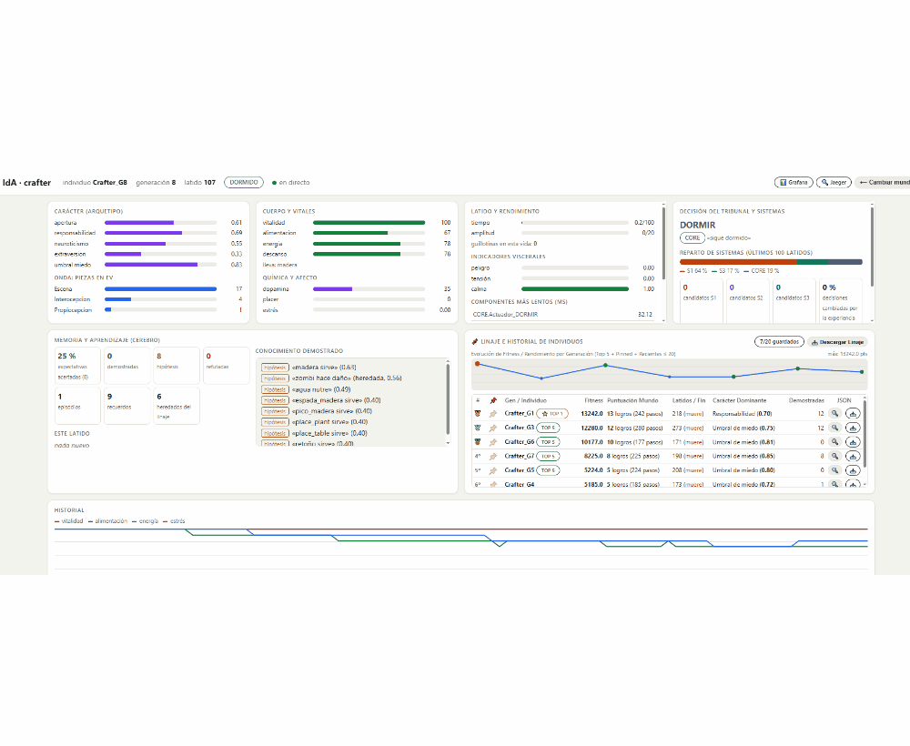
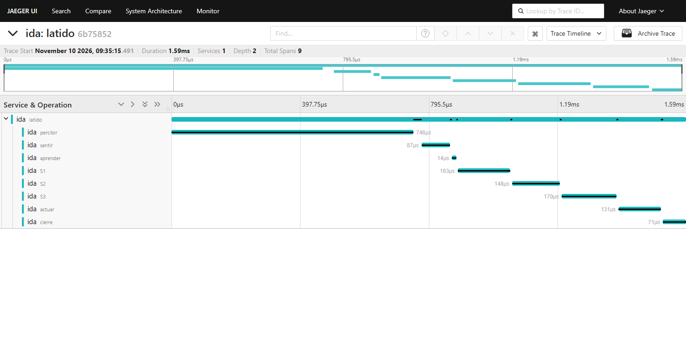

# IdA – Identidad Artificial (Artificial Identity)

**A bio-inspired Python framework for agents with a body, a character and a lineage that live in different worlds.**

[](https://github.com/diegorodriguezreija/IdA/actions/workflows/ci.yml)
[-blue)](NOTICE)


This is a short English summary. The full documentation, and the code itself, are in Spanish, starting with [README.md](README.md).

IdA is a **framework**: a generic core, inspired by how living beings solve the problem of staying alive, to which worlds plug in as adapters. It is made to **run and watch** its individuals live. It does not compete with other agents or chase the best score; that question is studied separately, in the [IdA Laboratory](#ida-laboratory).

Every IdA individual has a **body** that wears out, a **heartbeat** with an attention and time budget (and a guillotine that cuts thinking when the deadline passes), and **three systems** that propose what to do: S1 (survival), S2 (value) and S3 (truth). A **Tribunal** picks one according to the state of the body: under stress it listens to urgency, when calm to confidence. What the individual lives through is remembered, anticipated, turned into readable knowledge ("the mushroom hurts") and, at death, passed on to its **lineage**.

The mind does not know which world it lives in. Each world translates its reality into a shared vocabulary of traits (`nutritivo` nourishing, `peligro` danger, `lugar` place…) and verbs (`MOVER` move, `COMER` eat…). The same core, unchanged, runs in five worlds: a minimal one for tests, a **file-system world** on disk, **Snake** on a real website, **Crafter** and **chess**. The world perceives; IdA thinks: no sensor computes on the individual's behalf.

<p align="center">
  
</p>

## Try it in 1 minute

```bash
git clone https://github.com/diegorodriguezreija/IdA.git
cd IdA
python -m venv .venv
source .venv/bin/activate                 # Windows: .venv\Scripts\activate
pip install -e ".[dev,crafter,ajedrez]"
python -m pytest -q                       # 68 tests
python -m ida                             # interactive launcher at http://127.0.0.1:8000
```

Running `python -m ida` without arguments launches an **interactive web launcher room** ([`docs/img/room.png`](docs/img/room.png)) to choose a world, tune initial personality sliders, optionally enable graphical window displays (in Snake or Crafter), and adjust parameters before proceeding to the **live telemetry dashboard** ([`docs/img/dashboard.PNG`](docs/img/dashboard.PNG), [`docs/img/dashboard2.PNG`](docs/img/dashboard2.PNG)), which includes lineage tracking, an evolution chart, and an **expandable individual profile modal** ([`docs/img/dashboard3.PNG`](docs/img/dashboard3.PNG)) with one-click JSON download and restore capabilities.

Or, with nothing installed: `docker compose up --build`.

> **Note on Snake.** This world plays on [playsnake.org](https://playsnake.org/), a third-party site not affiliated with this project, by driving a browser with Playwright. It is a demonstration world: it plays one game at a time and uses no credentials and collects no data from the site. If you use it, respect the site's terms of use. If the site changes or goes away, this world will stop working; the other worlds do not need the internet.

## What's inside

- **The wave (Onda).** Each heartbeat travels in a wave with four channels: `ei` (how the previous beat ended, read-only), `ev` (what it perceives), `acc` (competing proposals) and `ef` (the full record, which becomes the next `ei`). Every component runs a reactive, an active and a proactive pass.
- **The guillotine.** Cooperative and synchronous: every emission checks the clock and the attention budget. If either runs out, the remaining components are skipped and the Tribunal still acts on what is already proposed.
- **Memory.** Expectations, episodes and propositions with a status (hypothesis, proven, refuted). Taste aversion and mortal trauma are learned fast; proven knowledge is inherited as a hypothesis the descendant must confirm.
- **A core blind to the world.** Worlds plug in through one port (`ida/core/mundo.py`). An AST test forbids world vocabulary and imports in the core; another keeps the GPL chess dependency inside its folder.

## Observabilidad

Besides its own panel, IdA can export traces and metrics with **OpenTelemetry** (`--otel`). The stack with **Jaeger**, **Prometheus** and **Grafana** (`docker compose up --build`) is currently in an **early, preliminary phase**: it provides basic heartbeat traces and phase waterfall breakdowns, but IdA's **native live web panel** remains the most informative tool for observing its cognition in real time.

<p align="center"></p>

## Milestones

- The same core runs unchanged in five very different worlds.
- Reproducible with a seed in the minimal, file, Crafter and chess worlds.
- By improving only each world's own code: Snake goes from about 232 to 916 points on average at the hardest level (best 1,605); toxic bites in the file world drop from 7.2 to 2.2 per life; Crafter, with spatial memory (hippocampus) and armed defense, increases mean lifespan from 208 to 264 beats (record 443) and achievements to 10.9 (record 16 with stone pickaxe/sword); in chess it wins 7 of 8 games against the 1-ply bot and 3 of 8 against the 2-ply bot.
- Negative results are published too: it loses against the 3-ply bot, and in Crafter mass nocturnal attacks remain the vital boundary.

Figures, method and limits (Spanish): [doc-repositorio/05_METRICAS_E_HITOS.md](doc-repositorio/05_METRICAS_E_HITOS.md).

## Engineering

Python 3.12+, standard library only in the core; worlds and observability are optional extras. `ruff`, `mypy`, 68 tests and GitHub Actions on Python 3.12 and 3.15, with and without world dependencies. Multi-stage Dockerfile, devcontainer and a Docker Compose observability stack with Grafana dashboards as code.

## IdA Laboratory

This repository is the framework: it is for running IdA and watching its individuals live. Whether IdA's organic design **beats a traditional design** in each world, in which situations and by how much, is studied in a separate repository, the [**IdA Laboratory**](https://github.com/diegorodriguezreija/laboratorio-ida) (in Spanish). It tests modified variants of IdA against traditional baselines for each world, with questions fixed in advance, the same seeds and negative results published. The laboratory's variants do not have to match this framework's version.

## Honesty

A personal prototype, not a study: few lives per measurement. Biological names are inspiration, not equivalence. Much of the code was written with AI agents under the author's direction and review.

## License

[Apache-2.0](LICENSE), except `ida/mundos/ajedrez/`, which is [GPL-3.0-or-later](ida/mundos/ajedrez/LICENSE) because it depends on `python-chess`. See [NOTICE](NOTICE).
