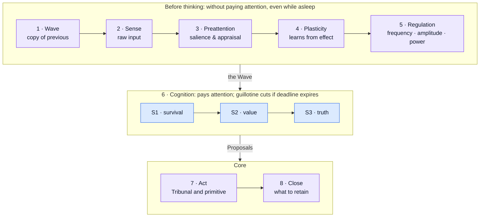
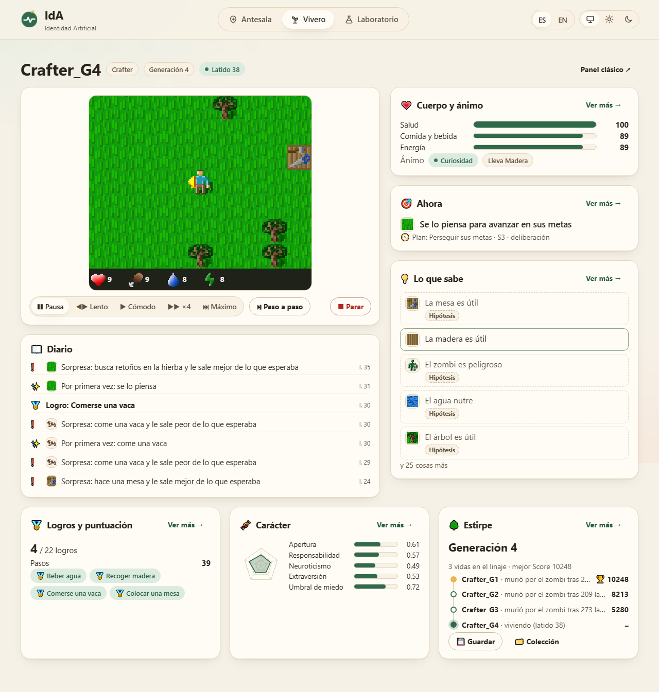
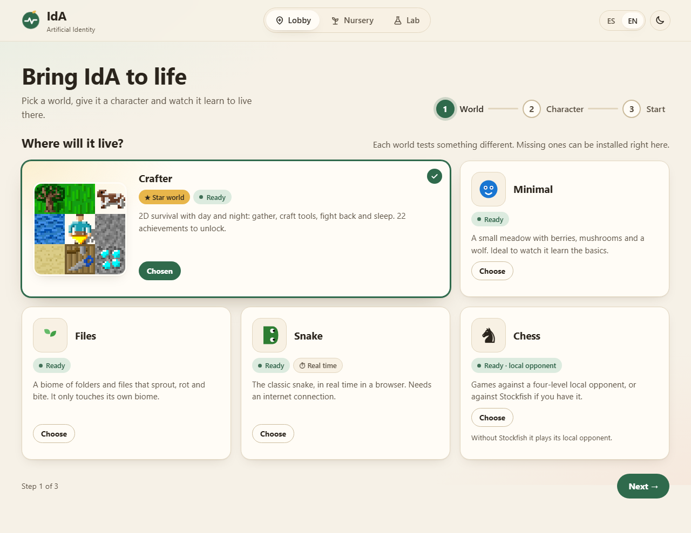
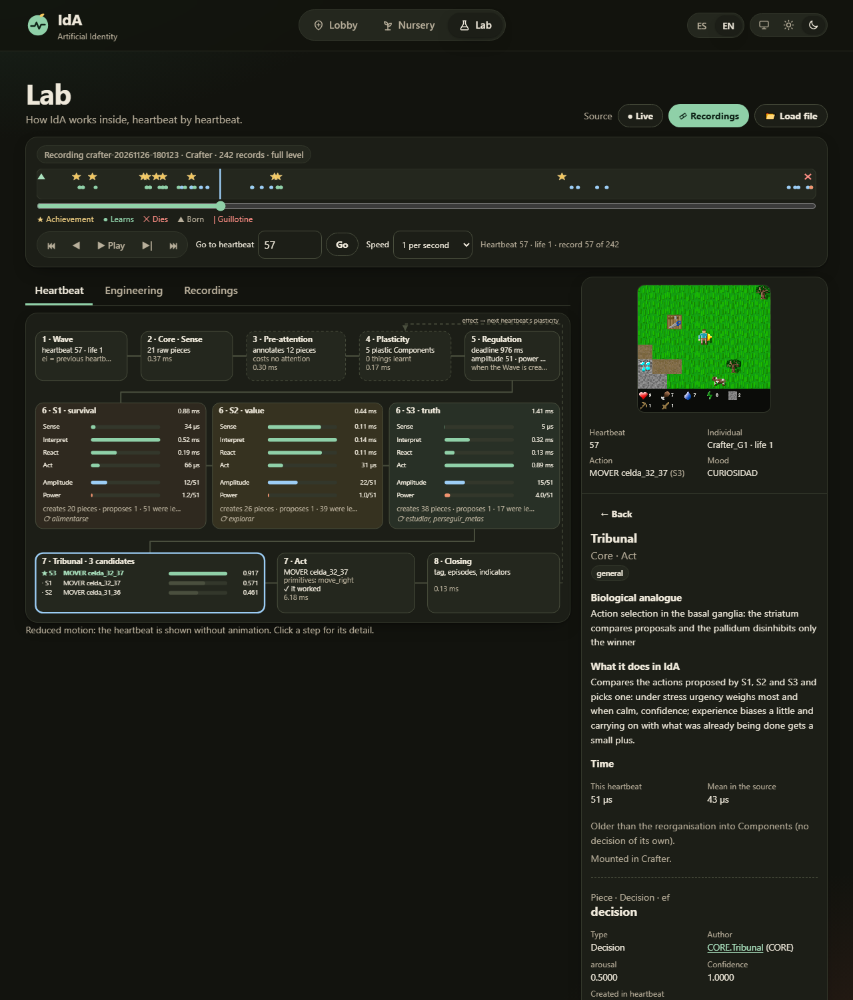
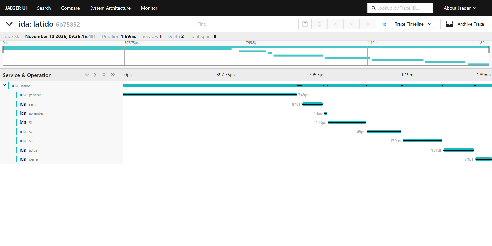

# IdA – Identidad Artificial (Artificial Identity)

**A bio-inspired Python framework for agents with a body, a character and a lineage that live in different worlds.**

[](https://github.com/diegorodriguezreija/IdA/actions/workflows/ci.yml)
[-blue)](NOTICE)


This is a short English summary. The full documentation, and the code itself, are in Spanish, starting with [README.md](README.md).

IdA is a **framework**: a generic core, inspired by how living beings solve the problem of staying alive, to which worlds plug in as adapters. It is made to **run and watch** its individuals live; that is its main purpose, not chasing high scores. But comparing also matters: when a world has a public evaluation protocol, IdA measures itself against it and publishes the result, so its figures can be placed alongside those of other agents. The underlying question, whether the organic design **outperforms** a traditional design and under what conditions, is studied separately, in the [IdA Laboratory](#ida-laboratory).

Every IdA individual has a **body** that wears out (vital constants, stress, pleasure and valence) and a **heartbeat**. On each beat the core senses the world (interoception, proprioception, **exteroception** and ambient conditions) and creates a **Wave** (*Onda*) with a frequency (the deadline; past it, a guillotine cuts thinking), an amplitude (how many pieces fit in attention) and a power (how much arousal can be granted or changed), set by the Core's Regulation from the state of the body. Each system (Core, S1, S2, S3) is organized into Components by stages (Sentir, Interpretar, Reaccionar, Actuar), declared in [`doc-repositorio/componentes.toml`](doc-repositorio/componentes.toml) and displayed in [`doc-repositorio/06_MAPA_DE_COMPONENTES.md`](doc-repositorio/06_MAPA_DE_COMPONENTES.md), and the world only provides its body and its own Components. Three systems work on the Wave in order: S1 (survival), S2 (value) and S3 (truth). Each one interprets (image and **objects**; the value of each subject; propositions, logic and **beliefs**), feels its **impulses** (bodily needs and safety, exploration, intentions such as knowing), chooses **strategies** with phases, progress and exhaustion, and turns them into **actions**. A **Tribunal** picks one according to the state of the body, with a small bonus for continuing the current strategy. Each component only produces and changes pieces of its own type. What the individual lives through is remembered, turned into readable knowledge ("the mushroom hurts") and, at death, passed on to its **lineage**.

### A heartbeat

Each heartbeat is a **Wave** (*Onda*) that always follows the same path. The Core senses and regulates without paying attention, even while asleep. The three systems think in turns on the same Wave, each in four modules. The Core acts at the end.



Each system goes through **Sense → Interpret → React → Act** (*Sentir → Interpretar → Reaccionar → Actuar*). Strategies live in React, each with its Action proposal (*Actuación*). A world does not change this flow: it only registers its body and its own Components. The complete diagram, with every Component of the core and each world, is in [`doc-repositorio/07_DISENO_VISUAL.md`](doc-repositorio/07_DISENO_VISUAL.md).

The mind does not know which world it lives in. Each world translates its reality into a shared vocabulary of traits (`nutritivo` nourishing, `peligro` danger, `lugar` place…) and verbs (`MOVER` move, `COMER` eat…). The same core, unchanged, runs in five worlds: a minimal one for tests, a **file-system world** on disk, **Snake** on a real website, **Crafter** and **chess**. The world perceives; IdA thinks: no sensor computes on the individual's behalf.

<p align="center">
  
</p>

## Try it in 1 minute

You need **Python 3.12 or later**. Check first:

```bash
python --version          # Windows: if it is not 3.12 or later, see the note below
```

```bash
git clone https://github.com/diegorodriguezreija/IdA.git
cd IdA
python -m venv .venv
source .venv/bin/activate                 # Windows: .venv\Scripts\activate
python -m pip install --upgrade pip
pip install -e ".[todos]"                 # all five worlds; without "[todos]", only minimal and files
python -m ida                             # opens the app at http://127.0.0.1:8000
```

**Windows with several Pythons.** If `python --version` shows an old version, the `python` on your PATH is the wrong one. With the Python install manager for Windows, `py list` shows what you have and `py install 3.12` installs one. Create the environment with that Python, e.g. `py -V:3.12 -m venv .venv`, or with its full path (`& "C:\...\python.exe" -m venv .venv`). With an old Python, pip fails with a misleading message ("File 'setup.py' not found").

`python -m ida` opens the app, in English or Spanish depending on your browser:

- **Lobby:** pick the world (missing ones install with one click), IdA's character and the world's options, in three steps. By default every option takes the value that scores best.
- **Nursery:** watch your IdA live: the world drawn live, its body and mood, what it does and why, what it is learning, its diary and achievements. Each world has a **companion**, a lineage that grows generation after generation even if you close the app, and a **collection** to save, export and import individuals. "See more" on each card gives the detail.
- **Lab:** how IdA works inside, beat by beat: the Wave going through the eight steps of the beat and the three systems, each Component with its biological analogue, what it knows and how it came to know it, its body and chemistry over time, and comparisons of lives and lineages. Lives can be recorded and replayed.

<p align="center">
  
  
</p>

To run the tests: `pip install -e ".[todos,dev]"` and `python -m pytest -q`.

Or, with nothing installed: `docker compose up --build`.

> **Note on Snake.** This world plays on [playsnake.org](https://playsnake.org/), a third-party site not affiliated with this project, by driving a browser with Playwright. It is a demonstration world: it plays one game at a time and uses no credentials and collects no data from the site. If you use it, respect the site's terms of use. If the site changes or goes away, this world will stop working; the other worlds do not need the internet.

Crafter evaluation with the official protocol: `python herramientas/evaluar_crafter.py --pasos 100000 --semilla 31 --vista oficial --sin-herencia --manual estricto --plazo-logico 40` ([method](docs/MEDICION_OFICIAL.md), [results](docs/MEDICION_MATERIAL_MAPA.md); the reorganization by Components of v5 preserves the exact same behavior and Score: [`docs/COMPARACION_MUNDOS.md`](docs/COMPARACION_MUNDOS.md)).

## What's inside

- **The wave (Onda).** Each heartbeat travels in a wave with four channels: `ei` (how the previous beat ended, read-only), `ev` (what it perceives), `acc` (competing proposals) and `ef` (the full record, which becomes the next `ei`). Every component runs a reactive, an active and a proactive pass.
- **The guillotine.** Cooperative and synchronous: every emission checks the clock and the attention budget. If either runs out, the remaining components are skipped and the Tribunal still acts on what is already proposed.
- **Memory.** Expectations, episodes and propositions with a status (hypothesis, proven, refuted). Taste aversion and mortal trauma are learned fast; proven knowledge is inherited as a hypothesis the descendant must confirm.
- **A core blind to the world.** Worlds plug in through one port (`ida/nucleo/mundo.py`). An AST test forbids world vocabulary and imports in the core; another keeps the GPL chess dependency inside its folder.

## Observability

Everything seen of IdA comes from a single versioned **heartbeat record**, produced by an observer that only reads the organism: invariance checks that IdA behaves identically with the observer on and off. That record feeds the Nursery, the Lab, the console, recordings (`--grabar`) and **OpenTelemetry** (`--otel`, `observabilidad` extra), which sends traces and metrics to the **Jaeger**, **Prometheus** and **Grafana** stack (`docker compose up --build`), designed for engineering and performance:

- **Jaeger** (http://localhost:16686): each heartbeat with its phases, to see where the guillotine cuts.
- **Grafana** (http://localhost:3000): phase durations, consumption per system, decisions, facts and vital signs.

<p align="center"></p>

The full design is in [`docs/DISENO_OBSERVABILIDAD.md`](docs/DISENO_OBSERVABILIDAD.md) (in Spanish).

## Milestones

- **Crafter: 15.9–17.3% Crafter Score without training and without any behavior written for Crafter.** The world adapter has no behavior of its own, and a test enforces this: it only perceives, acts, and declares facts in a manual drawn from the Crafter paper and README, every fact with its verified citation. Everything else is provided by the generic core:
  - a planner that chains requirements and learns what the manual does not state (quantities, tools, where each resource comes from);
  - learning what satisfies each need;
  - a general shelter that chooses, digs, and encloses an area to spend the night;
  - a general defense that learns how much damage each thing deals, from where, and where projectiles come from (discovering on its own that arrows come from skeletons), and decides whether to fight or flee based on its health.

  Measured with the official protocol (episodes of up to 10,000 steps, 9×7 local view, geometric mean of success rates across the 22 achievements), with two base seeds: 15.86% (95% CI: 14.6–17.1) and 17.34% (95% CI: 16.1–18.5), with 377 and 360 episodes, each episode in a new world and with a newborn individual. For reference, in the original Crafter paper, DreamerV2 achieves 10.0% and PPO 4.6% after training on 1M steps; random play scores 1.6%. Every decision can be inspected: which system proposed it, why ("afrontar: acercarse a esqueleto (alcance 8…)") and why it won in the Tribunal.
- **How it was achieved, measured step by step.** The core without Crafter behavior started at 1.45%, at the level of random play. The manual and planner brought it to 8.8%; learning what satisfies each need, to 11.3%; the general shelter, to 12.8–13.6%; general defense, to 14.0–15.5%; gathering at once the material for each workstation, to 14.8–16.0%; also looking for material in what it remembers of the map, to 15.9–17.3%. Two mechanisms that did not help were removed and remain documented. Details in [`docs/historico/FASE_GENERALIZACION_CRAFTER.md`](docs/historico/FASE_GENERALIZACION_CRAFTER.md).
- **The previous version, with behavior written for Crafter, remains as a reference.** With world-specific strategies (night shelter, defense, and technological plan), IdA achieved 19.2% (95% CI: 17.7–20.5). It is preserved in the `crafter-procedimental-v1` tag and is reproducible from it. The difference between the two lines (19.2% vs. 15.9–17.3%) is what hand-written knowledge still contributes over what the core learns on its own. Neither is presented as a like-for-like comparison with agents that learn from pixels: IdA receives the scene symbolically. Both remain below SPRING (27.3%, GPT-4 reading the Crafter paper) and current top agents.
- **The same core runs in five very different worlds**, and an AST test ensures it learns vocabulary from none of them.
- **Improving only each world's own code:**
  - Snake goes from about 232 to 916 points on average at python level (record: 1,605).
  - In the file world, toxic bites drop from 7.2 to 2.2 per life.
  - In chess it wins 7 of 8 games against the 1-ply bot and 3 of 8 against the 2-ply bot.
- **The guillotine is cooperative and reliable:** with a 0 ms deadline, cognition is cut and the Tribunal still decides.
- **Reproducible with a seed** in the minimal, file, Crafter, and chess worlds.
- **What doesn't work is published too:**
  - Against the 3-ply chess bot, it loses.
  - In Crafter, episodes last less than one in-game day (about 265–278 steps on average; a day is 300). Only in one out of four or five episodes does the individual survive the night: most do not find a place to take shelter in time. Seven out of ten episodes end by zombies.
  - Fights with caution: fells a zombie in 45–46% of episodes. Hand-written strategies reached 54% by attacking whenever a sword was available.
  - The five iron and diamond achievements remain practically at 0%, and eating a plant, below 1%, even though it plants almost every episode.

Figures, method and limits (Spanish): [`doc-repositorio/05_METRICAS_E_HITOS.md`](doc-repositorio/05_METRICAS_E_HITOS.md). The previous Crafter metric (achievements per life: 9.30 ± 1.09) and its history remain there.

## Engineering

`ruff` and `mypy` green, over 1,300 tests, and GitHub Actions on Python 3.12 and 3.15, with and without world dependencies. Equivalence and invariance check that every change that should not touch behavior does not. There is a [devcontainer](.devcontainer/devcontainer.json) for VS Code.

## IdA Laboratory

This repository is the framework: it is for running IdA and watching its individuals live. Whether IdA's organic design **beats a traditional design** in each world, in which situations and by how much, is studied in a separate repository, the [**IdA Laboratory**](https://github.com/diegorodriguezreija/laboratorio-ida) (in Spanish). It tests modified variants of IdA against traditional baselines for each world, with questions fixed in advance, the same seeds and negative results published. The laboratory's variants do not have to match this framework's version.

## Documentation

| | |
|---|---|
| [`MANIFIESTO.md`](MANIFIESTO.md) | Why IdA exists, in the author's voice (Spanish) |
| [`doc-repositorio/`](doc-repositorio/README.md) | Complete documentation: philosophy, architecture, worlds, technical guide, metrics and milestones (Spanish) |
| [`docs/DISENO_COMPONENTES.md`](docs/DISENO_COMPONENTES.md) | Living Component-based design specification (decisions D1–D17 and change process) |
| [`doc-repositorio/06_MAPA_DE_COMPONENTES.md`](doc-repositorio/06_MAPA_DE_COMPONENTES.md) | Complete Component map of the core and each world generated from the specification |
| [`doc-repositorio/07_DISENO_VISUAL.md`](doc-repositorio/07_DISENO_VISUAL.md) | Heartbeat diagrams with core and world Components (generated from `componentes.toml`) |
| [`docs/PENDIENTES.md`](docs/PENDIENTES.md) | Living backlog of pending tasks: cleanup, behavior changes and validation |
| [`docs/COMPARACION_MUNDOS.md`](docs/COMPARACION_MUNDOS.md) | Systematic benchmark demonstrating that v5 preserves identical behavior against v4 |
| [`docs/METODO_MEDICION.md`](docs/METODO_MEDICION.md) | Methodological protocol: logical deadline and reproducible paired comparisons |
| [`docs/historico/README.md`](docs/historico/README.md) | Index of historical documentation from previous design phases |
| [`CHANGELOG.md`](CHANGELOG.md) · [`CONTRIBUTING.md`](CONTRIBUTING.md) · [`SECURITY.md`](SECURITY.md) · [`AGENTS.md`](AGENTS.md) | Changelog, contributing guidelines, security and rules for AI agents |

## Honesty

A personal prototype, not a study. Most measurements use few lives and few seeds. The Crafter evaluations follow the official protocol, but with 100,000 steps (about 380 episodes) instead of the full 1 million. Because each episode starts without legacy, the score does not depend on the total budget duration; nevertheless, the full evaluation with held-out seeds will be published at the end of the generalization phase. They are reproducible with a seed. With --plazo-logico, the guillotine counts operations instead of milliseconds, and the result is identical even when the machine is loaded. The measurements published up to step 6 were taken with a clock and record their cut heartbeats (at most 6 out of 100,000). Biological names are inspiration, not equivalence. Figures are published as they came out, also when bad. Much of the code was written with AI agents under the author's direction and review.

## License

[Apache-2.0](LICENSE), except `ida/mundos/ajedrez/`, which is [GPL-3.0-or-later](ida/mundos/ajedrez/LICENSE) because it depends on `python-chess`. See [NOTICE](NOTICE).
