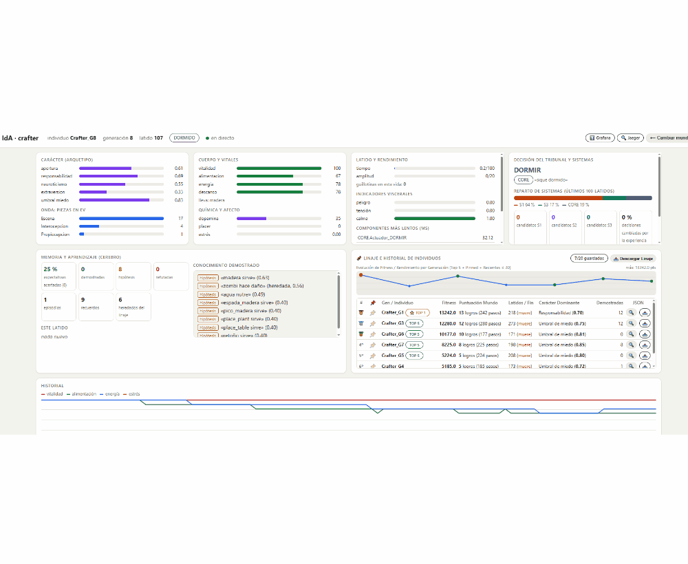
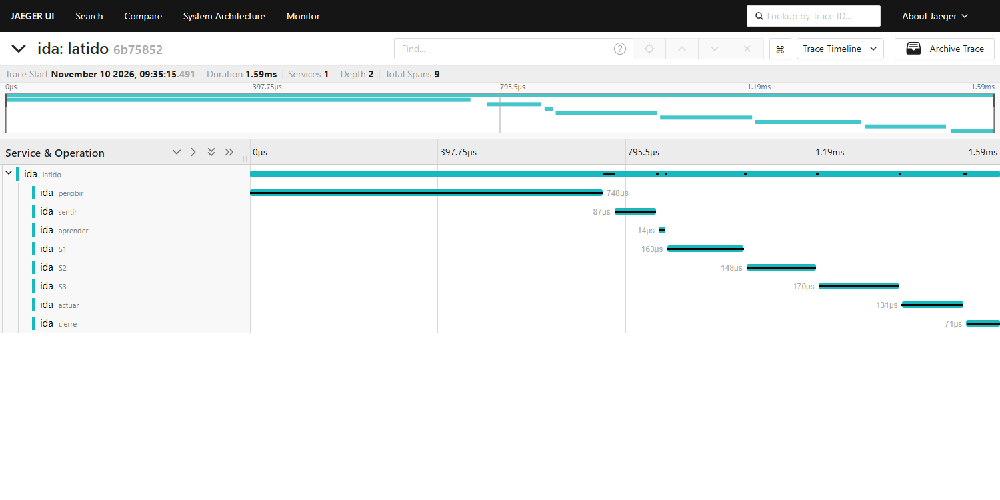

# IdA – Identidad Artificial

**Un framework bioinspirado en Python para crear agentes con cuerpo, carácter y linaje que viven en distintos mundos.**

[](https://github.com/diegorodriguezreija/IdA/actions/workflows/ci.yml)
[-blue)](NOTICE)


English summary: [README.en.md](README.en.md).

IdA es un **framework**: un núcleo genérico, inspirado en cómo resuelven los seres vivos el problema de seguir vivos, al que se conectan mundos como adaptadores. Está hecho para **ejecutarlo y ver vivir** a sus individuos; ese es su objetivo principal, no batir marcas. Pero compararse también importa: cuando un mundo tiene un protocolo público de evaluación, IdA se mide con él y publica el resultado, para que sus cifras se puedan situar junto a las de otros agentes. La pregunta de fondo, si el diseño orgánico **supera** a un diseño tradicional y en qué condiciones, se investiga aparte, en el [Laboratorio IdA](#laboratorio-ida).

Cada individuo de IdA tiene un **cuerpo** que se gasta (constantes vitales, estrés, placer y valencia) y un **latido**. En cada latido, el núcleo siente el mundo (interocepción, propiocepción, **exterocepción** y ambiente) y crea una **Onda** con frecuencia (el plazo; si se pasa, una guillotina corta), amplitud (cuántas piezas caben en la atención) y potencia (cuánto arousal se puede dar o cambiar), que fija un marcapasos. Tres sistemas trabajan sobre ella en orden: S1 (supervivencia), S2 (valor) y S3 (verdad). Cada uno interpreta (imagen y **objetos**; valor de cada sujeto; proposiciones, lógica y **creencias**), siente sus **impulsos** (las necesidades del cuerpo y la seguridad, la exploración, intenciones como saber), elige **estrategias** con fases, progreso y agotamiento, y las traduce en **acciones**. Un **Tribunal** elige una según cómo esté el cuerpo, con un pequeño plus por seguir la estrategia en curso. Cada componente solo produce y cambia piezas de su tipo. Lo vivido se recuerda, se convierte en conocimiento legible («la seta hace daño») y, al morir, pasa al **linaje**.

La mente no sabe en qué mundo está. Cada mundo traduce su realidad a un vocabulario común de rasgos (`nutritivo`, `peligro`, `lugar`…) y verbos (`MOVER`, `COMER`…), y el mismo núcleo, sin cambios, vive en cinco: uno mínimo para tests, un **mundo de archivos** en disco, **Snake** en una web real, **Crafter** y **Ajedrez**. El mundo percibe; IdA piensa: ningún sensor calcula por el individuo.

<p align="center">
  
</p>

## Pruébalo en 1 minuto

```bash
git clone https://github.com/diegorodriguezreija/IdA.git
cd IdA
python -m venv .venv
source .venv/bin/activate                 # Windows: .venv\Scripts\activate
pip install -e ".[dev,crafter,ajedrez]"
python -m pytest -q                       # 155 tests
python -m ida                             # antesala interactiva en http://127.0.0.1:8000
```

Al ejecutar `python -m ida` sin parámetros se abre en el navegador una **antesala interactiva** ([`docs/img/room.png`](docs/img/room.png)) para elegir el mundo, calibrar rasgos de personalidad iniciales, activar si se desea ventana gráfica (en Snake o Crafter) y configurar parámetros antes de pasar al **dashboard en vivo** ([`docs/img/dashboard.PNG`](docs/img/dashboard.PNG), [`docs/img/dashboard2.PNG`](docs/img/dashboard2.PNG)), que incluye historial del linaje, mini-gráfica evolutiva y una **ficha modal de individuo** ([`docs/img/dashboard3.PNG`](docs/img/dashboard3.PNG)) con descarga y restauración en un clic.

Con Docker no hace falta instalar nada: `docker compose up --build` levanta IdA viviendo en el mundo de archivos junto con la pila de observabilidad (abajo).

## Los mundos

| Mundo | Qué es | Ejemplo | Extra |
|---|---|---|---|
| Mínimo | Una pradera de 9×9 con bayas, setas y un lobo; sirve para los tests | `python -m ida --mundo minimo --semilla 3` | — |
| Archivos | El mundo original: las carpetas son biomas y los archivos, comida o veneno con la misma apariencia de bytes. Todo ocurre dentro de su sandbox | `python -m ida --mundo archivos --ver` | — |
| Snake | Juega en playsnake.org a través de un navegador real, en tiempo real | `python -m ida --mundo snake --opcion dificultad=piton` | `snake` |
| Crafter | Supervivencia y fabricación en 2D con 22 logros. IdA recibe la vista local oficial (9×7) en forma simbólica, sin píxeles ni estado oculto | `python -m ida --mundo crafter --latidos 600 --semilla 1` | `crafter` |
| Ajedrez | Contra un rival local de 1 a 3 ply o contra Stockfish | `python -m ida --mundo ajedrez --opcion dificultad=2` | `ajedrez` |

Opciones comunes: `--latidos`, `--semilla`, `--generaciones`, `--ver` (panel), `--otel` (OpenTelemetry), `--sin-experiencia` (apaga las dimensiones activa y proactiva para comparar), `--tabula-rasa` (borra el linaje), `--cada N` y `--opcion clave=valor`. Los datos se guardan en `datos/<mundo>/`.

Evaluación de Crafter con el protocolo oficial: `python herramientas/evaluar_crafter.py --pasos 100000 --semilla 31 --vista oficial --sin-herencia` ([método](docs/MEDICION_OFICIAL.md)).

> **Nota sobre Snake.** Este mundo juega en [playsnake.org](https://playsnake.org/), un sitio de terceros sin relación con este proyecto, controlando un navegador con Playwright. Es un mundo de demostración: juega una partida cada vez, no usa credenciales ni recoge datos del sitio. Si lo usas, respeta sus condiciones de uso. Si el sitio cambia o deja de estar disponible, este mundo dejará de funcionar; los demás no dependen de internet.

## Lo conseguido

- **Crafter: 19,2 % de Crafter Score sin ningún entrenamiento.** Medido con el protocolo oficial: episodios de hasta 10 000 pasos, vista local de 9×7 y media geométrica de las tasas de éxito de los 22 logros. La medición abarca 278 episodios, cada uno en un mundo nuevo y con un individuo recién nacido, sin legado (IC 95 %: 17,7–20,5 %). Con linaje entre vidas sube a 20,3 %. Como referencia, en el artículo original de Crafter, DreamerV2 obtiene 10,0 % y PPO 4,6 % tras entrenar con 1M de pasos; el azar saca 1,6 %. IdA no entrena: juega desde que nace, y cada decisión se puede leer (qué sistema la propuso, con qué motivo y por qué ganó en el Tribunal). [Método y datos](docs/MEDICION_OFICIAL.md).
- **De dónde sale esa cifra, sin adornos.** Incluye estrategias escritas para Crafter (refugio nocturno, defensa y plan tecnológico) sobre el núcleo genérico. Por eso no se presenta como comparación de igual a igual con agentes que aprenden desde píxeles, y queda por debajo de SPRING (27,3 %, GPT-4 leyendo el artículo de Crafter) y de los mejores agentes actuales. La fase en curso traslada esas capacidades al núcleo para medir IdA sin conducta específica del mundo.
- **El mismo núcleo vive en cinco mundos** muy distintos, y un test con AST vigila que no aprenda palabras de ninguno.
- **Optimizando solo el código de cada mundo:**
  - Snake pasa de unos 232 a 916 puntos de media en nivel pitón (récord: 1605).
  - En el mundo de archivos, los mordiscos tóxicos bajan de 7,2 a 2,2 por vida.
  - En ajedrez gana 7 de 8 partidas al rival de 1 ply y 3 de 8 al de 2 ply.
- **La guillotina es cooperativa y fiable:** con un plazo de 0 ms, la cognición se corta y el Tribunal sigue decidiendo.
- **Repetible con semilla** en el mundo mínimo, el de archivos, Crafter y el ajedrez.
- **Lo que no funciona, también publicado:**
  - Contra el rival de ajedrez de 3 ply pierde.
  - En Crafter, los episodios duran poco más de un día de juego (unos 360 pasos de media; un día son 300), y terminan por zombis, esqueletos, hambre y sed.
  - Los cinco logros de hierro y diamante siguen al 0 %, y comer una planta, al 0,4 %, aunque la planta casi siempre. 
  - Sin las estrategias escritas para Crafter (refugio nocturno, defensa y plan tecnológico), el núcleo saca 1,46 %, al nivel del azar

Cifras, método y límites: [`doc-repositorio/05_METRICAS_E_HITOS.md`](doc-repositorio/05_METRICAS_E_HITOS.md). La métrica anterior de Crafter (logros por vida: 9,30 ± 1,09) y su historia siguen allí.

## Observabilidad

Además del panel propio en vivo, IdA puede enviar trazas y métricas estándar por **OpenTelemetry** (`--otel`, extra `observabilidad`). La pila con **Jaeger**, **Prometheus** y **Grafana** (`docker compose up --build`) se encuentra todavía en una **fase inicial y preliminar**: aporta trazas básicas de latido y fases, pero el visor más informativo y completo para entender la cognición de IdA en tiempo real sigue siendo su **panel web nativo**.

- **Jaeger** (http://localhost:16686): trazas básicas de latido con tramos por fase para ver cortes de guillotina.
- **Grafana** (http://localhost:3000): panel inicial con duraciones de fase, reparto de decisiones y constantes vitales.

<p align="center"></p>

El núcleo no depende de esto: la Onda solo apunta cuándo empieza y acaba cada fase, y la traza se construye fuera del plazo del latido.

## Calidad

`ruff` y `mypy` en verde, 155 tests y GitHub Actions en Python 3.12 y 3.15, con y sin las dependencias de los mundos. Hay un [devcontainer](.devcontainer/devcontainer.json) para VS Code.

## Laboratorio IdA

Este repositorio es el framework: sirve para ejecutar y ver vivir a los individuos. La pregunta de si el diseño orgánico de IdA **supera a un diseño tradicional** en cada mundo, en qué situaciones y cuánto, se investiga en otro repositorio, el [**Laboratorio IdA**](https://github.com/diegorodriguezreija/laboratorio-ida). Allí se prueban variantes modificadas de IdA frente a líneas base tradicionales de cada mundo, con preguntas fijadas de antemano, las mismas semillas y los resultados negativos publicados. Las variantes del laboratorio no tienen por qué coincidir con la versión de este framework.

## Documentación

| | |
|---|---|
| [`MANIFIESTO.md`](MANIFIESTO.md) | Por qué existe IdA, en la voz del autor |
| [`doc-repositorio/`](doc-repositorio/README.md) | Documentación completa: filosofía, arquitectura, mundos, guía técnica, métricas e hitos |
| [`docs/DISENO_FRAMEWORK_BASE.md`](docs/DISENO_FRAMEWORK_BASE.md) | Diseño del framework base y sus principios |
| [`docs/ESTADO_IMPLEMENTACION.md`](docs/ESTADO_IMPLEMENTACION.md) | Fases, decisiones y pendientes |
| [`docs/RESULTADOS.md`](docs/RESULTADOS.md) | Primeras ejecuciones de verificación de cada mundo y sus límites |
| [`CHANGELOG.md`](CHANGELOG.md) · [`CONTRIBUTING.md`](CONTRIBUTING.md) · [`SECURITY.md`](SECURITY.md) · [`AGENTS.md`](AGENTS.md) | Cambios, cómo contribuir, seguridad y reglas para agentes de IA |

## Honestidad

Es un prototipo personal, no un estudio. La mayoría de las mediciones usan pocas vidas y pocas semillas. La de Crafter sigue el protocolo oficial, pero con 100 000 pasos (278 episodios) en lugar del millón completo. Como cada episodio empieza sin legado, la cifra no depende de la duración del presupuesto; aun así, la evaluación completa con semillas reservadas se publicará al cerrar la fase de generalización. Los nombres biológicos son inspiración, no equivalencia. Las cifras se publican tal como salieron, también cuando son malas. Gran parte del código se escribió con agentes de IA bajo la dirección y la revisión del autor.

## Licencia

[Apache-2.0](LICENSE), salvo `ida/mundos/ajedrez/`, que es [GPL-3.0-or-later](ida/mundos/ajedrez/LICENSE) porque depende de `python-chess`. Esa carpeta está aislada: nada fuera de ella importa `python-chess`, y un test lo comprueba. Detalles y licencias de terceros en [`NOTICE`](NOTICE).
