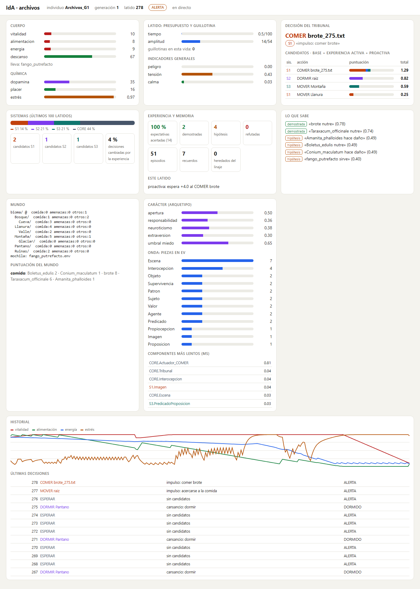
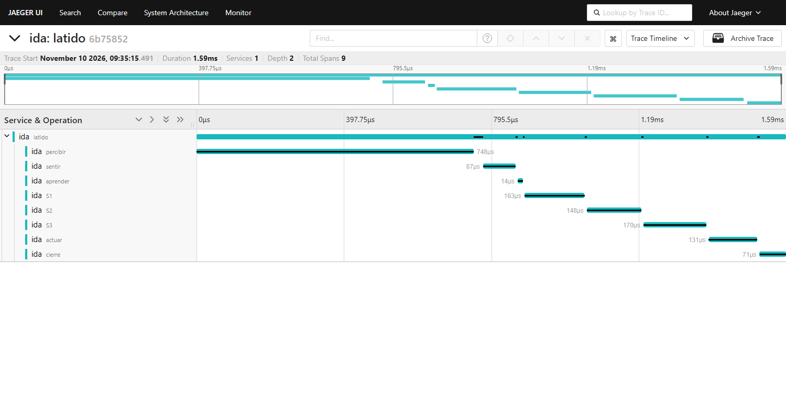

# IdA – Identidad Artificial

**Un framework bioinspirado en Python para crear agentes con cuerpo, carácter y linaje que viven en distintos mundos.**

[](https://github.com/diegorodriguezreija/IdA/actions/workflows/ci.yml)
[-blue)](NOTICE)


English summary: [README.en.md](README.en.md).

IdA es un **framework**: un núcleo genérico, inspirado en cómo resuelven los seres vivos el problema de seguir vivos, al que se conectan mundos como adaptadores. Está hecho para **ejecutarlo y ver vivir** a sus individuos. No compite con otros agentes ni busca la mejor puntuación; esa pregunta se investiga aparte, en el [Laboratorio IdA](#laboratorio-ida).

Cada individuo de IdA tiene un **cuerpo** que se gasta, un **latido** con un presupuesto de atención y de tiempo (y una guillotina si se pasa), y **tres sistemas** que proponen qué hacer: S1 (supervivencia), S2 (valor) y S3 (verdad). Un **Tribunal** decide según cómo esté el cuerpo. Lo vivido se recuerda, se anticipa, se convierte en conocimiento legible («la seta hace daño») y, al morir, pasa al **linaje**.

La mente no sabe en qué mundo está. Cada mundo traduce su realidad a un vocabulario común de rasgos (`nutritivo`, `peligro`, `lugar`…) y verbos (`MOVER`, `COMER`…), y el mismo núcleo, sin cambios, vive en cinco: uno mínimo para tests, un **mundo de archivos** en disco, **Snake** en una web real, **Crafter** y **Ajedrez**. El mundo percibe; IdA piensa: ningún sensor calcula por el individuo.

<p align="center"></p>

## Pruébalo

```bash
git clone https://github.com/diegorodriguezreija/IdA.git
cd IdA
python -m venv .venv
source .venv/bin/activate                 # Windows: .venv\Scripts\activate
pip install -e ".[dev,crafter,ajedrez]"
python -m pytest -q                       # 64 tests
python -m ida                             # antesala interactiva en http://127.0.0.1:8000
python -m ida --mundo minimo --latidos 300 --generaciones 3 --semilla 3 --tabula-rasa
python -m ida --mundo archivos --latidos 300 --ver     # panel en http://127.0.0.1:8000
```

Al ejecutar `python -m ida` sin parámetros se abre en el navegador una **antesala interactiva** para elegir el mundo, activar si se desea ventana gráfica (en Snake o Crafter) y configurar parámetros antes de pasar al panel en vivo.

Con Docker no hace falta instalar nada: `docker compose up --build` levanta IdA viviendo en el mundo de archivos junto con la pila de observabilidad (abajo).

## Los mundos

| Mundo | Qué es | Ejemplo | Extra |
|---|---|---|---|
| Mínimo | Una pradera de 9×9 con bayas, setas y un lobo; sirve para los tests | `python -m ida --mundo minimo --semilla 3` | — |
| Archivos | El mundo original: las carpetas son biomas y los archivos, comida o veneno con la misma apariencia de bytes. Todo ocurre dentro de su sandbox | `python -m ida --mundo archivos --ver` | — |
| Snake | Juega en playsnake.org a través de un navegador real, en tiempo real | `python -m ida --mundo snake --opcion dificultad=piton` | `snake` |
| Crafter | Supervivencia y fabricación en 2D con 22 logros (estado simbólico, no píxeles) | `python -m ida --mundo crafter --latidos 600 --semilla 1` | `crafter` |
| Ajedrez | Contra un rival local de 1 a 3 ply o contra Stockfish | `python -m ida --mundo ajedrez --opcion dificultad=2` | `ajedrez` |

Opciones comunes: `--latidos`, `--semilla`, `--generaciones`, `--ver` (panel), `--otel` (OpenTelemetry), `--sin-experiencia` (apaga las dimensiones activa y proactiva para comparar), `--tabula-rasa` (borra el linaje), `--cada N` y `--opcion clave=valor`. Los datos se guardan en `datos/<mundo>/`.

> **Nota sobre Snake.** Este mundo juega en [playsnake.org](https://playsnake.org/), un sitio de terceros sin relación con este proyecto, controlando un navegador con Playwright. Es un mundo de demostración: juega una partida cada vez, no usa credenciales ni recoge datos del sitio. Si lo usas, respeta sus condiciones de uso. Si el sitio cambia o deja de estar disponible, este mundo dejará de funcionar; los demás no dependen de internet.

## Lo conseguido

- **El mismo núcleo vive en cinco mundos** muy distintos, y un test con AST vigila que no aprenda palabras de ninguno.
- **La guillotina es cooperativa y fiable**: con un plazo de 0 ms la cognición se corta y el Tribunal sigue decidiendo.
- **Repetible con semilla** en el mundo mínimo, el de archivos, Crafter y el ajedrez.
- **Optimizando solo el código de cada mundo**: Snake pasa de unos 232 a 916 puntos de media en nivel pitón (récord 1605); en el mundo de archivos los mordiscos tóxicos bajan de 7,2 a 2,2 por vida; en Crafter, de 6,6 a 8,2 logros por vida; en ajedrez gana 7 de 8 partidas al rival de 1 ply y 3 de 8 al de 2 ply.
- **Lo que no funciona, también publicado**: contra el rival de 3 ply pierde, y en Crafter la vida no se alarga.

Cifras, método y límites: [`doc-repositorio/05_METRICAS_E_HITOS.md`](doc-repositorio/05_METRICAS_E_HITOS.md).

## Observabilidad

Además del panel propio en vivo, IdA puede enviar trazas y métricas estándar por **OpenTelemetry** (`--otel`, extra `observabilidad`). La pila con **Jaeger**, **Prometheus** y **Grafana** (`docker compose up --build`) se encuentra todavía en una **fase inicial y preliminar**: aporta trazas básicas de latido y fases, pero el visor más informativo y completo para entender la cognición de IdA en tiempo real sigue siendo su **panel web nativo**.

- **Jaeger** (http://localhost:16686): trazas básicas de latido con tramos por fase para ver cortes de guillotina.
- **Grafana** (http://localhost:3000): panel inicial con duraciones de fase, reparto de decisiones y constantes vitales.

<p align="center"></p>

El núcleo no depende de esto: la Onda solo apunta cuándo empieza y acaba cada fase, y la traza se construye fuera del plazo del latido.

## Calidad

`ruff` y `mypy` en verde, 64 tests y GitHub Actions en Python 3.12 y 3.15, con y sin las dependencias de los mundos. Hay un [devcontainer](.devcontainer/devcontainer.json) para VS Code.

## Laboratorio IdA

Este repositorio es el framework: sirve para ejecutar y ver vivir a los individuos. La pregunta de si el diseño orgánico de IdA **supera a un diseño tradicional** en cada mundo, en qué situaciones y cuánto, se investiga en otro repositorio, el [**Laboratorio IdA**](https://github.com/diegorodriguezreija/laboratorio-ida). Allí se prueban variantes modificadas de IdA frente a líneas base tradicionales de cada mundo, con preguntas fijadas de antemano, las mismas semillas y los resultados negativos publicados. Las variantes del laboratorio no tienen por qué coincidir con la versión de este framework.

## Documentación

| | |
|---|---|
| [`MANIFIESTO.md`](MANIFIESTO.md) | Por qué existe IdA, en la voz del autor |
| [`doc-repositorio/`](doc-repositorio/README.md) | Documentación completa: filosofía, arquitectura, mundos, guía técnica, métricas e hitos |
| [`docs/DISENO_FRAMEWORK_BASE.md`](docs/DISENO_FRAMEWORK_BASE.md) | Diseño del framework base y sus principios |
| [`docs/ESTADO_IMPLEMENTACION.md`](docs/ESTADO_IMPLEMENTACION.md) | Fases, decisiones y pendientes |
| [`docs/RESULTADOS.md`](docs/RESULTADOS.md) | Primeras ejecuciones de verificación de cada mundo y sus límites |
| [`CHANGELOG.md`](CHANGELOG.md) · [`CONTRIBUTING.md`](CONTRIBUTING.md) · [`SECURITY.md`](SECURITY.md) · [`AGENTS.md`](AGENTS.md) | Cambios, cómo contribuir, seguridad y reglas para agentes de IA |

## Honestidad

Es un prototipo personal, no un estudio: pocas vidas por medición y casi nunca más de cinco semillas. Los nombres biológicos son inspiración, no equivalencia. Las cifras se publican tal como salieron, también cuando son malas. Gran parte del código se escribió con agentes de IA bajo la dirección y la revisión del autor.

## Licencia

[Apache-2.0](LICENSE), salvo `ida/mundos/ajedrez/`, que es [GPL-3.0-or-later](ida/mundos/ajedrez/LICENSE) porque depende de `python-chess`. Esa carpeta está aislada: nada fuera de ella importa `python-chess`, y un test lo comprueba. Detalles y licencias de terceros en [`NOTICE`](NOTICE).
