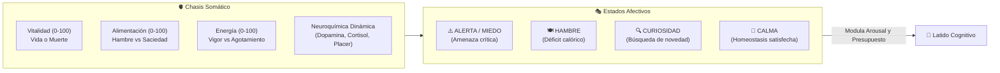
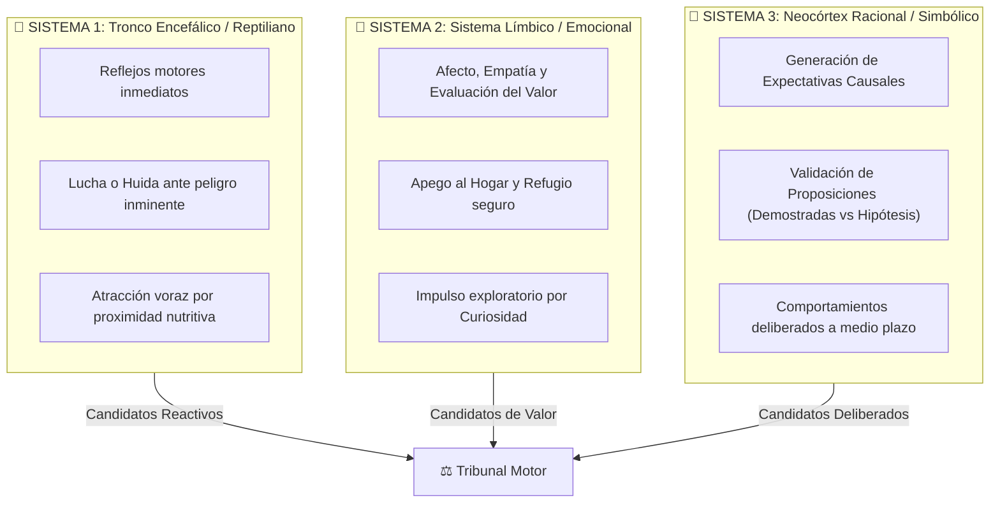
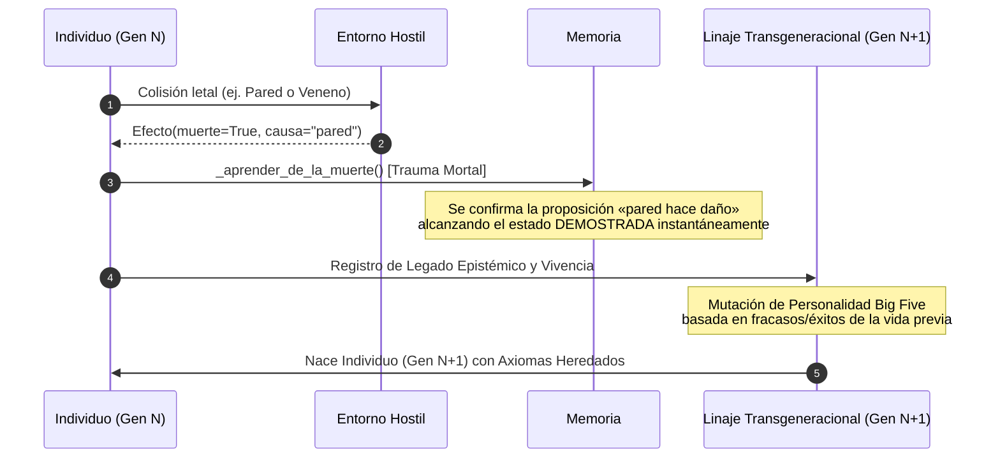

# 01. Filosofía y Biología de IdA 🧬

## 1. La Inteligencia Encarnada: Si no hay nada que perder, no hay mente

La mayoría de los sistemas de inteligencia artificial modernos operan como cerebros incorpóreos flotando en un éter informático: calculan probabilidades condicionales sobre textos o píxeles, pero son inmunes a las consecuencias de sus errores. Un modelo de lenguaje no siente dolor si genera una falsedad; un clasificador de imágenes no muere si confunde un hongo venenoso con una seta comestible.

En **IdA (Identidad Artificial)** nos apoyamos en los fundamentos de la neurobiología evolutiva, la cibernética biológica (Maturana y Varela) y la hipótesis del marcador somático de António Damásio:

> **La cognición no evolucionó para resolver acertijos abstractos en el vacío, sino para regular el cuerpo y garantizar la supervivencia en un entorno hostil e impredecible.**

*Los nombres biológicos de este documento (cerebro triuno, cortisol, dopamina, sueño REM, trauma, epigenética) son inspiración, no equivalencia: describen mecanismos sencillos (umbrales, contadores y pequeñas fórmulas) que imitan una función, no la biología que la produce.*

Para que una entidad desarrolle una relación causal genuina con el mundo, **debe tener un cuerpo vulnerable (Soma)**. El organismo debe pagar un coste metabólico por existir, debe sentir el desgaste de sus órganos y debe estar sometido al riesgo inminente de la extinción.

---

## 2. El Soma: Ancla Somática y Homeostasis

El **Soma** (`ida/core/soma.py`) es el chasis fisiológico de IdA. No es un conjunto de variables auxiliares, sino el centro de gravedad que dicta las prioridades operativas de la mente.

### Constantes Vitales y Metabolismo
* **Vitalidad ($0 - 100$):** La integridad estructural del individuo. Si cae a cero, el individuo sufre muerte biológica. Los daños físicos o toxinas la degradan directamente; el descanso y la buena nutrición la regeneran lentamente.
* **Alimentación ($0 - 100$):** El depósito calórico. Disminuye con una tasa metabólica basal fija en cada latido. Si llega a niveles críticos, el soma empieza a autoconsumir su vitalidad.
* **Energía ($0 - 100$):** La capacidad de trabajo inmediato. Cada acción física cuesta energía. Al agotarse, sobreviene el cansancio motor y se induce la necesidad de dormir.
* **Neuroquímica y Marcadores Somáticos:**
  * **Cortisol / Estrés:** Sube con el peligro percibido y con el hambre crítica. Con estrés alto, el Tribunal da más peso a la urgencia (arousal) que a la confianza, lo que favorece a los reflejos de S1. Además, el peligro acorta hasta un 30 % el plazo del latido.
  * **Dopamina / RPE (Prediction Error):** Recompensa el hallazgo de recursos y la confirmación de expectativas positivas.
  * **Placer / Dolor (Balance Hedónico):** La huella afectiva que deja cada interacción con el mundo y que se almacena en los episodios de memoria.

---

## 3. El Cerebro Triuno Revisitado (S1, S2 y S3)

IdA adopta y refina computacionalmente la célebre hipótesis del **Cerebro Triuno** de Paul MacLean, estructurando la mente en tres niveles cognitivos que se ejecutan secuencialmente en cada latido:

### Sistema 1 (S1) — Supervivencia y Reactividad Inmediata
* **Objetivo primordial:** Mantener el cuerpo intacto aquí y ahora.
* **Operación:** Es el primero en ejecutarse en cada latido. Calcula un peligro graduado por cercanía y número de amenazas (más sensible cuanto mayor es el neuroticismo). Si supera el **umbral de miedo** del individuo, emite un reflejo: huir al lugar más seguro o, si no hay salida y la amenaza está al alcance, defenderse. Además, propone comer lo que está al alcance y acercarse a la comida. No consulta el pasado; eso lo hacen S2, S3 y el Tribunal.

### Sistema 2 (S2) — Emoción, Hogar y Curiosidad
* **Objetivo primordial:** Optimizar el bienestar hedónico y la navegación a medio alcance.
* **Operación:** Reconoce patrones afectivos. S2 gestiona el concepto de **Hogar** (recuerda ubicaciones seguras donde el estrés baja y la recuperación es óptima) y el impulso de **Curiosidad** (empuja al organismo a explorar entidades con alto rasgo de `novedad` siempre que el peligro esté controlado).

### Sistema 3 (S3) — Inferencia Causal, Lógica y Expectativas
* **Objetivo primordial:** Modelar el mundo mediante proposiciones formales y anticipar el futuro.
* **Operación:** Lee lo que se sabe (`«clase_X hace daño»`, `«clase_Y nutre»`, `«clase_Z sirve»`) y lo encadena en sentencias («si hay X cerca, hace daño → evitarlo»). Un Comportamiento de S3 solo se apoya en proposiciones **demostradas**, y S3 frena los impulsos que van contra lo demostrado. El conocimiento lo escribe el Core al contrastar cada acción con su efecto. Las **expectativas proactivas** (lo que se espera de una acción sobre una clase) también las anota el Core; al validarlas, el error de predicción mueve la dopamina.

---

## 4. El Ciclo Circadiano y el Sueño Reparador

IdA no permanece despierto de forma indefinida, salvo en los mundos que lo declaran así (Snake y Ajedrez). Cuando el cansancio es alto y hay calma, S2 propone **Dormir**. Si la energía o el descanso llegan a 5, el sueño es ineludible. Algunos mundos deciden ellos mismos cuándo se duerme y se despierta (en Crafter, el juego) (`ida/core/latido.py`):

1. **Parálisis Motora:** Mientras duerme, S1, S2 y S3 no se ejecutan y no se actúa en el mundo.
2. **Despertar por Alarma:** El Core lo despierta si hay un peligro cercano (peligro × proximidad ≥ 0,6), si el hambre es crítica o cuando ha descansado.
3. **Consolidación en el Sueño:** Al dormirse se hace lo costoso, fuera del camino crítico: se olvidan las hipótesis débiles que no se han usado en mucho tiempo y los recuerdos de una sola vez sin consecuencias, y el búfer de piezas salientes se vuelca a SQLite. Lo demostrado no se olvida.

---

## 5. Muerte, Trauma y Linaje Transgeneracional

En IdA, la muerte individual no es un error de ejecución: **es el motor de la sabiduría de la especie**.

### El Trauma Mortal (`_aprender_de_la_muerte`)
Normalmente, una hipótesis requiere múltiples confirmaciones para considerarse una verdad demostrada (`CONFIRMACIONES_MINIMAS = 3`). Sin embargo, en la biología real, **un suceso mortal no da una segunda oportunidad**. 

Por ello, cuando un individuo muere por una causa identificada (`pared`, `depredador`, etc.), el mecanismo de trauma eleva inmediatamente esa proposición a **DEMOSTRADA** (con las confirmaciones y la confianza mínimas de una demostrada, 0,7), y así puede pasar al linaje. Algo parecido ocurre con un envenenamiento grave: cuenta como dos confirmaciones de «hace daño» (aversión gustativa).

**Lo que se hereda:** solo las proposiciones demostradas y los recuerdos agregados de acción y clase que se repitieron (la memoria colectiva de S1), y únicamente dentro del mismo linaje. Lo heredado entra como **hipótesis fuerte** (confianza × 0,8 y una confirmación menos de las necesarias), así que el descendiente necesita experiencia propia para darlo por demostrado. Los episodios vividos no se heredan.

### Epigenética y Personalidad Big Five
Cada individuo tiene su propio **arquetipo** (`ida/core/linaje.py`):
* **Apertura:** Atracción por lo nuevo y por los recursos (curiosidad de S2).
* **Responsabilidad:** Prudencia. Hoy apenas interviene; se reserva para ajustes.
* **Neuroticismo:** Sensibilidad al peligro (S1) y peso del peligro en el valor (S2).
* **Extraversión:** Atracción por otros agentes (componente social del valor en S2).
* **Umbral de miedo:** Peligro a partir del cual S1 dispara reflejos.

El primer individuo de un linaje nace con rasgos al azar (con semilla). Cada descendiente hereda los del padre **más un ruido de ±0,08** y una **pequeña marca** de lo que vivió el padre: más neuroticismo si pasó miedo, más apertura si vivió en calma, más responsabilidad si pasó hambre. Que esta diversidad rinda más no se ha medido.
