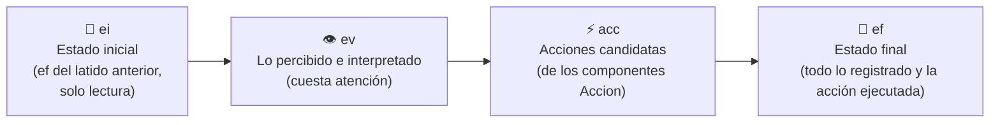

# 02. Arquitectura y Mecanismo Vital 🧠⚙️

Estado tras el rediseño de la base (bloques A a D de [`docs/PLAN_IMPLEMENTACION.md`](../docs/PLAN_IMPLEMENTACION.md); diseño en [`docs/REDISENO_BASE.md`](../docs/REDISENO_BASE.md)).

> **En migración (22/11/2026).** Las secciones 1 a 6 describen el código actual (`crafter-general-v4`). El diseño objetivo, al que se migra sin cambiar la conducta, está resumido en la sección 7 y decidido en [`docs/DISENO_COMPONENTES.md`](../docs/DISENO_COMPONENTES.md).

## 1. El Latido Vital: La Unidad Fundamental del Tiempo

En IdA, la vida discurre a través de una sucesión de **latidos** rítmicos (`ida/core/latido.py`). Cada latido es un ciclo completo de sentir, interpretar, reaccionar, actuar y cerrar.

```mermaid
sequenceDiagram
    autonumber
    participant Soma as 🫀 Soma
    participant Marc as 💓 Marcapasos
    participant Onda as 🌊 Onda
    participant Sentir as 👁️ Sentidos (Core)
    participant S1 as 🦎 S1 (Supervivencia)
    participant S2 as 🐺 S2 (Valor)
    participant S3 as 🐒 S3 (Verdad)
    participant Trib as ⚖️ Tribunal
    participant Mundo as 🌍 Mundo
    participant Mem as 📚 Memoria

    Soma->>Soma: Metabolismo basal, homeostasis
    Soma->>Marc: Estado del cuerpo (energía, sueño, peligro)
    Marc->>Onda: Frecuencia (plazo), amplitud y potencia; ei = ef anterior; estrategias activas
    Onda->>Sentir: Interocepción, propiocepción, exterocepción y ambiente -> ev
    Sentir->>Mem: El Core aprende del efecto de la acción anterior
    Sentir->>S1: Interpretar, impulsos, estrategias, acciones
    S1->>S2: Lo mismo con lo que sobra de amplitud y potencia
    S2->>S3: Lo mismo con lo que sobra
    alt Plazo agotado
        Note over S2,S3: ⚠️ Guillotina: se corta y el Tribunal decide con lo que haya
    end
    Onda->>Trib: Acciones candidatas en acc (con su impulso y estrategia de origen)
    Trib->>Mundo: Acción ganadora (MOVER, COMER, etc.)
    Mundo-->>Trib: Efecto (delta somático, éxito, causa)
    Trib->>Onda: Registra el resultado en ef["Accion"]
    Trib->>Soma: Aplica los cambios fisiológicos
    Onda->>Mem: Memoria rápida, episodios y expectativas
```

---

## 2. Del Impulso a la Acción

Cada sistema tiene las mismas etapas y una meta propia. **Un impulso** es el porqué (nace del estado sentido y no se elige); **una estrategia** es el cómo (dura varios latidos, tiene fases, progreso y agotamiento); **una acción** es el candidato concreto (verbo y objetivo); **la decisión** la toma el Tribunal.

| Etapa | S1 · Supervivencia | S2 · Valor | S3 · Verdad |
|---|---|---|---|
| Sentir | `Imagen` (el instante) | `Patron`, `Emocion` (valencia del cuerpo) | `Comunicacion` |
| Interpretar | `Objeto`, `Supervivencia` (recurso, peligro o neutro, con habituación y sensibilización) | `Sujeto`, `Valor` (motivacional, potencia, sentimental y social) | `Agente`, `Predicado`, `Proposicion`, `Sentencia`, `Logica`, `Creencia` (lo que sostiene, con trust y fuentes) |
| Reaccionar | `Reflejo` (solo ante saltos bruscos del peligro), `Impulso` (una necesidad por constante vital del mundo y Seguridad), `Feedback` (bajan los déficits), `Estrategia` | `Exteriorizacion`, `Impulso` (Exploración), `Feedback` (placer y estrés), `Estrategia` | `Intencion` (saber y las del mundo), `Impulso` (control gradual según la certeza), `Feedback` (error de predicción), `Estrategia` |
| Actuar | `Accion` | `Accion` | `Accion` |

- **Estrategias:** el componente `Estrategia` de cada sistema elige, mantiene y abandona estrategias (una por impulso). Una estrategia se cierra al bajar la necesidad, al dejar de ser elegible o al agotarse (progreso lento), y solo cede ante otra que la supere con un margen claro. Su valor se aprende durante la vida por el feedback de su sistema. Las genéricas viven en `ida/sistemas`; lo propio de cada mundo se declara en su registro (`Mundo.registro()`). Un mundo puede añadir o sustituir Componentes por destino (`"CORE.Sentir"`, `"S1.Interpretar"`...) y estrategias por sistema.
- **Acciones:** solo los componentes `Accion` proponen acciones, y cada una lleva su origen (impulso y estrategia).
- **Propiedad:** cada componente solo emite y modifica piezas de su tipo, a través de la Onda, que lo comprueba y lo anota en el registro de la pieza. Los `Impulso` de S2 y S3 modulan piezas `Impulso`, no acciones.

---

## 3. La Onda: Información y Atención de un Latido

Toda la información de un latido viaja en una **`Onda`** (`ida/core/onda.py`), en cuatro fases que avanzan en un solo sentido:



- **`ei`** es de **solo lectura** (`MappingProxyType`): ningún componente reescribe el pasado.
- **`ev`** recoge lo que entra en la atención; **`ef`**, todo lo registrado (también lo que no cuesta atención, como impulsos, estrategias o creencias).
- **Estrategias activas:** la Onda las recibe del Core y las conserva entre latidos.
- **Metadatos de cada pieza:** arousal, confianza, *decay*, *audit* (creación, actualización, origen y registro de cambios) y, si aplica, *fitness* y *cost*.

### Atención: frecuencia, amplitud y potencia

La **`Regulacion`** (`ida/core/regulacion.py`, Componente del Core, D12; antes `Marcapasos`) fija tres recursos por latido a partir del cuerpo. En la fase A se calcula al crear la Onda, con el soma y los indicadores del latido anterior:

1. **Frecuencia (plazo):** tiempo máximo de cognición. Con peligro se acorta hasta un 30 %.
2. **Amplitud:** cuántas piezas nuevas caben en `ev` y `acc` (cada una cuesta 1): 0,45 × la amplitud base del perfil del mundo (calibración en [`docs/CALIBRACION_ATENCION.md`](../docs/CALIBRACION_ATENCION.md)). La energía la escala; dormido baja a 20; si el latido anterior se quedó sin amplitud, el siguiente tiene un 50 % más («taquicardia»).
3. **Potencia:** cuánto arousal se puede otorgar o cambiar (cuesta |Δ arousal|, al subir y al bajar). Lo máximo que un componente cambia una pieza en un latido es potencia / amplitud.

Los recursos son un único fondo que S1, S2 y S3 gastan en ese orden: S1 usa lo que necesite y los demás, lo que sobre. Sin amplitud, la pieza nueva se rechaza; sin potencia, el cambio de arousal se recorta; lo demás sigue. El Core no paga atención ni se recorta.

---

## 4. La Guillotina: el Plazo del Pensamiento

En la naturaleza, un animal que se detiene a reflexionar diez segundos cuando un tigre salta sobre él resulta devorado antes de dar el primer paso.

La **Guillotina** (`LatidoAgotado`) es cooperativa y solo mira el **plazo**: cada operación sobre la Onda comprueba el reloj y, si se ha superado, corta los componentes que faltan y salta al Tribunal, que decide con lo que haya en `acc`. Como el orden es siempre **S1 → S2 → S3**, S1 ya ha tenido su turno. Si no hay candidatos, el individuo espera; en un mundo que no deja esperar (Ajedrez), la estrategia de último recurso de S1 «seguir en movimiento» propone moverse.

- **¿Por qué cooperativa?** En Python, `asyncio.wait_for` o los hilos no interrumpen de forma fiable cálculos síncronos pesados. Por eso los componentes deben ser cortos y lo costoso se hace al dormir o al morir.

---

## 5. El Tribunal: la Física de la Decisión

El **Tribunal** (`ida/core/sentidos.py`) es el único que decide qué se ejecuta.

$$\text{Puntuación}_i = \text{Arousal}^{*}_i \cdot \text{Estrés} + \text{Confianza}_i \cdot (1 - \text{Estrés}) + \Delta_{\text{experiencia}} + \text{plus}_i$$

- **Arousal ya modulado** ($\text{Arousal}^{*}$): el de la acción más lo que S2 o S3 hayan subido o bajado su impulso de origen.
- **Con estrés** manda la urgencia (reflejos y huida); **en calma**, la confianza (planes contrastados).
- **$\Delta_{\text{experiencia}}$:** pequeño sesgo por lo vivido con esa acción sobre esa clase (peso del mundo, 0,15 a 0,2; cero sin experiencia).
- **Plus de continuidad:** 0,1 × (1 − agotamiento) × (1 − progreso) para la acción de la estrategia que se ejecutó en el latido anterior y sigue activa; se apaga al agotarse y al acercarse al objetivo.
- **Empate** (≤ 0,02): decide el azar con semilla. **Acecho:** un candidato con poca confianza y sin urgencia espera a que su confianza se acumule.

---

## 6. Tiempo Real y Tiempo Discreto

1. **Mundos de tiempo real (Snake):** el reloj del entorno no espera. Si el plazo es de 100 ms y la mente pensó 8 ms, se esperan los 92 restantes para acompasar el ritmo con el mundo.
2. **Mundos por turnos (Archivos, Crafter, Ajedrez):** el mundo espera la decisión, pero cada latido mantiene su plazo (guillotina) para evitar el sobrepensamiento.

---

## 7. Diseño objetivo: Componentes generales y de cada mundo

Decidido en [`docs/DISENO_COMPONENTES.md`](../docs/DISENO_COMPONENTES.md). Qué Componente va en cada módulo, y dónde está hoy, lo dice el [mapa de Componentes](06_MAPA_DE_COMPONENTES.md), generado desde [`componentes.toml`](componentes.toml) y vigilado por un test. Se migra en dos fases: la A (reorganización con el mismo resultado, campo a campo) y la B (cambios de conducta medidos uno a uno).

**El latido, en ocho pasos:**
1. **Onda:** copia de la anterior; la anterior pasa a la memoria a corto plazo (cola de ondas, de la que salen los episodios).
2. **Sentir (Core):** solo datos en bruto, sin valorar. La Observación del mundo solo la leen los sensores.
3. **Preatención (S1 · Sentir):** saliencia y valoración rápida de lo sentido. No paga atención y corre también dormido (vigilancia). Solo modifica las piezas de los sensores; no crea piezas ni propone acciones.
4. **Plasticidad:** cada Componente que aprende lo hace del efecto de la acción anterior, sin pagar atención.
5. **Regulación (Core):** reglas instantáneas que fijan frecuencia, amplitud y potencia.
6. **S1 → S2 → S3:** Sentir, Interpretar, Reaccionar y Actuar, con la guillotina por plazo. Dormido, parálisis.
7. **Actuar (Core):** el Tribunal acepta una Actuación y el Core ejecuta su primitiva (las teclas del mundo). La Actuación lleva la primitiva y la intención.
8. **Cierre:** marcar qué guardar (arousal y feedback), episodios e indicadores.

**Organización:**
- `ida/nucleo/`: mecánica (Onda, piezas, Componentes, latido, Memoria como almacén).
- `ida/core/`, `ida/s1/`, `ida/s2/`, `ida/s3/`: una carpeta por módulo y un fichero por Componente.
- `ida/cuerpos/<familia>/`: lo compartido por los mundos con el mismo cuerpo (geometría, capa motora, modelo del cuerpo, mapa métrico).
- `ida/mundos/<mundo>/`: adaptador, perfil, manual, registro y Componentes propios, con la misma estructura.

**Reglas:**
- **Registro declarado:** un mundo declara qué Componentes añade o sustituye y en qué módulo. Nada se activa por el nombre de un fichero ni por una condición dentro de un Componente general.
- **Propiedad por tipo:** un Componente emite y modifica piezas de su tipo, sea general o del mundo; cada cambio queda en el registro de la pieza.
- **Estrategias:** las generales hablan de intenciones; la capa motora del cuerpo las traduce a primitivas. Pueden tener fases si las transiciones las disparan piezas de la Onda, nunca el reloj del mundo.
- **Memoria:** un solo almacén, con una sección por dueño. Lo aprendido y el legado son de cada mundo.
- **Lo que un mundo sabe por diseño se mide:** Componentes registrados, sustituciones y rasgos que el mundo entrega ya valorados.
