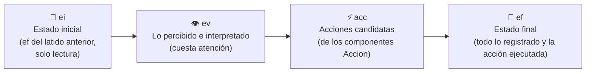

# 02. Arquitectura y Mecanismo Vital 🧠⚙️

Estado tras la reorganización por Componentes (fase A de [`docs/DISENO_COMPONENTES.md`](../docs/DISENO_COMPONENTES.md); mapa en [`doc-repositorio/06_MAPA_DE_COMPONENTES.md`](06_MAPA_DE_COMPONENTES.md)).

## 1. El Latido Vital: La Unidad Fundamental del Tiempo

En IdA, la vida discurre a través de una sucesión de **latidos** rítmicos (`ida/core/latido.py`). Cada latido es un ciclo en ocho pasos (D1):

1. **Onda (y memoria a corto plazo):** copia de la anterior; la anterior pasa a la memoria a corto plazo (cola de ondas, de la que salen los episodios).
2. **Sentir (Core):** solo datos en bruto, sin valorar. La Observación del mundo solo la leen los sensores (`Interocepcion`, `Propiocepcion`, `Exterocepcion`, `Ambiente`).
3. **Preatención (S1 · Sentir):** saliencia y valoración rápida de lo sentido (`Saliencia`, `Amenaza` y valoraciones de mundo como `ValoracionCrafter`). No paga atención y corre también dormido (vigilancia). Solo modifica las piezas de los sensores; no crea piezas ni propone acciones (D5).
4. **Plasticidad:** cada Componente que aprende lo hace del efecto de la acción anterior, sin pagar atención (`MapaLocal`, `ModeloDirecto`, `Apetencia`, `Requisito`, etc.) (D6).
5. **Regulación (Core):** reglas instantáneas que fijan frecuencia (plazo), amplitud y potencia (`Regulacion`, D12).
6. **S1 → S2 → S3:** Sentir, Interpretar, Reaccionar y Actuar, con la guillotina cooperativa por plazo. Dormido, parálisis.
7. **Actuar (Core):** el Tribunal selecciona la acción ganadora (o acepta una Actuación) y el Core ejecuta sus primitivas a través del Motor del cuerpo (`Tribunal`, `Actuador`, `Motor`) (D9).
8. **Cierre:** marcar qué guardar (arousal y feedback), formación de episodios, actualización del soma e indicadores.

```mermaid
sequenceDiagram
    autonumber
    participant Soma as 🫀 Soma
    participant Onda as 🌊 Onda / Mem CP
    participant Sentir as 👁️ Sentidos (Core)
    participant Preat as ⚡ Preatención (S1)
    participant Plast as 🌱 Plasticidad
    participant Reg as 💓 Regulación (Core)
    participant S1 as 🦎 S1 (Supervivencia)
    participant S2 as 🐺 S2 (Valor)
    participant S3 as 🐒 S3 (Verdad)
    participant Trib as ⚖️ Tribunal / Actuador
    participant Motor as ⚙️ Motor / Cuerpo
    participant Mundo as 🌍 Mundo

    Soma->>Soma: Metabolismo basal, homeostasis
    Onda->>Onda: 1. Onda inicial: ei = ef anterior; archivo en memoria CP
    Mundo->>Sentir: Observación en bruto
    Sentir->>Onda: 2. Interocepción, propiocepción, exterocepción y ambiente -> ev
    Onda->>Preat: 3. Preatención: Saliencia, Amenaza y valoración de mundo (no paga atención)
    Preat->>Onda: Modifica arousal y rasgos en piezas de sensores
    Onda->>Plast: 4. Plasticidad: componentes aprenden del efecto anterior en memoria
    Soma->>Reg: Estado del cuerpo (energía, sueño, peligro)
    Reg->>Onda: 5. Regulación: fija frecuencia (plazo), amplitud y potencia
    Onda->>S1: 6. S1: Sentir, Interpretar, Reaccionar, Actuar
    S1->>S2: S2: Lo mismo con lo que sobra de amplitud y potencia
    S2->>S3: S3: Lo mismo con lo que sobra
    alt Plazo agotado
        Note over S1,S3: ⚠️ Guillotina: se corta y el Tribunal decide con lo que haya
    end
    Onda->>Trib: 7. Acciones candidatas en acc
    Trib->>Motor: Intención ganadora seleccionada
    Motor->>Mundo: Primitivas ejecutadas en el entorno
    Mundo-->>Motor: Resultado y delta somático
    Motor->>Onda: Registro de ejecución y éxito
    Onda->>Soma: 8. Cierre: cambios fisiológicos, episodios y métricas
```

---

## 2. Del Impulso a la Acción

Cada sistema tiene las mismas etapas y una meta propia. **Un impulso** es el porqué (nace del estado sentido y no se elige); **una estrategia** es el cómo (dura varios latidos, tiene fases, progreso y agotamiento); **una acción** es el candidato concreto (verbo y objetivo); **la decisión** la toma el Tribunal.

La arquitectura se divide en paquetes modulares (`ida/nucleo/`, `ida/core/`, `ida/s1/`, `ida/s2/`, `ida/s3/`, `ida/cuerpos/` e `ida/mundos/`), organizados en cuatro etapas funcionales:

| Etapa | Core | S1 · Supervivencia | S2 · Valor | S3 · Verdad |
|---|---|---|---|---|
| Sentir | `Interocepcion`, `Propiocepcion`, `Exterocepcion`, `Ambiente` | `Saliencia`, `Amenaza` (preatención), `Imagen` | `Patron`, `Emocion`, `Recuerdo` | `Comunicacion` |
| Interpretar | — | `Objeto`, `Supervivencia`, `Apetencia` (aliestesia), `Recinto` (mundo), `MapaLocal` (cuerpo) | `Sujeto`, `Valor` (motivacional, potencia, sentimental y social) | `Agente`, `Predicado`, `Proposicion`, `Sentencia`, `Logica`, `Creencia`, `Requisito` |
| Reaccionar | — | `Reflejo`, `Impulso`, `Feedback`, `Estrategia`, `Peticion`, estrategias (`Huir`, `Afrontar`, `Proteger`...) | `Exteriorizacion`, `Impulso` (Exploración), `Feedback`, `Estrategia`, `Peticion`, estrategias (`Explorar`...) | `Intencion`, `Impulso`, `Feedback`, `Estrategia`, estrategias (`PerseguirMetas`...) |
| Actuar | `Tribunal`, `Actuador`, `ModeloDirecto` (cuerpo) | `Accion`, `Anticipacion` | `Accion`, `Anticipacion` | `Accion` |

- **Intenciones y primitivas (D9):** Las estrategias emiten intenciones biológicas de alto nivel (como MOVER, COMER, COGER, ATACAR o FABRICAR). El `Motor` del cuerpo (`ida/cuerpos/cuadricula/motor.py`) traduce esas intenciones en secuencias de primitivas ejecutables en el mundo (girar, avanzar, golpear), gestionando sinergias motoras (`max_sinergia = 2` en la fase A). El `Actuador` del Core ejecuta las primitivas y el cuerpo evalúa el éxito de la intención.
- **Estrategias:** el componente `Estrategia` de cada sistema elige, mantiene y abandona estrategias (una por impulso). Una estrategia se activa por piezas de la Onda (nunca por el reloj del mundo), se cierra al bajar la necesidad, al dejar de ser elegible o al agotarse (progreso lento), y compite en el Tribunal con margen. Su valor se aprende durante la vida por el feedback de su sistema. Las genéricas viven en `ida/s1/`, `ida/s2/` e `ida/s3/`; lo propio de cada mundo se declara en su registro (`Mundo.registro()`). Un mundo puede añadir o sustituir Componentes por destino (`"CORE.Sentir"`, `"S1.Interpretar"`...) y estrategias por sistema.
- **Acciones:** solo los componentes `Accion` proponen acciones, y cada una lleva su origen (impulso y estrategia).
- **Propiedad por tipo (D3):** cada componente solo emite y modifica piezas de su tipo registrado, a través de la Onda, que lo comprueba y lo anota en el registro de la pieza. Los `Impulso` de S2 y S3 modulan piezas `Impulso`, no acciones.

---

## 3. La Onda: Información y Atención de un Latido

Toda la información de un latido viaja en una **`Onda`** (`ida/nucleo/onda.py`), en cuatro fases que avanzan en un solo sentido:



- **`ei`** es de **solo lectura** (`MappingProxyType`): ningún componente reescribe el pasado.
- **`ev`** recoge lo que entra en la atención; **`ef`**, todo lo registrado (también lo que no cuesta atención, como impulsos, estrategias o creencias).
- **Estrategias activas:** la Onda las recibe del Core y las conserva entre latidos.
- **Metadatos de cada pieza:** arousal, confianza, *decay*, *audit* (creación, actualización, origen y registro de cambios) y, si aplica, *fitness* y *cost*.

### Atención: frecuencia, amplitud y potencia

La **`Regulacion`** (`ida/core/regulacion.py`, Componente del Core, D12; antes `Marcapasos`) fija tres recursos por latido a partir del cuerpo. En la fase A se calcula al crear la Onda, con el soma y los indicadores del latido anterior:

1. **Frecuencia (plazo):** tiempo máximo de cognición. Con peligro se acorta hasta un 30 %.
2. **Amplitud:** cuántas piezas nuevas caben en `ev` y `acc` (cada una cuesta 1): 0,45 × la amplitud base del perfil del mundo (calibración en [`docs/historico/CALIBRACION_ATENCION.md`](../docs/historico/CALIBRACION_ATENCION.md)). La energía la escala; dormido baja a 20; si el latido anterior se quedó sin amplitud, el siguiente tiene un 50 % más («taquicardia»).
3. **Potencia:** cuánto arousal se puede otorgar o cambiar (cuesta |Δ arousal|, al subir y al bajar). Lo máximo que un componente cambia una pieza en un latido es potencia / amplitud.

Los recursos son un único fondo que S1, S2 y S3 gastan en ese orden: S1 usa lo que necesite y los demás, lo que sobre. Sin amplitud, la pieza nueva se rechaza; sin potencia, el cambio de arousal se recorta; lo demás sigue. El Core no paga atención ni se recorta.

---

## 4. La Guillotina: el Plazo del Pensamiento

En la naturaleza, un animal que se detiene a reflexionar diez segundos cuando un tigre salta sobre él resulta devorado antes de dar el primer paso.

La **Guillotina** (`LatidoAgotado`) es cooperativa y solo mira el **plazo**: cada operación sobre la Onda comprueba el reloj y, si se ha superado, corta los componentes que faltan y salta al Tribunal, que decide con lo que haya en `acc`. Como el orden es siempre **S1 → S2 → S3**, S1 ya ha tenido su turno. Si no hay candidatos, el individuo espera; en un mundo que no deja esperar (Ajedrez), la estrategia de último recurso de S1 «seguir en movimiento» propone moverse.

- **¿Por qué cooperativa?** En Python, `asyncio.wait_for` o los hilos no interrumpen de forma fiable cálculos síncronos pesados. Por eso los componentes deben ser cortos y lo costoso se hace al dormir o al morir.

---

## 5. El Tribunal: la Física de la Decisión

El **Tribunal** (`ida/core/actuar/tribunal.py`) es el único que decide qué se ejecuta.

$$\text{Puntuación}_i = \text{Arousal}^{*}_i \cdot \text{Estrés} + \text{Confianza}_i \cdot (1 - \text{Estrés}) + \Delta_{\text{experiencia}} + \text{plus}_i$$

- **Arousal ya modulado** ($\text{Arousal}^{*}$): el de la acción más lo que S2 o S3 hayan subido o bajado su impulso de origen.
- **Con estrés** manda la urgencia (reflejos y huida); **en calma**, la confianza (planes contrastados).
- **$\Delta_{\text{experiencia}}$:** pequeño sesgo por lo vivido con esa acción sobre esa clase (peso del mundo, 0,15 a 0,2; cero sin experiencia).
- **Plus de continuidad:** 0,1 × (1 − agotamiento) × (1 − progreso) para la acción de la estrategia que se ejecutó en el latido anterior y sigue activa; se apaga al agotarse y al acercarse al objetivo.
- **Empate** (≤ 0,02): decide el azar con semilla. **Acecho:** un candidato con poca confianza y sin urgencia espera a que su confianza se acumule.

---

## 6. Tiempo Real y Tiempo Discreto

1. **Mundos de tiempo real (Snake):** el reloj del entorno no espera. Si el plazo es de 100 ms y la mente pensó 8 ms, se esperan los 92 restantes para acompasar el ritmo con el mundo.
2. **Mundos por turnos (Archivos, Crafter, Ajedrez):** el mundo espera la decisión, pero cada latido mantiene su plazo (guillotina) para evitar el sobrepensamiento.

---

## 7. Principios de diseño y extensibilidad

El marco de Componentes de IdA se formaliza en [`docs/DISENO_COMPONENTES.md`](../docs/DISENO_COMPONENTES.md) y se organiza en los siguientes pilares:

- **Estructura de paquetes acíclica (D2):** La jerarquía estricta de dependencias sigue la dirección `nucleo ← core ← s1–s3 ← cuerpos ← mundos`, vigilada de forma continua por `tests/test_pureza.py`. `nucleo` no importa a ningún otro paquete; el `core` sólo conoce al núcleo; los sistemas cognitivos `s1`–`s3` conocen a `core` y `nucleo`; y los paquetes base jamás importan mundos ni cuerpos concretos.
- **Registro explícito y modular (D3):** Cada mundo declara en su método `registro()` una instancia de `Registro` con su cuerpo y sus declaraciones `añade` o `sustituye` (por destino como `"CORE.Sentir"`, `"S1.Interpretar"`...). Los componentes opcionales (como `Apetencia`) sólo se montan si el mundo los registra expresamente; no existen activaciones por nombre de fichero ni cables ocultos.
- **Cuerpo desacoplado y familia Cuadrícula (D9, D10):** La física espacial y cinemática reside en `ida/cuerpos/`. El cuerpo `Cuadricula` (`ida/cuerpos/cuadricula/`) aporta dos Componentes que monta quien lo registra, `ModeloDirecto` en Core · Actuar (aprende qué efecto tiene cada movimiento: el modelo directo del cuerpo) y `MapaLocal` en S1 · Interpretar (el mapa del entorno y la navegación), y sus bibliotecas: la geometría, el buscador de posturas y el `Motor`, que traduce cada intención en primitivas del mundo (con `max_sinergia`), cuenta la copia eferente y juzga si la intención se cumplió.
- **Memoria por secciones con dueño (D7):** Un único almacén `Memoria` estructurado en secciones declaradas con dueño responsable (`peligros`, `satisface`, `requisitos`, `cuadricula`), con escrituras delegadas con autor y serialización limpia.
- **Percepción pura y preatención (D4, D5):** La Observación bruta del entorno sólo es accesible a los sensores del Core (`CORE.Sentir`). La valoración rápida (`nutritivo`, `peligro`, `recurso`, `novedad`) se realiza en la preatención (S1) sin coste atencional ni propuestas de acción.
- **Propiedad estricta por tipo (D3):** Cada Componente sólo crea o altera piezas de su propio tipo registrado, garantizando trazabilidad y autoría auditable en la Onda.
- **Especificación viva:** El catálogo completo de componentes está formalizado en [`doc-repositorio/componentes.toml`](componentes.toml) y documentado en el [mapa de Componentes](06_MAPA_DE_COMPONENTES.md), verificado por `tests/test_mapa_componentes.py`. Para el detalle completo de las 17 decisiones de diseño, consultar [`docs/DISENO_COMPONENTES.md`](../docs/DISENO_COMPONENTES.md).
