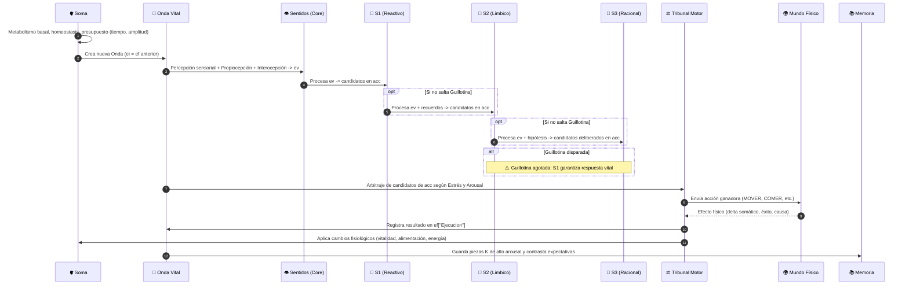
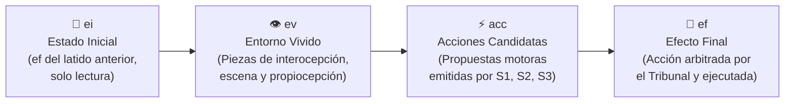
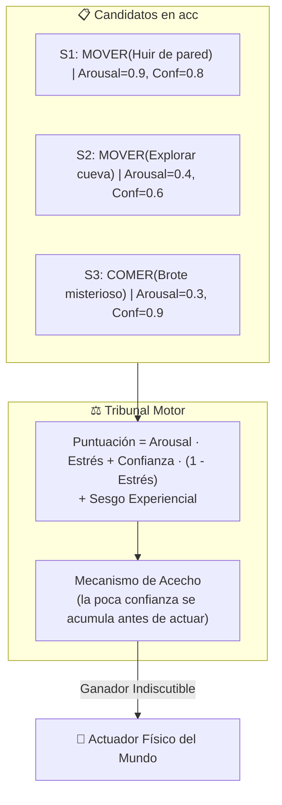

# 02. Arquitectura y Mecanismo Vital 🧠⚙️

## 1. El Latido Vital: La Unidad Fundamental del Tiempo

En IdA, la vida discurre a través de una sucesión de **latidos** rítmicos (`ida/core/latido.py`). Cada latido es un ciclo completo de sentir, reflexionar, decidir y ejecutar.

---

## 2. La Onda: Estructura de Información en Cuatro Fases

Toda la información que fluye dentro de un latido está encapsulada en una **`Onda`** (`ida/core/onda.py`). Para evitar acoplamientos y efectos colaterales indeseados, la Onda se divide estrictamente en cuatro fases que avanzan unidireccionalmente:

### 1. `ei` (Estado Inicial / Experiencia Inicial)
* Contiene el efecto del latido inmediatamente anterior (`ef`).
* **Blindaje:** Es de **solo lectura** (protegido mediante estructuras inmutables `MappingProxyType`). Ningún componente puede reescribir el pasado.

### 2. `ev` (Entorno Vivido)
* El módulo de **Sentir** deposita aquí las `Piezas` sensoriales:
  * **Interocepción:** Vitalidad, alimentación, energía y descanso, cada una con su variación respecto al latido anterior.
  * **Escena:** Entidades detectadas en el entorno con sus rasgos normalizados.
  * **Propiocepción:** Orientación, ubicación y postura física del individuo.

### 3. `acc` (Acciones Candidatas)
* Es la «pizarra de intenciones». Cada sistema (S1, S2, S3) deposita aquí candidatos de acción para el verbo correspondiente, acompañados de:
  * **Arousal:** Grado de urgencia e intensidad biológica.
  * **Confianza:** Grado de certidumbre del sistema en su propuesta.
  * **Carga causal:** Explicación y datos de destino.

### 4. `ef` (Efecto Final / Ejecución)
* El **Tribunal Motor** selecciona el candidato ganador de `acc` y lo remite al actuador del mundo físico. El resultado (`Efecto`) se almacena aquí y se convertirá en el `ei` del siguiente latido.

---

## 3. La Guillotina Biológica: Límite Estricto de Pensamiento

En la naturaleza, un animal que se detiene a reflexionar durante diez segundos cuando un tigre salta sobre él resulta devorado antes de dar el primer paso.

IdA cuenta con un mecanismo innegociable denominado **Guillotina** (`LatidoAgotado`), implementado de forma cooperativa y síncrona en cada punto de control del organismo:

### Dos presupuestos concurrentes:
1. **Presupuesto de Amplitud Cognitiva:** Número máximo de `Piezas` de información que los sistemas pueden emitir durante el latido (por ejemplo, 80 o 100 piezas). Evita la proliferación incontrolada de pensamientos.
2. **Presupuesto de Tiempo (Milisegundos):** Tiempo de reloj de pared máximo asignado a la cognición en cada ciclo (100 ms de base en los cinco mundos). Se adapta al estado: el peligro acorta el plazo hasta un 30 %, la energía escala la amplitud, dormido la amplitud baja a 20 y, si el latido anterior agotó la amplitud, el siguiente tiene un 50 % más («taquicardia»). El tiempo que tarda el mundo (la jugada del rival, la web) no se cobra a la cognición.

### ¿Por qué síncrona y cooperativa?
Las pruebas técnicas demostraron que en entornos Python estándar, `asyncio.wait_for` o el multihilo no pueden interrumpir de forma fiable cálculos síncronos pesados (CPU-bound) en Windows sin recurrir a matar subprocesos del sistema operativo (lo cual es inviable por latencia y consumo de recursos).

En IdA:
* Cada emisión de una pieza invoca `onda.control_vital()`.
* Si el tiempo o la amplitud se agotan, se lanza inmediatamente la excepción `LatidoAgotado`.
* El gestor captura el corte, **aborta la ejecución de S2 o S3** y salta directamente al **Tribunal Motor**.
* Como el orden de evaluación es siempre **$S1 \rightarrow S2 \rightarrow S3$**, S1 siempre ha tenido su turno antes de que corte la guillotina. El Tribunal decide con lo que haya en `acc`: si no hay ningún candidato, el individuo espera; y si el mundo no admite esperar (Ajedrez), S1 propone el mal menor.
* La guillotina es **cooperativa**: interrumpe entre componentes y en cada emisión, no dentro de un cálculo largo que no emita nada. Por eso los componentes deben ser cortos y lo costoso se hace al dormir o al morir.

---

## 4. El Tribunal Motor: La Física de la Decisión

El **Tribunal Motor** (`ida/core/sentidos.py`) es el único árbitro autorizado a tomar el control de los actuadores del cuerpo. Ningún sistema cognitivo puede mover un músculo por sí mismo: todos deben comparecer ante el Tribunal.

### La Ecuación del Arbitraje
Para cada acción candidata $i$, el Tribunal calcula su idoneidad motora mediante:

$$\text{Puntuación}_i = (\text{Arousal}_i \cdot \text{Estrés}) + (\text{Confianza}_i \cdot (1 - \text{Estrés})) + \Delta_{\text{experiencia}}$$

* **Bajo alto estrés (Peligro, Daño, Pánico):** El término $\text{Arousal} \cdot \text{Estrés}$ domina de forma absoluta. El Tribunal elige los impulsos de S1 (reflejos rápidos y potentes), ignorando las cavilaciones complejas.
* **Bajo bajo estrés (Calma, Refugio, Saciedad):** El término $\text{Confianza} \cdot (1 - \text{Estrés})$ toma el control. El organismo prefiere planes bien justificados y contrastados de S2 y S3.
* **$\Delta_{\text{experiencia}}$:** Pequeño sesgo, de peso configurable por mundo (`peso_experiencia`, de 0,15 a 0,2), que suma dos términos en [−1, 1]: el **activo**, el balance medio que dejó hacer esa misma acción sobre esa clase de cosa, y el **proactivo**, lo que se sabe de la clase («nutre» demostrado suma, «hace daño» demostrado resta). No añade candidatos, solo reordena los existentes; la consola avisa cuando cambia la decisión. Con `--sin-experiencia` vale cero.
* **Empate:** si los dos mejores distan 0,02 o menos, decide el azar (con semilla).
* **Acecho:** un candidato con confianza baja (< 0,35) y sin urgencia no se ejecuta enseguida: su confianza se acumula latido a latido hasta superar el umbral. No se aplica en mundos que no admiten esperar.

---

## 5. El Marcapasos: Tiempo Real vs Tiempo Discreto

IdA opera de dos modos distintos según el perfil que declare cada mundo:

1. **Mundos de Tiempo Real (ej. Snake):**
   * El reloj físico del entorno no se detiene a esperar a IdA.
   * El marcapasos calcula cuánto tardó la cognición: si el ciclo dura 100 ms y la mente pensó en 8 ms, el gestor espera los 92 ms restantes para acompasar el ritmo metabólico con el del mundo exterior.
2. **Mundos por Turnos (ej. Archivos, Crafter, Ajedrez):**
   * El mundo espera pacientemente a que IdA decida su jugada o acción.
   * Sin embargo, **la mente de IdA no tiene tiempo infinito**: cada latido individual mantiene su presupuesto interno estricto (guillotina) para evitar sobrepensamiento.
