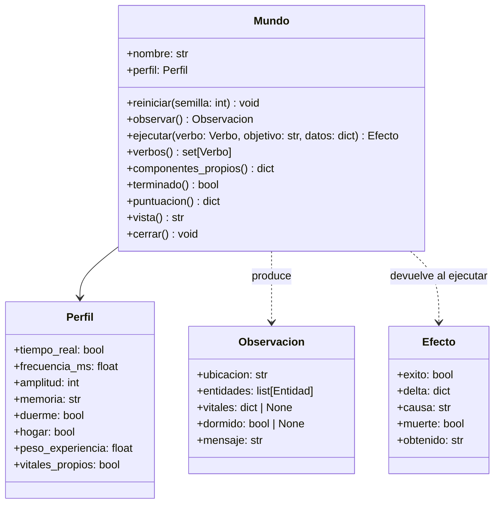
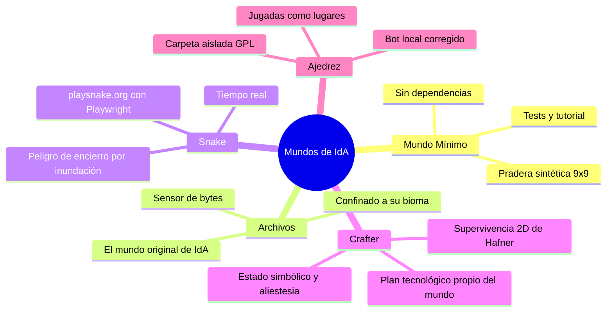

# 03. Los Mundos de IdA 🌍🕹️

## 1. El Contrato de Mundo: La Frontera Sensoriomotora

Para que el organismo mantenga su naturaleza universal y ciego al dominio, todo entorno en el que habite debe implementar la interfaz abstracta **`Mundo`** (`ida/core/mundo.py`).

### El mundo percibe; IdA piensa

Un sensor traduce lo que hay *ahora* a rasgos: qué se ve, qué está al alcance, qué amenaza de inmediato. No piensa por el individuo. **Si el sensor calcula mucho, quien juega bien es el mundo, no IdA.** Por eso el sensor de ajedrez mira una sola respuesta del rival y no busca combinaciones, y por eso ningún motor ni modelo de lenguaje elige la acción. Las mejoras de un mundo afinan su percepción y sus componentes propios; el juicio sigue siendo del Tribunal.

---

## 2. El Vocabulario Común: Rasgos y Verbos Universales

El mundo traduce su estado interno complejo a un conjunto cerrado y normalizado de **rasgos** $[0.0, 1.0]$ y acepta un conjunto cerrado de **verbos**:

### Los 7 Rasgos Universales
| Rasgo | Significado para la mente | Archivos | Snake | Crafter | Ajedrez |
|---|---|---|---|---|---|
| `proximidad` | Cercanía (1 = al alcance) | Todo lo de la carpeta actual es 1 | Distancia a la comida | Distancia en el radio de visión | 1 (jugadas y piezas propias) |
| `nutritivo` | Lo que promete al cuerpo | Biomasa periódica (comestibles y tóxicos se ven igual); carpetas con comida | Comida; casillas que acercan a ella | Agua, vaca y planta madura según sed y hambre (aliestesia); casillas que acercan | Material que gana la jugada más valor posicional (1 si da mate) |
| `peligro` | Amenaza al cuerpo | Depredadores `.exe`; carpetas con depredadores | Pared y cuerpo (1); casillas que llevan a un encierro | Zombis, esqueletos, flechas, lava; casillas cerca de ellos | Material que se puede perder justo después (1 si permite mate en 1) |
| `novedad` | Desconocido o no visto hace tiempo | Archivos no vistos; carpetas no visitadas | — | Casillas no pisadas hace tiempo | — |
| `recurso` | Utilidad instrumental | Mensajes y elementos ambientales | — | Árbol, piedra, carbón, hierro, diamante | — |
| `lugar` | Destino al que se puede ir | Subcarpetas y carpeta padre | Las 4 casillas vecinas (pared y cuerpo incluidos) | Casillas vecinas transitables | Cada jugada legal |
| `agente` | Actúa por sí mismo | Depredadores | — | Vacas y criaturas | El jaque recibido |

### Los 8 Verbos Universales
* `MOVER`: Desplazarse hacia una entidad que posea el rasgo `lugar`.
* `COMER`: Ingerir o deglutir una entidad con rasgo `nutritivo`.
* `ATACAR`: Destruir, neutralizar o capturar una amenaza o presa.
* `COGER`: Recoger un objeto o recurso y depositarlo en el inventario.
* `SOLTAR`: Desprenderse de un objeto del inventario.
* `USAR`: Emplear una herramienta, craftear un ítem o activar un mecanismo.
* `DORMIR`: Iniciar el reposo motor para restaurar energía y consolidar memoria.
* `ESPERAR`: Ceder el turno o acechar observando la evolución del entorno.

---

## 3. Catálogo de Mundos

Cifras de cada mundo: [`05_METRICAS_E_HITOS.md`](05_METRICAS_E_HITOS.md).

---

### Mundo 1: El Mundo Mínimo (`ida/mundos/minimo.py`)
* **Propósito:** pruebas de extremo a extremo y tutorial de cómo se escribe un mundo. Es determinista con semilla.
* **Estructura:** pradera de 9×9 con bayas (nutren), setas (parecen comida pero hacen daño: solo la experiencia lo revela), piedras (sirven, se pueden coger) y un lobo que se acerca y muerde. Los lugares son las cuatro casillas vecinas.
* **Componente propio:** `Defensa` (S1), que planta cara al lobo cuando está al alcance (huir no sirve: persigue).
* **Ventaja:** sin dependencias; cientos de latidos en un segundo.

---

### Mundo 2: Archivos (`ida/mundos/archivos.py`)
* **Propósito:** el ecosistema original de IdA. Las carpetas son biomas (Llanura/Valle, Bosque/Cueva, Montaña/Glaciar, Pantano, Ruinas) y los archivos, lo que vive en ellos.
* **La retina de bytes:** el sensor de este mundo calcula masa, entropía de Shannon, periodicidad y firma cinética de cada archivo y de ahí saca los rasgos. Comestibles y tóxicos tienen la misma apariencia (biomasa periódica); solo comiendo se distinguen.
* **Acciones:** comer da mordiscos destructivos de bytes, atacar puede eliminar un depredador, coger y soltar mueven un archivo a la «mochila». Los depredadores muerden y a veces cambian de carpeta; la biomasa rebrota.
* **Componentes propios:** `Defensa` (S1) ataca al depredador de la carpeta; `Prudencia` (S3) frena comer lo que tiene indicios de daño, aplica neofobia y recuerda las carpetas con solo comida dañina.
* **Seguridad:** toda operación de disco se comprueba contra la raíz del bioma (`datos/archivos/bioma`); fuera de ella no se lee, escribe ni borra nada (lo comprueba un test).

---

### Mundo 3: Snake (`ida/mundos/snake.py`)
* **Propósito:** jugar en la web real [playsnake.org](https://playsnake.org/) controlando Chromium con **Playwright**. Necesita internet.
* **Tiempo real:** la serpiente avanza aunque IdA no haya decidido; el marcapasos ajusta el latido al periodo declarado, **60 ms** por defecto (`--opcion ritmo=MS`), porque a nivel pitón 100 ms llega tarde.
* **Sensor de espacio libre:** relleno por inundación acotado desde cada casilla vecina, comparado con la longitud:

$$\text{Peligro} = \max\left(0, \min\left(0{,}9, 1 - \frac{\text{Espacio libre}}{2 \cdot \text{Longitud} + 4}\right)\right)$$
ight)
ight)$$

* **Comer en tiempo real:** COMER gira hacia la comida y espera a que la cabeza llegue; si no llega (giro de 180° imposible), es un fallo, no una prueba de que la comida no nutra.
* **Lugares:** las casillas vecinas libres; pared y cuerpo (peligro 1) solo se ofrecen si no queda ninguna segura.
* **Trauma de muerte:** la causa (`pared` o `cuerpo`) se calcula antes de que la web reinicie la partida, proyectando la dirección hasta 3 casillas, y el último latido aprende de ella.

---

### Mundo 4: Crafter (`ida/mundos/crafter.py`)
* **Propósito:** supervivencia en 2D con recursos, criaturas, día y noche y 22 logros ([Crafter](https://github.com/danijar/crafter), Hafner 2021).
* **Cuerpo:** salud, comida, bebida y energía las marca el juego (`vitales_propios`), y también el sueño (`Observacion.dormido`).
* **Sensor:** estado simbólico del juego en un radio de 4 casillas (2 de noche). **Aliestesia:** el agua vale según la sed y la vaca según el hambre.
* **Componente propio:** `PlanTecnologico` (S3) avanza por el árbol tecnológico con las recetas del juego, aprovecha logros baratos (retoño, plantar, minerales) y propone dormir de día sin hostiles a la vista. Es código de este mundo, no del framework.
* **Repetible:** las criaturas tienen identificadores estables y el adaptador ordena las criaturas de cada zona por orden de llegada (la librería las guarda en conjuntos ordenados por dirección de memoria), así que la misma semilla da la misma vida, también entre procesos.
* **Diferencia con el benchmark oficial:** no ve píxeles; sus cifras no son comparables con las publicadas.

---

### Mundo 5: Ajedrez (`ida/mundos/ajedrez/`, GPL-3.0-or-later)
* **Propósito:** un mundo por turnos y abstracto, contra un bot local (dificultad 0 a 3) o, con `--opcion stockfish=RUTA`, contra Stockfish.
* **Traducción:** cada jugada legal es un lugar. El sensor mira una respuesta del rival: `nutritivo` es el material que gana (más un pequeño valor posicional; 1 si da mate) y `peligro`, el que puede perder justo después (1 si permite mate en 1). La clase de cada jugada es su tipo (`captura_dama`, `jaque`, `enroque`…). Que mire solo una respuesta es deliberado: ver más lejos sería calcular por IdA (ver «El mundo percibe; IdA piensa»). Por eso pierde contra el rival de 3 ply, y es un resultado honesto.
* **Remate y tablas:** con 3 o más de ventaja, el valor posicional premia el jaque, quitar casillas al rey rival, avanzar peones y no repetir posición; en desventaja, repetir posición vale.
* **Cuerpo:** la vitalidad refleja el material propio y la alimentación, el balance de material; solo el mate recibido es la muerte.
* **Rival:** un negamax local con poda alfa-beta de 1 a 3 ply.
