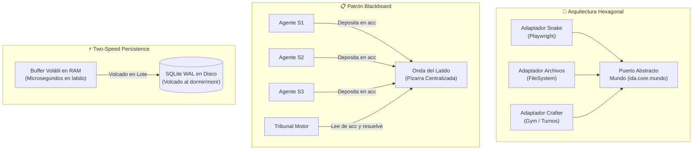
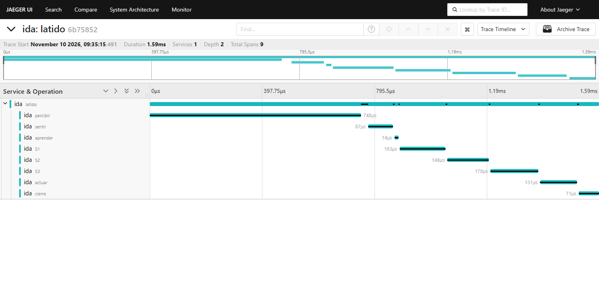
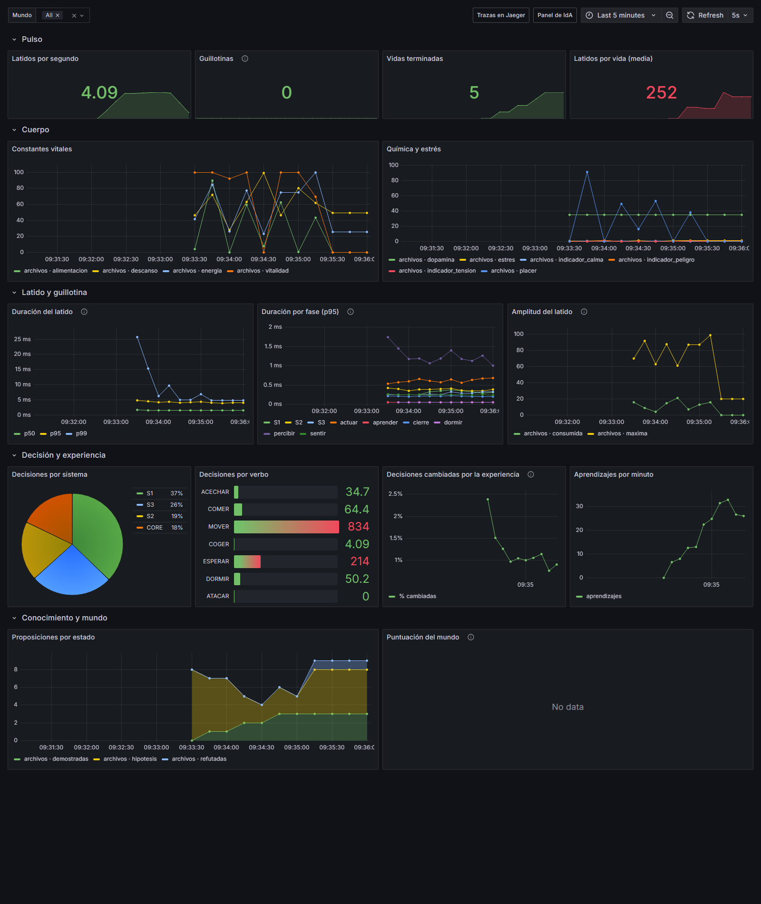

# 04. Guía Técnica y Patrones de Diseño 🛠️🏗️

Este documento está dirigido a ingenieros de software, investigadores de IA y arquitectos de sistemas que deseen comprender las tripas de la implementación, los patrones de diseño adoptados y las justificaciones técnicas de cada decisión.

---

## 1. Stack Tecnológico: núcleo sin dependencias, extras alrededor

Una de las premisas rectoras del framework base de IdA es la **sobriedad arquitectónica**: el núcleo no depende de nada, y todo lo demás (mundos, observabilidad, herramientas) entra como extra opcional de `pyproject.toml`.

* **Python 3.12 o posterior:** `dataclasses`, `typing` y la biblioteca estándar. La integración continua prueba 3.12 y 3.15; se desarrolló con 3.15.1.
* **Sin dependencias en el Core:** el núcleo (`ida/core/`) y los sistemas (`ida/sistemas/`) solo usan la biblioteca estándar de Python. Las dependencias son de cada mundo, como extras: `[crafter]`, `[snake]` (`playwright`), `[ajedrez]` (`python-chess`). La CI ejecuta los tests también sin ningún extra.
* **Calidad:** `ruff` (linter) y `mypy` (tipos) en verde sobre todo `ida/`, 64 tests con `pytest` y un workflow de **GitHub Actions** que los ejecuta en cada push.
* **Contenedores:** `Dockerfile` multietapa (imagen de IdA y etapa `dev` con las herramientas), **devcontainer** para VS Code y `docker-compose.yml` con la pila de observabilidad.
* **Observabilidad estándar (opcional):** **OpenTelemetry** (trazas y métricas por OTLP), un **OpenTelemetry Collector**, **Jaeger**, **Prometheus** y **Grafana** con el panel provisionado como código (`infra/`). Ver el patrón 6.
* **Persistencia Integrada con SQLite en modo WAL:** Se utiliza el motor nativo `sqlite3` con Journal Mode en `WAL` (Write-Ahead Logging). Esto permite lecturas ultra-rápidas concurrentes y escrituras transaccionales sin bloquear el latido.
* **Telemetría Web Nativa con SSE (Server-Sent Events):** El servidor de visualización (`ida/telemetria/servidor.py`) corre sobre `http.server.ThreadingHTTPServer` nativo, transmitiendo resúmenes de latidos en JSON mediante un stream unidireccional HTTP `text/event-stream`. Publicar nunca bloquea el latido. El panel (`ida/telemetria/panel.html`, sin dependencias, con modo oscuro) muestra el cuerpo y la química, el presupuesto del latido (tiempo, amplitud y guillotinas), los indicadores generales, la decisión del Tribunal con cada candidato desglosado (base, experiencia activa y proactiva), el reparto de decisiones por sistema y cuántas cambió la experiencia, la memoria (expectativas acertadas, proposiciones por estado, episodios, recuerdos, herencia), lo que sabe, el carácter, la vista y la puntuación del mundo, y un historial.

---

## 2. Patrones de Diseño Implementados



---

### Patrón 1: Arquitectura Hexagonal (Puertos y Adaptadores)
* **El Problema:** si la mente supiera qué es un archivo en disco (`.exe`, `.brote`), IdA no podría jugar al ajedrez ni navegar por la web sin reescribir su cerebro.
* **La Solución:** `ida/core/mundo.py` actúa como el **Puerto**. El Core solo conoce interfaces abstractas (`Observacion`, `Entidad`, `Efecto`). Los mundos concretos residen en `ida/mundos/` como **Adaptadores** independientes.
* **Beneficio:** Añadir un nuevo entorno (por ejemplo, robótica simulada o Doom) solo requiere crear un adaptador que implemente el puerto; el Core y los sistemas cognitivos permanecen 100% inalterados.

---

### Patrón 2: Patrón Blackboard (Pizarra Compartida de la Onda)
* **El Problema:** La interacción directa entre componentes heterogéneos (un reflejo motor que quiere hablar con una proposición lógica o una emoción límbica) genera un acoplamiento cuadrático $O(N^2)$ imposible de mantener.
* **La Solución:** La **Onda** actúa como una pizarra centralizada compartida:
  * Los sentidos escriben en la sección `ev`.
  * Los sistemas S1, S2 y S3 leen de `ev` y depositan sus propuestas en la sección `acc` sin conocerse entre sí.
  * El Tribunal Motor lee todas las propuestas de `acc`, aplica su función de arbitraje y declara al ganador en `ef`.
* **Beneficio:** Desacoplamiento total entre subsistemas cognitivos. Cada módulo se puede activar, desactivar o reemplazar de forma independiente.

---

### Patrón 3: Inversión de Control (IoC) y Composición sobre Herencia
* **El Problema:** La herencia rígida de clases crea jerarquías frágiles donde los organismos no pueden adaptar sus órganos sensoriales al entorno.
* **La Solución:** El **Organismo** (`ida/core/latido.py`) se compone dinámicamente inyectando:
  * El Mundo que habitará.
  * Los Sistemas cognitivos (S1, S2, S3).
  * El Arquetipo de personalidad.
  * La Memoria activa y proactiva.
  * El generador de Azar con semilla.
* **Beneficio:** Cada pieza se puede probar por separado (los tests de Snake sustituyen el navegador por un doble) y cada mundo añade sus propios componentes sin tocar el núcleo (`Mundo.componentes_propios()`).

---

### Patrón 4: Persistencia en Dos Velocidades (Two-Speed Persistence)
* **El Problema:** escribir en disco en cada latido añadiría una latencia variable al camino crítico, que en mundos de tiempo real como Snake tiene un plazo de 100 ms.
* **La Solución:**
  1. **Velocidad Rápida (En latido):** Solo se guardan en un buffer de memoria RAM las $K$ piezas con mayor `arousal` (relevancia somática).
  2. **Velocidad Lenta (Fuera de latido):** La escritura pesada a base de datos (`memoria.db`) se delega exclusivamente a los momentos de descanso (**al dormir**) o al cierre de ciclo (**al morir**).

---

### Patrón 5: Determinismo y Reproducibilidad con PRNG Derivado
* **El Problema:** Si un experimento de aprendizaje muestra un comportamiento emergente fascinante, es imprescindible poder reproducirlo bit a bit para su análisis científico.
* **La Solución:** La clase `Azar` (`ida/core/azar.py`) envuelve `random.Random` aislado. Nunca se utiliza la aleatoriedad global de Python:
  * Cada generación deriva una sub-semilla determinista:
    $$\text{semilla}_{g} = \text{azar.derivar}(g + 1)$$
  * Todos los empates del tribunal, mutaciones genéticas del Big Five y decisiones estocásticas son idénticas ante la misma semilla inicial.
  * **Límite:** la repetibilidad es completa en el mundo mínimo (lo comprueba un test), en el de archivos, en Crafter y en el ajedrez contra el rival local. Snake juega en una web en tiempo real y no es repetible.
  * **Lección de Crafter:** la propia librería guarda las criaturas de cada zona en `set`s, que Python ordena por dirección de memoria, y al despoblar una zona elige una por índice. La misma semilla daba vidas distintas entre procesos. El adaptador sustituye esos conjuntos por otros con orden de inserción y nombra a las criaturas por el objeto y no por `id(obj)` (que Python reutiliza). Se comprobó con cuatro `PYTHONHASHSEED` distintos.

---

### Patrón 6: Observabilidad pasiva

* **El Problema:** medir un latido sin cambiarlo. Si el núcleo llamara a un servicio de trazas, dependería de él y su latencia entraría en el plazo de la guillotina.
* **La Solución:** la Onda solo **apunta** cuándo empieza y termina cada fase (`Onda.fases`: percibir, sentir, aprender, S1, S2, S3 o dormir, actuar, cierre), con el reloj de pared. No llama a nadie. Después del latido, fuera del plazo, `ida/telemetria/otel.py` convierte ese registro en una traza de OpenTelemetry con un tramo por fase y sus tiempos reales, y añade métricas (histogramas de duración, contadores de guillotinas, decisiones y aprendizajes, e indicadores observables del cuerpo, la amplitud y el conocimiento).
* **Beneficio:** en Jaeger un latido se ve como una cascada; si la guillotina corta, aparece el evento `guillotina` y faltan las fases que no llegaron a correr. El test de pureza prohíbe importar `opentelemetry` en el núcleo, y el panel de Grafana es código versionado (`infra/grafana/dashboards/ida.json`).

```bash
docker compose up --build          # IdA + Collector + Jaeger + Prometheus + Grafana
python -m ida --mundo minimo --otel   # o desde el anfitrión, con la pila levantada
```

<p align="center"></p>

<p align="center"></p>

---

## 3. Blindaje de Pureza con AST (Abstract Syntax Tree)

Para evitar la contaminación accidental del Core con conceptos de mundos específicos a lo largo del tiempo, IdA incluye un test estático automatizado en [`tests/test_pureza.py`](../tests/test_pureza.py):

```python
# Extracto conceptual de test_pureza.py
def test_pureza(ruta_archivo_core):
    arbol = ast.parse(ruta_archivo_core.read_text(encoding="utf-8"))
    for nodo in ast.walk(arbol):
        # 1. Prohíbe imports de infraestructura o mundos
        if isinstance(nodo, (ast.Import, ast.ImportFrom)):
            assert nodo.module not in IMPORTS_PROHIBIDOS
        
        # 2. Prohíbe cadenas literales con palabras de mundos concretos
        if isinstance(nodo, ast.Constant) and isinstance(nodo.value, str):
            for palabra in PALABRAS_DE_MUNDO:
                assert palabra not in nodo.value.lower()
```

Si un desarrollador introduce en el Core una línea como `if entidad.clase == "serpiente":` o `import playwright`, la suite de tests falla. El test vigila una lista concreta de palabras: es una red de seguridad, no una garantía absoluta.

Un segundo test con AST (`tests/test_licencias.py`) vigila la frontera de licencias: `python-chess` (GPL) solo puede importarse dentro de `ida/mundos/ajedrez/`.

---

## 4. Estructura de Directorios del Repositorio

```
IdA/
├── ida/                           # PAQUETE PRINCIPAL DEL FRAMEWORK
│   ├── core/                      # El Organismo Puro (Ciego al Dominio)
│   │   ├── arquitectura.py        # Clases base: Componente, Módulo, Contexto
│   │   ├── azar.py                # Generador pseudoaleatorio determinista y reproducible
│   │   ├── latido.py              # Orquestador del latido vital, marcapasos y ciclo de vida
│   │   ├── linaje.py              # Arquetipos Big Five, mutación y transmisión hereditaria
│   │   ├── memoria.py             # Memoria activa, expectativas, episodios y proposiciones
│   │   ├── mundo.py               # Contrato formal (Puerto) entre IdA y cualquier entorno
│   │   ├── onda.py                # La Onda vital en cuatro fases (ei, ev, acc, ef) y Guillotina
│   │   ├── persistencia.py        # Motor SQLite en modo WAL para consolidación en dos velocidades
│   │   ├── pieza.py               # Unidad atómica de información cognitiva (Pieza y Episodio)
│   │   ├── sentidos.py            # Componentes base de Sentir (Interocepción) y Tribunal Motor
│   │   ├── soma.py                # El chasis somático (Vitalidad, Energía, Hambre, Neuroquímica)
│   │   └── vocabulario.py         # Verbos comunes, rasgos universales y estados de saber
│   ├── sistemas/                  # SISTEMAS COGNITIVOS TRIÚNICOS
│   │   ├── s1.py                  # Tronco encefálico: reflejos, lucha/huida y aversión
│   │   ├── s2.py                  # Sistema límbico: apego al hogar, curiosidad y afecto
│   │   ├── s3.py                  # Neocórtex simbólico: generación y validación de hipótesis
│   │   └── comun.py               # Utilidades comunes (lugares, objetos, apetito, alarma)
│   ├── mundos/                    # ADAPTADORES CONECTABLES (Hexagonal)
│   │   ├── minimo.py              # Mundo sintético para testing ultrarrápido
│   │   ├── archivos.py            # Bioma clásico de archivos con sensor de bytes
│   │   ├── snake.py               # Adaptador web para playsnake.org vía Playwright
│   │   ├── crafter.py             # Supervivencia 2D (estado simbólico) + PlanTecnologico propio
│   │   └── ajedrez/               # Ajedrez (GPL-3.0-or-later, aislado)
│   │       ├── __init__.py        # Jugadas legales como lugares, sensor con una réplica del rival
│   │       ├── rival.py           # Bot local: negamax con poda alfa-beta
│   │       ├── LICENSE            # Texto de la GPL-3.0
│   │       └── LICENCIA.md
│   ├── telemetria/                # SERVIDOR Y PANEL EN TIEMPO REAL
│   │   ├── servidor.py            # Servidor HTTP / SSE multihilo sin dependencias externas
│   │   ├── panel.html             # Dashboard reactivo en HTML5/VanillaJS
│   │   └── otel.py                # Trazas y métricas OpenTelemetry (extra [observabilidad])
│   ├── consola.py                 # Formateo estético y telemetría de texto por terminal
│   ├── ejecutor.py                # Orquestador de vidas, generaciones y linajes
│   └── __main__.py                # CLI de ejecución: python -m ida ...
├── tests/                         # SUITE DE PRUEBAS AUTOMATIZADAS
│   ├── test_core.py               # Validación del core, guillotina, memoria y soma
│   ├── test_organismo.py          # Validación de ciclo de vida completo de un individuo
│   ├── test_mundo_archivos.py     # Sandbox y sensor de bytes del mundo de archivos
│   ├── test_snake.py              # Espacio libre, causas de muerte y trauma mortal
│   ├── test_crafter.py            # Rasgos, sueño sincronizado, reglas de éxito
│   ├── test_ajedrez.py            # Rival corregido y sensor de jugadas
│   ├── test_observabilidad.py     # Trazas por fase y guillotina visible (OpenTelemetry en memoria)
│   ├── test_licencias.py          # python-chess solo dentro de ida/mundos/ajedrez/
│   └── test_pureza.py             # Linter AST de pureza arquitectónica
├── infra/                         # CONFIGURACIÓN DE LA PILA DE OBSERVABILIDAD
│   ├── otel-collector.yaml        # OTLP → Jaeger (trazas) y Prometheus (métricas)
│   ├── prometheus.yml
│   └── grafana/                   # Fuentes de datos y panel de IdA como código
├── .github/workflows/ci.yml       # ruff + mypy y tests en Python 3.12 y 3.15, con y sin extras
├── .devcontainer/                 # Entorno de desarrollo en contenedor
├── Dockerfile                     # Imagen de IdA y etapa dev
├── docker-compose.yml             # IdA + Collector + Jaeger + Prometheus + Grafana
├── pyproject.toml                 # Paquete, extras por mundo y configuración de ruff, mypy y pytest
├── LICENSE · NOTICE               # Apache-2.0 y aviso de licencias de terceros
├── docs/                          # DISEÑO, ESTADO, RESULTADOS DE LA LÍNEA BASE E IMÁGENES
└── doc-repositorio/               # DOCUMENTACIÓN EXHAUSTIVA DEL PROYECTO
    ├── README.md                  # Portada y bienvenida para GitHub
    ├── 01_FILOSOFIA_Y_BIOLOGIA.md # Fundamentos biológicos y ontológicos
    ├── 02_ARQUITECTURA_Y_MECANISMO_VITAL.md # El latido, la onda, guillotina y tribunal
    ├── 03_LOS_MUNDOS.md           # Contratos, rasgos universales y catálogo de mundos
    ├── 04_GUIA_TECNICA_Y_PATRONES.md # Arquitectura de software, patrones y tecnologías
    └── 05_METRICAS_E_HITOS.md     # Métricas e hitos conseguidos en cada mundo
```
