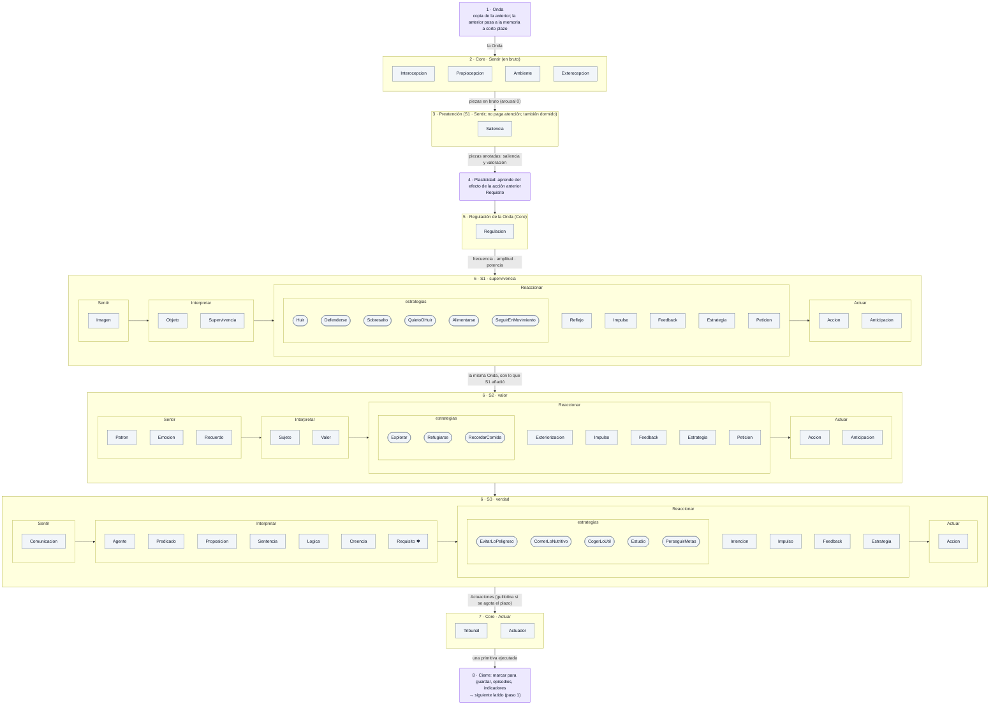
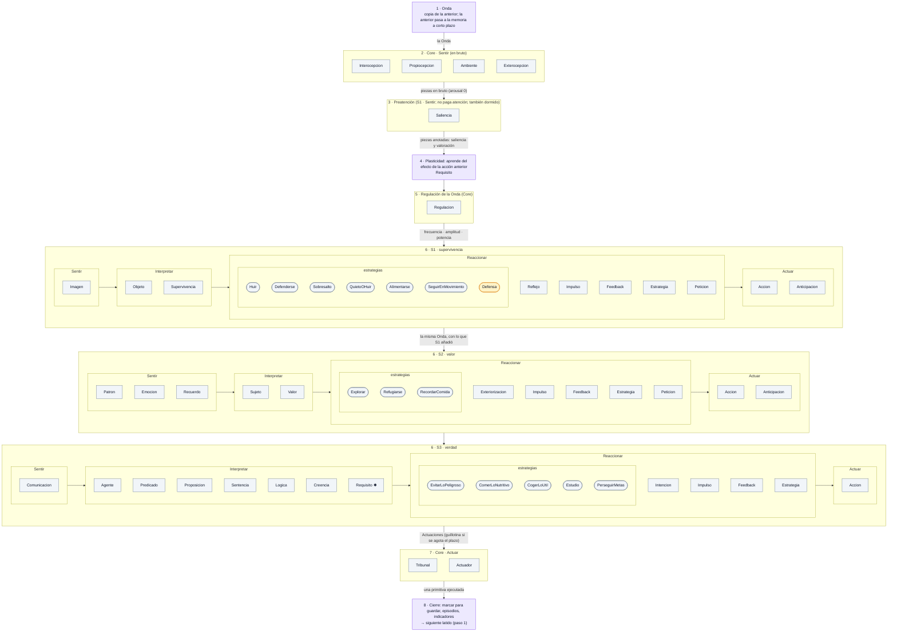
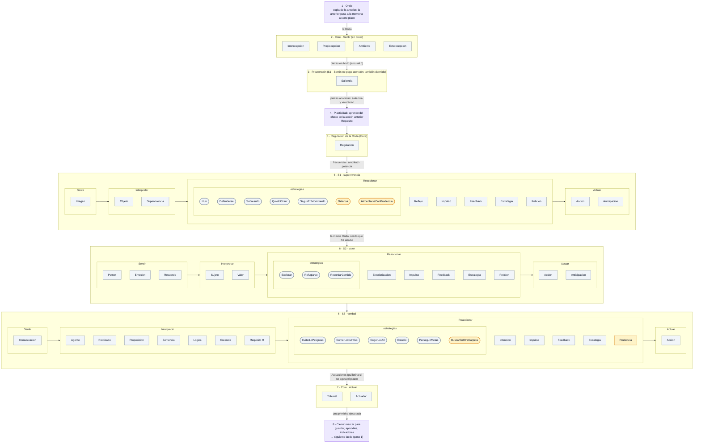
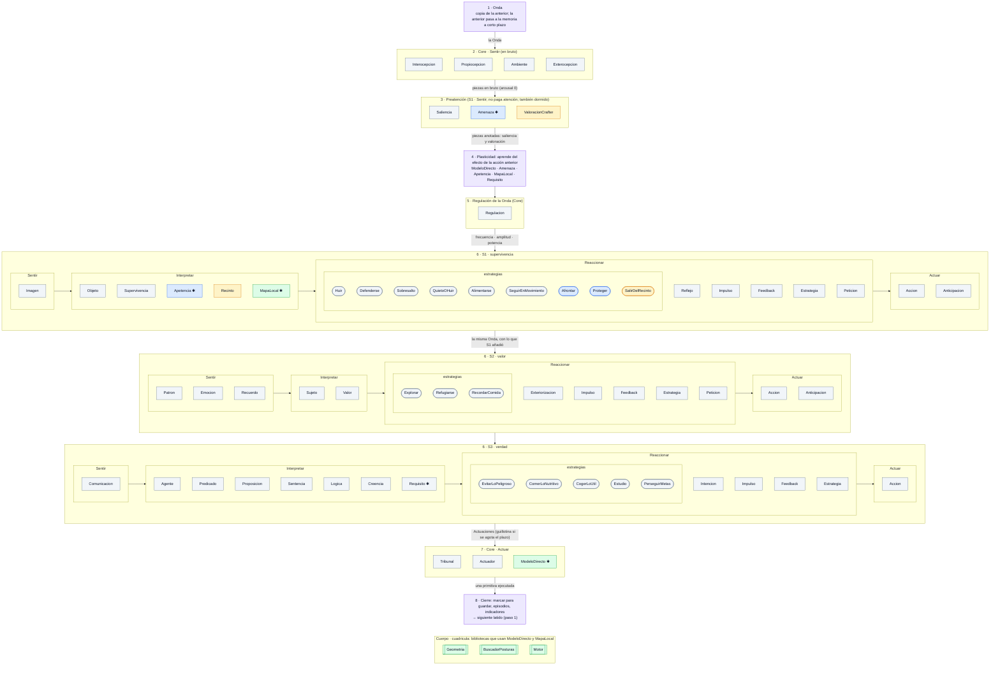

# Diseño visual: el latido, el núcleo y cada mundo

> **Generado** por `herramientas/mapa_componentes.py --escribir` desde [`componentes.toml`](componentes.toml). No se edita a mano.
> Tabla completa: [`06_MAPA_DE_COMPONENTES.md`](06_MAPA_DE_COMPONENTES.md) · Decisiones: [`docs/DISENO_COMPONENTES.md`](../docs/DISENO_COMPONENTES.md).

## Cómo leerlo

Cada latido es una **Onda** que recorre ocho pasos, siempre en el mismo orden (D1). La Onda lleva el plazo (**frecuencia**; si se agota, la **guillotina** corta lo que quede), cuántas piezas caben en la atención (**amplitud**) y cuánto arousal se puede dar o cambiar (**potencia**). Cada Componente solo produce y cambia piezas de su tipo.

- **Pasos 1–5 (Core y preatención):** sentir en bruto, anotar lo saliente y lo valorado, aprender del efecto de la acción anterior y fijar la Onda. No pagan atención y corren también dormido.
- **Paso 6 (cognición):** S1 → S2 → S3, uno tras otro sobre la misma Onda. En cada sistema, Sentir → Interpretar → Reaccionar (las estrategias, cada una con su Actuación) → Actuar. Pagan atención y la guillotina puede cortarlos.
- **Pasos 7–8 (Core):** el Tribunal elige una Actuación, el Core ejecuta su primitiva, y el cierre marca qué guardar.

Un mundo no cambia este flujo: solo **registra** su cuerpo y sus Componentes propios, que se añaden a lo general o lo sustituyen en el mismo sitio.

**Leyenda.** Rectángulo: Componente · óvalo: estrategia · doble borde: biblioteca del cuerpo · ✱: aprende (paso 4). Color: gris, general · azul, opcional (general, montado solo por quien lo registra) · verde, del cuerpo · ámbar, propio del mundo · violeta, paso del latido sin Componentes declarados.

## El núcleo (lo que monta cualquier mundo)

## Mínimo

Añade al núcleo:

- `Defensa` (estrategia, mundo: minimo) en S1 · Reaccionar

## Archivos

Añade al núcleo:

- `Defensa` (estrategia, mundo: archivos) en S1 · Reaccionar
- `AlimentarseConPrudencia` (estrategia, mundo: archivos) en S1 · Reaccionar, sustituye a `Alimentarse`
- `Prudencia` (componente, mundo: archivos) en S3 · Reaccionar
- `BuscarEnOtraCarpeta` (estrategia, mundo: archivos) en S3 · Reaccionar

## Snake

Monta solo el núcleo: el diagrama es el de arriba.

## Ajedrez

Monta solo el núcleo: el diagrama es el de arriba.

## Crafter

Añade al núcleo:

- `ModeloDirecto` (componente, cuerpo: cuadricula) en 7 · Core · Actuar
- `Amenaza` (componente, opcional (crafter)) en 3 · Preatención (S1 · Sentir, no paga atención, también dormido)
- `ValoracionCrafter` (componente, mundo: crafter) en 3 · Preatención (S1 · Sentir, no paga atención, también dormido)
- `Apetencia` (componente, opcional (crafter)) en S1 · Interpretar
- `Recinto` (componente, mundo: crafter) en S1 · Interpretar
- `MapaLocal` (componente, cuerpo: cuadricula) en S1 · Interpretar
- `Afrontar` (estrategia, opcional (crafter)) en S1 · Reaccionar
- `Proteger` (estrategia, opcional (crafter)) en S1 · Reaccionar
- `SalirDelRecinto` (estrategia, mundo: crafter) en S1 · Reaccionar
- `Geometria` (biblioteca, cuerpo: cuadricula) en Bibliotecas de los cuerpos
- `BuscadorPosturas` (biblioteca, cuerpo: cuadricula) en Bibliotecas de los cuerpos
- `Motor` (biblioteca, cuerpo: cuadricula) en Bibliotecas de los cuerpos

