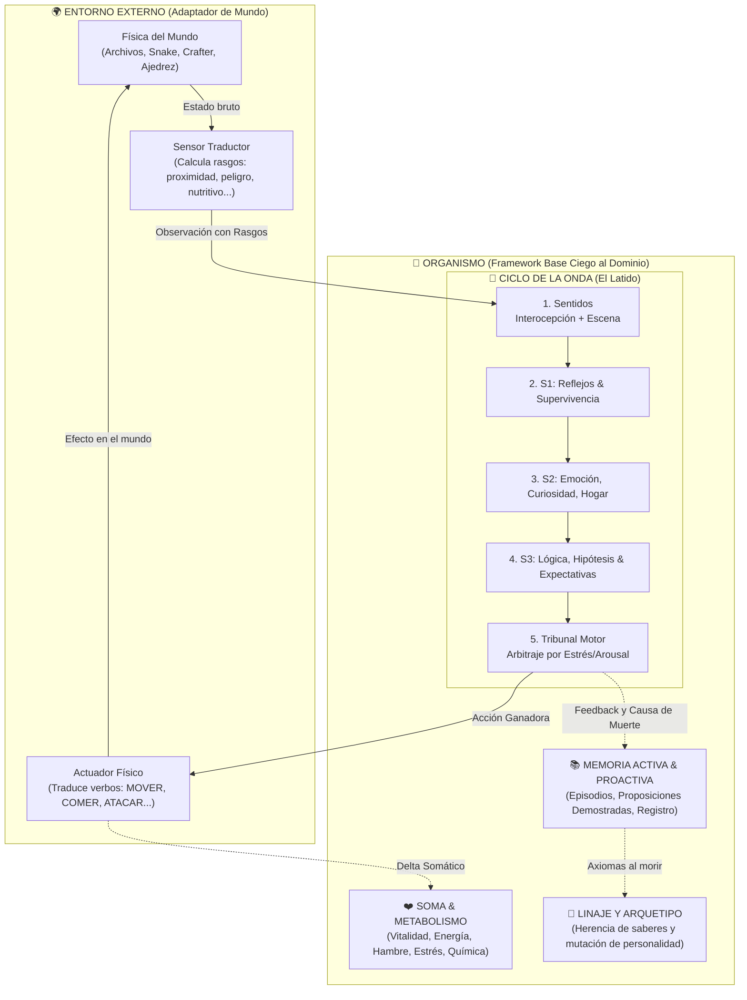

# IdA — Identidad Artificial 🧬🧠

> **Un framework cognitivo bio-inspirado, agnóstico al dominio y guiado por la supervivencia somática, el aprendizaje experiencial y la evolución transgeneracional.**

[](https://github.com/diegorodriguezreija/IdA/actions/workflows/ci.yml)
[](https://www.python.org/)
[](04_GUIA_TECNICA_Y_PATRONES.md)
[-blue)](../NOTICE)

---

## 🌟 ¿Qué es IdA?

La inmensa mayoría de las inteligencias artificiales actuales son **oráculos estáticos y desencarnados**: procesan peticiones aisladas, carecen de cuerpo, no sienten hambre ni miedo, no tienen nada que perder y se apagan sin haber acumulado una historia viva.

**IdA (Identidad Artificial)** nace desde una premisa radicalmente opuesta: **la inteligencia genuina no surge de procesar billones de parámetros en el vacío, sino de la necesidad innegociable de un organismo vivo por conservar su integridad física ante el entorno.**

En IdA:
1. **Hay un cuerpo (Soma):** El individuo experimenta vitalidad, hambre, fatiga, dopamina, dolor y placer. Si su vitalidad llega a cero, muere irremediablemente.
2. **El tiempo apremia (El Latido Vital):** La cognición discurre a través de latidos rítmicos marcados por un presupuesto estricto de tiempo (milisegundos) y amplitud cognitiva. Una **guillotina biológica** interrumpe el exceso de pensamiento: quien duda demasiado ante el peligro, perece.
3. **Estructura mental triúnica (S1, S2, S3):** Inspirado en la neurobiología, el organismo procesa la realidad a través de tres niveles superpuestos:
   * **S1 (Reptiliano):** Reflejos inmediatos de supervivencia y huida.
   * **S2 (Límbico):** Emoción, apego al hogar, curiosidad y valencia hedónica.
   * **S3 (Neocórtex Simbólico):** Generación de hipótesis causales («comer esto daña»), expectativas y comportamientos deliberados.
4. **Generalismo ciego al entorno:** La mente de IdA **no sabe en qué mundo habita**. No conoce las palabras «fichero», «pared», «manzana» ni «jaque». Todo mundo traduce su física a un vocabulario universal de **rasgos** (`proximidad`, `nutritivo`, `peligro`, `novedad`, `lugar`, etc.) y **verbos** (`MOVER`, `COMER`, `ATACAR`, `COGER`, `DORMIR`, etc.).
5. **Evolución y linaje transgeneracional:** La muerte no es el fin del linaje. Lo que mató al ancestro queda demostrado por trauma (`_aprender_de_la_muerte`), lo demostrado pasa al descendiente como hipótesis fuerte que debe confirmar con su propia experiencia, y los rasgos de carácter mutan con algo de ruido y una pequeña marca de lo que vivió el padre.

---

## 🗺️ Mapa de la Documentación

Esta carpeta `doc-repositorio/` contiene el desglose exhaustivo del proyecto:

| Documento | Contenido Principal |
|---|---|
| [**01. Filosofía y Biología**](01_FILOSOFIA_Y_BIOLOGIA.md) | Homeostasis somática, cerebro triuno, consolidación en el sueño REM, trauma mortal, linaje y modelo Big Five. |
| [**02. Arquitectura y Mecanismo Vital**](02_ARQUITECTURA_Y_MECANISMO_VITAL.md) | El ciclo del Latido, la Onda cuatripartita (`ei`, `ev`, `acc`, `ef`), la Guillotina cooperativa y el Tribunal Motor. |
| [**03. Los Mundos de IdA**](03_LOS_MUNDOS.md) | El contrato del Mundo, el Mundo Mínimo, Bosque de Archivos, Snake (Playwright), Crafter 2D y Ajedrez. |
| [**04. Guía Técnica y Patrones de Diseño**](04_GUIA_TECNICA_Y_PATRONES.md) | Arquitectura Hexagonal, Blackboard, Inversión de Control, Determinismo PRNG, Persistencia WAL y Tests AST de Pureza. |
| [**05. Métricas e Hitos**](05_METRICAS_E_HITOS.md) | Lo conseguido en cada mundo, con los comandos para repetirlo y sus límites. |

---

## ⚡ Vista Panorámica del Sistema



---

## 🚀 Inicio Rápido

### Requisitos
* **Python 3.12 o posterior.** La integración continua prueba 3.12 y 3.15; se desarrolló con 3.15.1.
* El framework base solo usa la biblioteca estándar. Cada mundo trae sus dependencias como extra:
  ```bash
  pip install -e ".[dev,crafter,ajedrez]"          # tests, Crafter y ajedrez
  pip install -e ".[snake]" && python -m playwright install chromium   # Snake (necesita internet)
  pip install -e ".[observabilidad]"               # OpenTelemetry
  ```
* O con Docker, sin instalar nada: `docker compose up --build` (ver más abajo).

### Ejecutar una simulación básica
Para abrir la **antesala interactiva** en el navegador y configurar cualquier mundo visualmente:
```bash
python -m ida
```

Para lanzar directamente una vida en el **Mundo Mínimo sintético**:
```bash
python -m ida --mundo minimo --latidos 100 --semilla 42
```

Para activar el **panel de telemetría web en vivo**:
```bash
python -m ida --mundo archivos --latidos 300 --ver
```
*(Abre en tu navegador `http://localhost:8000/` para ver en tiempo real la mente de IdA pulsando latido a latido).*

Para simular una **cadena evolutiva de 5 generaciones sucesivas**:
```bash
python -m ida --mundo minimo --latidos 80 --generaciones 5
```

---

## 🛡️ Principio Innegociable: Pureza Arquitectónica

IdA no permite que sus módulos de pensamiento conozcan atajos del entorno. Para vigilarlo, el proyecto incluye un linter estático basado en AST (`tests/test_pureza.py`) que analiza el código fuente en cada ejecución:

> **Si una línea de `ida/core/` o `ida/sistemas/` menciona palabras como *"archivo"*, *"snake"*, *"zombi"* o importa bibliotecas de red o de los mundos, los tests fallan.**

La mente no sabe en qué mundo está; el mundo es un adaptador intercambiable. Y el mundo **percibe pero no piensa**: si su sensor calculara por el individuo, quien jugaría bien sería el mundo, no IdA ([03, «El mundo percibe; IdA piensa»](03_LOS_MUNDOS.md)).

---

## 🔭 Observabilidad

Además del panel propio (`--ver`), IdA puede enviar trazas y métricas estándar por **OpenTelemetry** (`--otel`). Esta pila complementaria con **Jaeger**, **Prometheus** y **Grafana** (`docker compose up --build`) se encuentra en una **fase inicial y preliminar** para análisis técnico de fases y cortes de guillotina; el **panel web nativo de IdA** sigue siendo la vista principal y más rica para observar la vida del individuo.

* **Trazas (Jaeger, http://localhost:16686):** cada latido es una traza con un tramo por fase (percibir, sentir, aprender, S1, S2, S3, actuar, cierre). Si salta la guillotina, se ve el corte.
* **Métricas (Prometheus y Grafana, http://localhost:3000):** duración del latido y de cada fase, guillotinas, decisiones por sistema y verbo, decisiones cambiadas por la experiencia, aprendizajes, cuerpo, amplitud, conocimiento y vidas.

El núcleo no depende de nada de esto: solo apunta cuándo empieza y acaba cada fase en la Onda. Detalles en [04 · Observabilidad](04_GUIA_TECNICA_Y_PATRONES.md#patrón-6-observabilidad-pasiva).

---

## 🧭 Estado actual y límites

* **Funciona en cinco mundos** (mínimo, archivos, Snake, Crafter y Ajedrez) con el mismo núcleo. Las cifras están en [05. Métricas e Hitos](05_METRICAS_E_HITOS.md).
* **Es un prototipo personal**, no un estudio: pocas vidas, casi siempre una semilla. Que la experiencia ayude solo está indicado (mundo mínimo), no demostrado.
* **Los nombres biológicos son inspiración, no equivalencia**: describen mecanismos sencillos.
* **No es comparable con benchmarks publicados**: en Crafter IdA lee el estado simbólico del juego y usa un plan tecnológico escrito a mano.
* **Licencia:** Apache-2.0, salvo `ida/mundos/ajedrez/`, que es GPL-3.0-or-later por depender de `python-chess` y está aislada del resto (ver [`NOTICE`](../NOTICE)).
