# Diseño de la observabilidad y la experiencia de usuario de IdA

> Estado: **aprobado por el autor** (26/11/2026). Base: `main` en `crafter-general-v5.1`.
> Este documento manda sobre la telemetría, la antesala, el Vivero, el Laboratorio y la grabación.
> El diseño del organismo sigue mandado por [`DISENO_COMPONENTES.md`](DISENO_COMPONENTES.md): nada de lo que aquí se
> decide puede cambiar la conducta de IdA.

## 1. Objetivos

1. **Entender IdA.** Que el autor y quien se interese por el proyecto vean cómo funciona: el flujo de la Onda por el
   latido, los sistemas, los Componentes, qué sabe IdA y de dónde lo sabe. Cinco miradas: analítica, de ingeniería,
   epistemológica, neurocientífica y biológica.
2. **Probar IdA sin esfuerzo.** Que un usuario casual con Python configure y vea vivir a IdA en cualquier mundo, en su PC,
   con una interfaz moderna y atractiva («tamagotchi»): sus indicadores, sus aprendizajes y cómo evoluciona su estirpe.
3. **Reutilizar lo que ya funciona** y evolucionarlo.

## 2. Lo que hay y qué se hace con ello

| Hoy | Qué se hace |
|---|---|
| `python -m ida` abre la antesala; servidor de la biblioteca estándar (`ida/telemetria/servidor.py`), sin dependencias | **Se mantiene** la forma de arrancar y la ausencia de dependencias. El servidor se reorganiza con una API versionada (O14) |
| Antesala (`antesala.html`): mundo, opciones, arquetipo con presets y deslizadores, semilla, generaciones, tabula rasa, OTel | **Se reutiliza su contenido**; las opciones de cada mundo dejan de estar escritas a mano (O8) |
| Panel (`panel.html`): carácter, Onda, cuerpo y química, latido y rendimiento, tribunal, memoria, linaje, ficha de individuo con descarga y restauración | **Se reparte**: lo vital va al Vivero; lo cognitivo y lo técnico, al Laboratorio. La ficha de individuo es la base de la colección (O10) |
| Resumen del latido montado a mano en `consola.py` y ampliado en `ejecutor.py` | **Se sustituye** por el registro del latido v1 (O2). La consola lo usa también |
| OTel (`ida/telemetria/otel.py`) y la pila de `infra/` (Grafana, Jaeger, Prometheus) | **Se mantiene** para ingeniería; se alimenta del registro (O15) |
| `vista()` de texto en cada mundo; Snake y Crafter solo se ven en su propia ventana | **Se añade** `escena()` estructurada (O6); `vista()` queda para la consola |
| `componentes.toml` con destino, decisión, preatentivo y plasticidad de cada Componente | **Se amplía** con su análogo biológico y una descripción en los dos idiomas (O13) |
| La Onda ya registra autoría de cada pieza (`origen`, `registro`), tiempos por Componente, fases, notas y consumo por sistema | **Se aprovecha**: es la materia prima del Laboratorio |

## 3. Decisiones

| Id | Decisión |
|---|---|
| **O1** | **Tres superficies y una para ingeniería.** **Antesala / Lobby**: configurar y lanzar. **Vivero / Nursery**: la vista casual y la colección. **Laboratorio / Lab**: la vista experta. Grafana y Jaeger siguen para ingeniería. Se pasa de una a otra sin salir de la aplicación |
| **O2** | **Una sola fuente de datos: el registro del latido.** Un *observador* lee el organismo al final de cada latido y produce un registro con esquema versionado (sección 4). Ninguna vista lee el organismo directamente. La consola, el directo, la grabación y OTel consumen el mismo registro |
| **O3** | **El observador no cambia la conducta.** Solo lee. `herramientas/invariancia.py` debe dar lo mismo con el observador encendido y apagado, y la equivalencia sigue en OK. El ritmo visible (pausa, ×1, ×4, máximo) se aplica *entre* latidos y fuera del organismo; en los mundos de tiempo real (Snake) lo marca el mundo |
| **O4** | **Tres niveles de detalle.** *Vital* (cuerpo, ánimo, necesidades, acción, Score, logros, hechos), *cognitivo* (piezas por canal con su autoría, flujo entre sistemas, tribunal y candidatos, consumo de amplitud y potencia, estrategias) y *completo* (tiempos por Componente, fases, todas las piezas con su registro). Cada nivel incluye al anterior |
| **O5** | **Hechos estructurados, no frases.** Lo que pasa en la vida se registra como hechos con tipo y parámetros (sección 5), y la interfaz forma la frase en el idioma elegido. El observador deduce los hechos comparando el estado entre latidos (proposiciones nuevas o que cambian de estado, logros, muerte...): **no se toca el motor**. Las frases de la consola actual se mantienen |
| **O6** | **`escena()`: el mundo se describe, la interfaz lo dibuja.** Contrato nuevo de `Mundo`: una descripción estructurada de lo que se ve (sección 6). La implementan los cinco mundos. Por defecto devuelve `None` y la interfaz enseña `vista()` |
| **O7** | **Grabación.** Cada vida se puede grabar en `.jsonl.gz`: una cabecera (versión del esquema, commit, mundo, opciones, semilla, arquetipo, plazo, nivel) y un registro por línea. Por defecto, nivel *cognitivo*; *completo* a petición. El Laboratorio reproduce, rebobina y compara grabaciones |
| **O8** | **Cada mundo declara sus opciones.** Nombre, tipo, rango o valores, valor por defecto y etiqueta y ayuda en es/en. La antesala construye el formulario. Las opciones actuales se conservan y se añaden las de la sección 8. **El valor por defecto de cada opción es el que da más Score de base**: el de la medición oficial donde la hay (en Crafter, la de D17) o, si no, el comportamiento de hoy. Así lo que el usuario lanza sin tocar nada es lo mejor que IdA sabe hacer, y coincide con lo medido. Una opción nueva solo cambia ese valor si una medición demuestra que da más Score |
| **O9** | **Vivero: un compañero por mundo y una colección.** En cada mundo, un individuo es *tu compañero*: el Vivero se abre con él, su estado, su diario y su estirpe. El resto de individuos guardados forma la *colección*, con un ranking por mundo (mejor Score) y la opción de hacer compañero a cualquiera. **Confirmado por el autor (26/11/2026)** tras probar el Vivero provisional; se ajustará al verlo terminado. El compañero de un mundo es su estirpe viva (`<datos>/<mundo>/`: linaje y memoria): cada «Empezar» la continúa con una generación nueva, salvo «Empezar de cero». *Adoptar* una ficha la convierte en el compañero; la estirpe anterior se archiva en la colección, nunca se borra sin confirmación |
| **O10** | **Ficha de individuo v1.** JSON con arquetipo, legado, historial de vidas, mejor Score, logros, mundo y fecha. Compatible con la descarga de hoy (se pueden importar las fichas antiguas). Guardar crea la ficha en `datos/vivero/`; *adoptar* (cargar una ficha propia o recibida) empieza una vida nueva con su legado |
| **O11** | **Vidas reproducibles por defecto.** Lo que se lanza desde la antesala usa plazo lógico (`ops_por_ms` = 40, como D17), salvo en los mundos de tiempo real. Con la misma ficha, opciones y semilla, la vida es la misma, y una grabación puede regenerarse |
| **O12** | **Frontal sin compilación.** JavaScript moderno con módulos ES, Web Components y SVG o Canvas. Sin Node ni npm. Las bibliotecas copiadas van en `ida/telemetria/web/vendor/`, solo con licencia MIT, BSD o Apache, cada una en `NOTICE` con su versión. Funciona sin conexión |
| **O13** | **El Laboratorio se alimenta del diseño.** `componentes.toml` gana dos campos opcionales: `analogo` (correspondencia biológica: interocepción, saliencia, aliestesia, traza de elegibilidad...) y `descripcion` en es/en. El Laboratorio los lee; el mapa de Componentes del Laboratorio sale de la misma fuente que los diagramas 06 y 07 |
| **O14** | **Servidor.** Solo biblioteca estándar, escucha solo en `127.0.0.1`. API REST versionada (`/api/v1/...`) y SSE para el directo. Sirve los ficheros estáticos de `ida/telemetria/web/` |
| **O15** | **OTel se alimenta del registro.** Las mismas métricas y trazas de hoy, sacadas del registro del latido. Sigue siendo un extra (`[observabilidad]`) |
| **O16** | **Idiomas.** Español e inglés desde el principio. Por defecto el del navegador (`navigator.language`; si no es español, inglés), con selector siempre visible y la elección recordada. Textos en `web/i18n/es.json` y `en.json`; un test comprueba que los dos tienen las mismas claves |
| **O17** | **Mundos instalables desde la antesala.** La antesala muestra el estado de cada mundo (listo / no instalado). «Instalar» ejecuta `pip install -e ".[<extra>]"` con el Python del propio entorno de IdA (y `playwright install chromium` para Snake), con la salida en pantalla. Solo extras conocidos de `pyproject.toml`, nunca texto libre. Nuevo extra `[todos]` para instalarlo todo |
| **O19** | **Profundidad por capas.** Tres niveles: el *Vivero* enseña lo justo para seguir a IdA de un vistazo; «Ver más» en cada tarjeta abre un panel lateral con su detalle (lo que daba el panel clásico, ordenado por temas); y «Abrir en el Laboratorio», al pie de cada detalle, lleva a la vista experta. Tarjetas del Vivero y su detalle: *Cuerpo y ánimo* (química, afecto, indicadores viscerales); *Ahora*, la acción en frase con su motivo (tribunal y candidatos, estrategia activa, reparto entre S1, S2 y S3); *Lo que sabe*, en frases con el sprite del objeto y lo nuevo resaltado (confianza, fuente, hipótesis, refutadas, aciertos y sorpresas); *Logros y puntuación* (historial de la vida); *Carácter* (rasgos y su mutación entre generaciones); *Estirpe* (linaje, ranking y fichas). Lo técnico (latido, rendimiento, Componentes, guillotina) no va al Vivero: va al Laboratorio. Todo sale del registro de nivel cognitivo; nada nuevo se pide al motor |
| **O20** | **El visionado no es el plazo del latido.** El plazo del latido (`Perfil.frecuencia_ms`) es biología: cuánto tiene IdA para pensar. La velocidad para mirar es de la telemetría: cada mundo tiene un *ritmo cómodo* para seguirlo a ojo (ms por latido, en el catálogo de la telemetría, no en el motor). Ritmos: pausa, lento (el doble del cómodo), cómodo (el de entrada), ×4 (la cuarta parte) y máximo; en pausa, «paso a paso» avanza un latido. Se aplica entre latidos (O3); en tiempo real, lo marca el mundo |
| **O21** | **Snake juega en la web real, y se ve.** La opción `ventana` de Snake se enseña fuera de «Avanzado», como «Ver también la web real (playsnake.org)», apagada por defecto (abre una ventana aparte). El Vivero dice «Jugando ahora en playsnake.org» con su enlace; con la ventana abierta, hace de segunda pantalla: lo que IdA siente y sabe mientras juega |
| **O18** | **Pruebas.** Validación del esquema del registro (biblioteca estándar), invariancia con observador, paridad de claves de idioma, que cada mundo declare opciones válidas y que `escena()` cumpla su contrato. Las vistas se revisan a mano con una lista de comprobación por fase |

## 4. Registro del latido v1

Fijado en T1 (26/11/2026). Lo produce `Observador(nivel).registrar(org, onda)` (`ida/telemetria/observador.py`) al
final de cada latido; el esquema y su validador, con la biblioteca estándar, están en `ida/telemetria/esquema.py`
(`ESQUEMA`, `HECHOS`, `validar`). Cada nivel incluye al anterior. Las versiones futuras solo **añaden** campos (el
validador de v1 acepta campos que no conoce); quitar o renombrar exige `v: 2` y un conversor de las grabaciones antiguas.

**Siempre.** `v` (1), `nivel`, `latido`, `vida` (número de vida en la ejecución, desde 1), `generacion`, `individuo`,
`mundo`, `con_experiencia`.

**Nivel vital.**

| Campo | Contenido | De dónde sale |
|---|---|---|
| `ritmo` | `ms`, `ms_total` (lógicos con plazo lógico, de reloj sin él), `plazo_ms`, `amplitud` [consumida, máxima], `potencia` [consumida, máxima], `guillotina` (motivo o vacío), `logico` | `Onda`, `onda.notas` |
| `cuerpo` | `vitalidad`, `alimentacion`, `energia`, `descanso`, `dormido`, `cargando`, `vivo` | `Soma.valores()` |
| `quimica` | `dopamina`, `placer`, `estres` | `Soma.valores()` |
| `afecto` | `estado` (CALMA, CURIOSIDAD, ALERTA...), `valencia`, `indicadores` (peligro, tensión, calma) | `Soma` |
| `necesidades` | `[{nombre, deficit}]` de cada necesidad declarada | `Perfil.necesidades`, `Necesidad.deficit` |
| `accion` | `verbo`, `objetivo`, `clase`, `sistema`, `exito`, `mensaje`, `motivo` y, si viene de una, `estrategia`; `null` si no hubo | `ef["Accion"]` |
| `score` | `puntuacion` (el diccionario del mundo) y `logros` (su lista `logros`, si la tiene) | `Mundo.puntuacion()` |
| `hechos` | lista de hechos del latido (sección 5) | deducidos |
| `experiencia` | `aprendizaje`, `expectativa`, `cambio_decision`, `episodio`: las frases de la consola de siempre (O5) | `onda.notas` |
| `memoria` | `aciertos`, `sorpresas`, `episodios`, `demostradas`, `hipotesis`, `refutadas`, `recuerdos`, `heredados` | `Memoria` |
| `contadores` | los del organismo (miedo, calma, hambre, guillotinas, dormido...) | `Organismo.contadores` |
| `arquetipo` | los cinco rasgos | `Arquetipo` |
| `vista` | la vista de texto del mundo | `Mundo.vista()` |
| `escena` | la escena estructurada (sección 6), **solo cuando cambia** respecto a la del latido anterior de la misma vida; falta si el mundo no la da o no ha cambiado | `Mundo.escena()` |

**Nivel cognitivo.**

| Campo | Contenido |
|---|---|
| `onda.canales` | por canal, cuántas piezas hay en `ev`, `acc` y `ef` |
| `onda.piezas` | las piezas de `ev` y `acc`: `id`, `canal`, `fase`, `tipo`, `arousal`, `confianza`, `origen` (autoría, `Pieza.origen`), `sistema` |
| `onda.flujo` | `[{pieza, de, a, op}]`: cada pieza que otro Componente modificó en este latido (de su autor a quien la tocó, según `Pieza.registro`) y cada pieza formada a partir de otra (`entradas`, `op: "entrada"`) |
| `onda.consumo`, `onda.restante` | gasto, rechazos y recortes de amplitud y potencia por sistema; lo que quedaba al entrar en cada sistema |
| `onda.operaciones`, `onda.guillotina`, `onda.excepciones` | operaciones del plazo lógico, si saltó la guillotina, usos de excepciones a la propiedad |
| `tribunal` | `ganador` (`id` del candidato y `sistema`), `candidatos` (los 8 primeros, con `base`, `activa`, `proactiva`, `plus` y `total`), `cambio_experiencia`, `plus_decide` |
| `estrategias` | `activas` (`id`, `sistema`, `nombre`) y `por_sistema` (lo que anota cada sistema: activas, ejecutada, abandonos, reflejo...) |
| `saber` | las 20 proposiciones de más confianza: `sujeto`, `relacion`, `estado` (`hipotesis`, `demostrada`, `refutada`), `confianza`, `heredada`, `autoridad` |

**Nivel completo.** `tiempos_ms` (cada Componente), `fases` (`[nombre, inicio_ms, fin_ms]` desde el inicio del latido),
`piezas` (todas las de `ef`, con `creada`, `actualizada`, `entradas`, `carga` y su `registro`) y `saber` entero.

**Campos de tiempo** (`esquema.CAMPOS_TIEMPO`): `ritmo.ms`, `ritmo.ms_total`, `tiempos_ms` y `fases`. Son los únicos que
pueden cambiar entre dos grabaciones de la misma vida con plazo lógico (con plazo de reloj, `ritmo.ms` y
`ritmo.ms_total` también son de reloj).

**Lectura sin efectos.** El observador solo lee atributos y métodos de consulta. Una excepción, revisada con el autor
en T1: en Crafter `vista()` llama a `_cosas()`, que asigna un id a cada criatura vista por primera vez. Entre el final
del latido y el `observar()` siguiente (que también empieza por `_cosas()`) el entorno no avanza, así que asigna los
mismos ids en el mismo orden. `herramientas/invariancia.py --observador completo` da OK en los cuatro mundos.

**Grabación** (O7, `ida/telemetria/grabacion.py`). `.jsonl.gz`: una cabecera (`formato`, `esquema`, `commit` de
`git rev-parse HEAD` con `+cambios` si los hay, `mundo`, `opciones`, `semilla`, `arquetipo`, `latidos`,
`generaciones`, `plazo_logico`, `nivel`, `sin_experiencia`, `creada`) y un registro por línea. Se graba con
`python -m ida --mundo M --grabar RUTA [--nivel vital|cognitivo|completo] [--plazo-logico OPS]`; por defecto, nivel
cognitivo. El lector (`leer`, `iterar`) rehace la secuencia y `comparar` compara dos grabaciones sin los campos de tiempo.

**Consumidores.** La consola forma su línea desde el registro (`ida/consola.py`, la misma salida byte a byte). El panel,
la antesala y OTel reciben, hasta T6, la forma de antes por la capa `ida/telemetria/compat.py` (`a_panel`). Lo lanzado
desde la antesala usa plazo lógico 40 (O11) salvo en los mundos cuyo `Perfil.tiempo_real` es verdadero (Snake), y nivel
completo (el panel enseña los tiempos por Componente).

## 5. Catálogo de hechos v1

Los deduce `ida/telemetria/hechos.py` comparando el estado al final de cada latido con el del anterior; no se toca el
motor. Lo que el individuo ya trae al nacer (manual, herencia) es la línea de partida y no cuenta como aprendido.

| Tipo | Parámetros | Cuándo | Ejemplo de frase (es) |
|---|---|---|---|
| `nace` | `individuo`, `generacion`, `heredados` | primer latido de un organismo | «Nace Crafter_G2, generación 2, con 14 recuerdos heredados» |
| `primera_vez` | `verbo`, `clase` | primera acción con éxito de ese verbo sobre esa clase en la vida | «Por primera vez: come una vaca» |
| `aprende` | `saber: "proposicion"`, `clase`, `relacion`, `estado`, `fuente`, `confianza` | una proposición nueva, que pasa a demostrada o que vuelve de refutada | «Ha aprendido que el agua nutre» |
| `aprende` | `saber: "requisito"`, `verbo`, `clase`, `requiere`, `cerca`, `efecto`, `confirmado`, `fuente`, `confianza` | un requisito nuevo, que cambia lo que pide o produce, o que se cumple por primera vez (sección «requisitos») | «Ha aprendido que la mesa necesita madera» |
| `duda` | `clase`, `relacion`, `confianza` | una proposición demostrada vuelve a hipótesis | «Ya no está segura de que la seta nutra» |
| `refuta` | `clase`, `relacion`, `confianza` | una proposición pasa a refutada | «Ya no cree que el agua quite el hambre» |
| `sorpresa` | `origen: "expectativa"`, `verbo`, `clase`, `esperado`, `obtenido`, `rpe` | pieza `Sorpresa` de la expectativa (lo esperado es la expectativa que quedó al final del latido anterior) | «Esperaba ganar y perdió: sorpresa» |
| `sorpresa` | `origen: "modelo"`, `sistema`, `clase`, `error` | pieza `Sorpresa` del modelo de transiciones (F1) | «Lo de la vaca no salió como preveía» |
| `logro` | `nombre` (del mundo) | logro nuevo en `score.logros` | «Logro: colocar una mesa» |
| `peligro` | `clase`, `estado`, `dano`, `confianza` | con cada `aprende` de «hace daño»; `dano` es el daño esperado de un encuentro según la sección «peligros», si la hay | «Ha aprendido a temer al zombi» |
| `estrategia` | `sistema`, `nombre`, `cambio` (`inicio` o `fin`) y, al terminar, `estado` | una estrategia entra en las activas o sale | «Cambia de plan: buscar refugio» |
| `duerme` | — | el cuerpo pasa a dormido | «Se duerme» |
| `despierta` | `motivo` (`alarma`, `descansado` o vacío) | el cuerpo deja de estar dormido | «Despierta por una alarma» |
| `muere` | `causa`, `latidos`, `puntuacion` | la vitalidad llega a cero (la causa es la del Core) | «Muere de hambre tras 812 latidos» |

**Fuera de v1** (no se deducen sin tocar el motor, o se dejan para más adelante):

- ~~Lo que se aprende de la acción que mató (`Organismo._aprender_de_la_muerte`) ocurre después del último latido
  observado: no da hechos (tampoco sale hoy en la consola).~~ Desde T4b lo da el registro de cierre (sección 13.5): sus
  hechos `aprende`, `peligro`, `duda` y `refuta`, con `cierre: true`. La consola sigue sin enseñarlo.
- Las proposiciones olvidadas al dormir (olvido, reducción nocturna) no dan hecho: el catálogo no tiene `olvida`.
- Los recuerdos agregados verbo × clase (`Memoria.registros`) cambian casi en cada acción: no dan `aprende`.
- `duerme` no lleva la causa (sueño elegido o forzado por agotamiento): el Core no la deja en la Onda de forma
  estructurada.

## 6. Contratos de `escena()` y de las opciones (v1)

Fijados en T2a (26/11/2026). El código de cada contrato: `Mundo.escena()` y `Mundo.opciones()` en
`ida/nucleo/mundo.py`; el esquema y el validador de la escena en `ida/telemetria/esquema.py` (`ESCENAS`,
`validar_escena`); el formato y la validación de las opciones en `ida/mundos/opciones.py`.

### 6.1 `escena()` (O6)

`Mundo.escena()` devuelve un diccionario o `None` (por defecto, `None`: la interfaz enseña `vista()`). Solo lee (O3):
no cambia el estado del mundo ni el del azar. Lo describe el mundo tal como lo percibe el individuo (la misma ventana
que `vista()`); no añade valoraciones (regla 3 de `AGENTS.md`).

**Campos comunes a los tres tipos:** `tipo`, `inventario` (`{clase: número}`, vacío si no hay) y `extra` (objeto libre
con lo propio del mundo). **Coordenadas:** enteras desde 0, `x` hacia la derecha e `y` hacia abajo (la fila 0 es la
de arriba). Las clases son las del mundo (las mismas que entrega en la `Observacion`). Un campo con `?` es opcional.

```jsonc
// rejilla (Crafter, mínimo, Snake)
{
  "tipo": "rejilla",
  "ancho": 9, "alto": 7,                       // la parte visible, en casillas
  "celdas": [["hierba", "arbol", null]],       // alto filas de ancho clases del fondo; null: nada que dibujar (fuera del mapa)
  "entidades": [{"clase": "zombi", "x": 3, "y": 1, "?id": "zombi_2", "?estado": "madura"}],
  "yo": {"x": 4, "y": 3, "?orientacion": "norte", "?estado": "dormido"},   // o null; orientacion: norte, sur, este, oeste o null
  "?origen": [27, 30],                         // [x, y] en el mundo de la celda (0, 0), si el mundo tiene coordenadas
  "inventario": {"madera": 2},
  "extra": {"luz": 0.8}
}

// arbol (archivos)
{
  "tipo": "arbol",
  "nodos": [{"ruta": "", "clase": "raiz", "padre": null},              // los padres van antes que los hijos
            {"ruta": "pradera", "clase": "carpeta", "padre": "", "?id": "...", "?estado": "..."}],
  "entidades": [{"clase": "comida", "ruta": "pradera", "?id": "...", "?nombre": "a.brote", "?estado": "..."}],   // ruta: un nodo
  "yo": {"ruta": "pradera"},                   // o null
  "inventario": {}, "extra": {}
}

// tablero (ajedrez)
{
  "tipo": "tablero",
  "ancho": 8, "alto": 8,                       // x = columna (0 = a), y = fila desde arriba (0 = la 8.ª vista por las blancas)
  "piezas": [{"clase": "rey", "color": "blanco", "x": 4, "y": 7}],
  "yo": {"color": "blanco"},                   // o null
  "turno": "negro",                            // o null
  "?marcas": [{"clase": "ultima", "x": 4, "y": 6}],   // última jugada, jaque...
  "inventario": {}, "extra": {"fen": "..."}
}
```

`validar_escena` comprueba los campos y sus tipos y la coherencia: dimensiones de `celdas`, coordenadas dentro de la
rejilla o del tablero, orientación conocida, padres y rutas que existen en el árbol.

**En el registro.** La escena va en el nivel vital (campo `escena`, sección 4) solo cuando cambia: la primera completa
y después completa cada vez que cambia (comparación de igualdad con la anterior de la misma vida). Para reproducir, la
escena de un latido es la última que llegó en su vida (`ida.telemetria.grabacion.escenas`). Es un campo añadido: el
registro sigue siendo v1 y el validador la valida cuando está.

**Sprites.** En `ida/telemetria/web/sprites/<mundo>/`, con un `indice.json` cuyo `mapa_sprites` da el fichero de cada
clave: la clase del fondo o de la entidad; `clase.estado` si la entidad lleva estado; `yo.<orientacion>` o
`yo.<estado>`; las clases del inventario; y `?` para lo que no tiene sprite. Crafter usa sus texturas (crafter 1.8.3,
licencia MIT, en `NOTICE`); el resto, sprites propios sencillos. Sin índice, el visor dibuja colores y letras.

**Crafter (T2a).** Rejilla con la ventana que se ve (9×7 con la vista oficial; de noche, 5×5; con la cuadrada,
(2·radio+1)²), el fondo de cada casilla (`hierba`, `arena`, `camino`, `agua`, `piedra`, `arbol`, `carbon`, `hierro`,
`diamante`, `mesa`, `horno`, `lava`), las criaturas y plantas con su id (`vaca`, `zombi`, `esqueleto`, `planta` con
estado `madura`, `flecha` con estado su dirección), `yo` en el centro con su orientación y `estado: "dormido"`, el
inventario completo (con `salud`, `comida`, `bebida` y `energia`) y, en `extra`, `luz` (la del día, con dos decimales)
y `logros`. Las criaturas se leen con `_cosas()`, la misma vía que `observar()` y `vista()`: asigna un id a la criatura
vista por primera vez, pero el observador llama a `vista()` y `escena()` al final del latido y el entorno no avanza
antes del `observar()` siguiente, así que los ids y su orden son los mismos (la excepción de lectura de la sección 4).

**Visor de comprobación** (no es el Vivero). `ida/telemetria/web/escena.html` y `escena.js`, servidos en `/escena`:
cargan una grabación `.jsonl.gz` (con `DecompressionStream`) o `.jsonl`, o un registro `.json`, y dibujan en Canvas
las escenas de rejilla; las de árbol y tablero se enseñan en JSON. El servidor sirve `web/` en `/web/` (solo esa
carpeta y tipos conocidos).

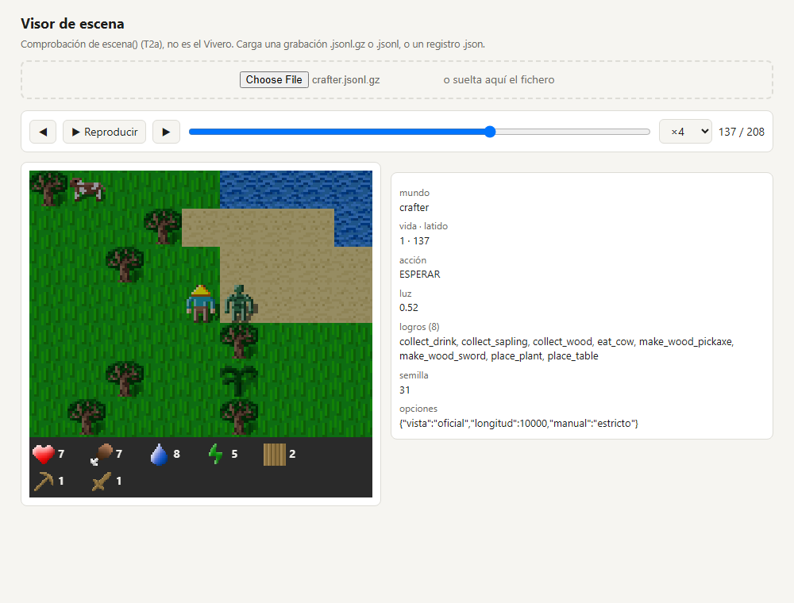

*Grabación `python -m ida --mundo crafter --latidos 300 --semilla 31 --plazo-logico 40 --opcion vista=oficial --opcion
longitud=10000 --opcion manual=estricto --grabar F:\tmp\t2a\crafter.jsonl.gz` (commit `2041fd0`, 26/11/2026; 208
latidos, todos válidos, escena en 190), latido 137.*

### 6.2 Opciones declaradas (O8)

`Mundo.opciones()` es un método de clase (se lee sin crear el mundo ni cargar sus dependencias) que devuelve una lista
de declaraciones; por defecto, vacía. Cada declaración:

| Campo | Contenido |
|---|---|
| `nombre` | clave de `--opcion nombre=valor` y argumento del constructor del mundo (identificador) |
| `tipo` | `entero`, `real`, `opcion` o `booleano` |
| `min`, `max` | entero y real: el rango, ambos obligatorios |
| `valores` | opción: lista no vacía de textos |
| `defecto` | el valor que da más Score de base (O8); pasa su propia validación |
| `etiqueta`, `ayuda` | `{"es": ..., "en": ...}` |
| `vacia` | opcional: la opción admite no tener valor (`None`, el campo vacío); solo entonces `defecto` puede ser `None` |
| `etiquetas_valores` | opcional, solo en las de tipo `opcion` (T4a): `{valor: {es, en}}`, el texto que enseña la interfaz para cada valor; cubre exactamente `valores`. No cambia el valor guardado ni el que llega al mundo. Lo declaran Crafter (`vista`, `manual`) y ajedrez (`color`) |
| `destacada` | opcional, booleano (T4a, O21): la antesala la enseña siempre, aunque sea booleana o admita vacío (las que van en «Avanzado»). La declara la `ventana` de Snake |

`ida/mundos/opciones.py` da `opcion(...)` (crea una declaración y la valida), `validar_declaracion`, `convertir`
(comprueba y convierte los valores de `--opcion`, que llegan como texto, y los de la antesala, que llegan como JSON;
un nombre no declarado es un error; un mundo sin declaraciones recibe los valores tal cual), `con_defectos` y
`defectos`. Los errores son `OpcionInvalida` con el mundo, la opción y el motivo, p. ej. «crafter: opción 'mapa': 500
fuera del rango [32, 128]».

**Dónde se aplican.** El ejecutor convierte siempre las opciones que recibe; la CLI da el error antes de crear nada.
Lo que no se da toma el valor por defecto **del constructor**, que no cambia: la invariancia y las herramientas de
medición lo usan. La antesala lanza con los **declarados** (`servidor.opciones_por_defecto`, con `con_defectos`), y el
Vivero hará lo mismo. Así, lo que se lanza desde la interfaz sin tocar nada coincide con la medición oficial.

## 7. Fases

Cada fase sale de `main` en su rama (`vista/<fase>`) y vuelve con autorización del autor.

| Fase | Contenido | Criterio | Agente |
|---|---|---|---|
| **T0** | Este documento, aprobado | Aprobación del autor | — |
| **T1** | Observador, registro v1 (tres niveles), hechos deducidos, grabación `.jsonl.gz`, consola sobre el registro, vidas reproducibles (O11) | Equivalencia OK; invariancia igual con observador encendido y apagado; validación del esquema; coste ≤ 5 % por latido con nivel cognitivo | Opus |
| **T2** | `escena()` en los cinco mundos; opciones declaradas por mundo (O8) con las de hoy y las nuevas aprobadas | Equivalencia OK; tests de contrato de escena y opciones | Opus diseña el contrato, Flash lo extiende a los mundos |
| **T3** | Servidor v1 (API y SSE); estructura `web/` con i18n; antesala nueva (mundos instalables, formulario automático, presets de carácter, idioma) | Paridad de idiomas; lista de comprobación de la antesala | Opus |
| **T4a** | Vivero de un vistazo: tarjetas con «Ver más» (O19), «Lo que sabe», diario de hechos en frases, acción en frase, logros, ritmos nuevos y paso a paso (O20), Snake a la vista (O21), valores de las opciones traducidos, escena sin franjas, selector sistema/claro/oscuro | Equivalencia e invariancia OK; ritmo sin cambio de conducta; lista de comprobación; el autor lo prueba | Opus |
| **T4b** | Compañero por mundo y colección (O9, O10): estirpe, guardar, adoptar, archivar, ranking, fichas antiguas importables; lo aprendido de la muerte en el diario | Igual que T4a; nada se borra sin confirmación | Opus |
| **T5** | Laboratorio: latido animado (Onda por las 8 fases), mapa de Componentes, epistemología, biología y química, análisis y comparación de vidas, reproductor de grabaciones | Lista de comprobación del Laboratorio | Opus |
| **T6** | Cierre: OTel sobre el registro, README («Pruébalo en 1 minuto» con `[todos]`), capturas, `CHANGELOG`; retirar `panel.html` y `antesala.html` | Todo en verde; el autor revisa | Flash |

El orden pone el Vivero antes que el Laboratorio, como pidió el autor. T1 y T2 son la base de los dos.

## 8. Opciones nuevas por mundo (aprobadas; sus valores por defecto siguen O8)

| Mundo | Opciones que se proponen |
|---|---|
| Crafter | Tamaño del mapa; semilla del mapa independiente de la del organismo; vista oficial o ampliada (**hecho en T2a**, abajo) |
| Snake | Velocidad del juego; tamaño del tablero (si la web lo permite) |
| Mínimo | Tamaño de la rejilla; número de depredadores; abundancia de comida |
| Archivos | Número de biomas; frecuencia de brotes; agresividad del depredador |
| Ajedrez | Ya tiene color, Stockfish y Elo; añadir «apertura aleatoria» |

**Crafter (T2a).** Defecto declarado frente al del constructor (el que usan la CLI sin `--opcion`, la invariancia y la
equivalencia):

| Opción | Tipo y rango | Declarado (O8) | Constructor | De dónde sale el declarado |
|---|---|---|---|---|
| `vista` | opción: `oficial`, `cuadrada` | `oficial` | `cuadrada` | `evaluar_crafter.py` (D17) |
| `radio` | entero, 2–8 | 4 | 4 | la evaluación no lo toca |
| `manual` | opción: `estricto`, `ampliado` | `estricto` | `estricto` | `evaluar_crafter.py` |
| `longitud` | entero, 100–1 000 000 | 10 000 | 100 000 | `evaluar_crafter.py` (longitud oficial del episodio) |
| `mapa` | entero, 32–128 (lado en casillas) | 64 | 64 | nueva; reproduce lo de hoy (`crafter.Env(area=(64, 64))`) |
| `semilla_mapa` | entero, 0–2 147 483 646, admite vacía | vacía | vacía | nueva; vacía = la semilla del organismo, como hoy |
| `ventana` | booleano | no | no (`0`) | la evaluación no la abre |

`mapa` y `semilla_mapa` existen en el paquete: `crafter.Env(area=(64, 64), ..., seed=None)` (crafter 1.8.3); con lados
16, 32, 48, 96 y 128 el mapa se genera y avanza 50 pasos sin error (prueba del 26/11/2026). Pasarlas con su valor por
defecto da las mismas acciones que sin ellas (`tests/test_escena_crafter.py`, 40 latidos, semilla 31, plazo lógico 40).
No quedó fuera ninguna de las aprobadas.

**Mínimo (T2b).** Escena tipo «rejilla» (la pradera entera, entidades por clase y yo). Opciones nuevas declaradas:

| Opción | Tipo y rango | Declarado (O8) | Constructor | De dónde sale el declarado |
|---|---|---|---|---|
| `tamano` | entero, 5–25 | 9 | 9 | la constante `TAM = 9` de hoy |
| `depredadores` | entero, 0–5 | 1 | 1 | el lobo único de hoy (`self.lobo`) |
| `comida` | entero, 1–20 | 4 | 4 | las 4 bayas sembradas de hoy |

No quedó fuera ninguna de las opciones propuestas. En sus valores por defecto dan exactamente las mismas acciones en 100 latidos (`tests/test_escena_minimo.py`, semilla 1, plazo lógico 40).

**Archivos (T2b).** Escena tipo «arbol» (carpetas como nodos con padre, contenido como entidades con ruta y nombre, yo.ruta = carpeta actual, mochila en el inventario; solo lee dentro del bioma en el orden de `_carpetas()`). Opciones nuevas declaradas:

| Opción | Tipo y rango | Declarado (O8) | Constructor | De dónde sale el declarado |
|---|---|---|---|---|
| `biomas` | entero, 1–5 | 5 | 5 | los 5 biomas de `BIOMAS` de hoy |
| `frecuencia_brotes` | entero, 5–100 | 25 | 25 | el periodo de 25 latidos de `_dinamica` |
| `agresividad` | real, 0.0–1.0 | 0.35 | 0.35 | probabilidad de mordisco (0,35) en `_dinamica` |

No quedó fuera ninguna de las opciones propuestas. En sus valores por defecto dan exactamente las mismas acciones en 100 latidos (`tests/test_escena_archivos.py`, semilla 1, plazo lógico 40).

**Snake (T2b).** Escena tipo «rejilla» (cuerpo como entidades con estado cabeza o cuerpo, comida, yo = cabeza con orientación; solo lee el estado del adaptador sin peticiones a la web). Opciones declaradas:

| Opción | Tipo y rango | Declarado (O8) | Constructor | De dónde sale el declarado |
|---|---|---|---|---|
| `dificultad` | entero, 0–2 | 0 | 0 | babosa (0), gusano (1), pitón (2) |
| `ventana` | booleano | no | no (`False`) | navegador en segundo plano por defecto |
| `ritmo` | entero, 20–200 | 60 | 60 | periodo del latido en ms (velocidad) |

*Opción que queda fuera:* el tamaño del tablero queda fuera porque la web real `playsnake.org` tiene un tablero fijo de 21×15 casillas codificado en el DOM/canvas del juego y no admite configuración ni escalado de dimensiones desde el exterior.

**Ajedrez (T2b).** Escena tipo «tablero» (extra.fen, última jugada en marcas, yo.color, turno; importación de `chess` restringida al módulo). Opciones declaradas:

| Opción | Tipo y rango | Declarado (O8) | Constructor | De dónde sale el declarado |
|---|---|---|---|---|
| `color` | opción: `blancas`, `negras` | `blancas` | `blancas` | bando de IdA (blancas mueven primero) |
| `dificultad` | entero, 0–3 | 2 | 2 | bot rival local (0 azar, 1 material, 2 posicional, 3 profundo) |
| `elo` | entero, 500–3000 | 1350 | 1350 | fuerza UCI de Stockfish si se usa |
| `apertura` | entero, 0–20 | 0 | 0 | nueva: medias jugadas al azar al inicio; 0 = posición estándar |

*Opción que queda fuera:* la ruta al binario de Stockfish (`stockfish`) queda fuera de la declaración porque es una ruta libre en el sistema de archivos (cadena de texto) y el esquema de opciones declaradas (O8) solo contempla tipos estructurados (`entero`, `real`, `opcion`, `booleano`); la opción sigue admitiéndose por constructor y CLI tal cual.

## 9. Qué no entra (por ahora)

- **Intervenir en la vida.** El usuario solo observa. La intervención podrá llegar como modo aparte, con las vidas
  intervenidas marcadas y fuera de cualquier medición.
- Un ejecutable descargable y una demo web sin instalar nada.
- Cuentas, nube o compartir en línea: compartir es enviar una ficha o una grabación.

## 10. Registro de cambios

| Fecha | Decisión | Cambio | Motivo |
|---|---|---|---|
| 25/11/2026 | O1–O18 | Propuesta inicial | Conversación con el autor sobre la evolución de la telemetría y la experiencia de usuario |
| 26/11/2026 | O1–O18, sección 8 | Aprobadas por el autor. O8: el valor por defecto de cada opción es el que da más Score de base | Aprobación del autor |
| 26/11/2026 | O2–O5, O7, O11, secciones 4 y 5 | T1: el registro del latido pasa de esbozo a v1 (esquema y catálogo de hechos finales, con lo que queda fuera); grabación `.jsonl.gz`; consola sobre el registro; plazo lógico 40 desde la antesala salvo en tiempo real. Excepción de lectura de `vista()` en Crafter (caché de ids), aprobada por el autor. Equivalencia OK; invariancia OK con el observador en los tres niveles; coste con nivel cognitivo, +4,6 % por latido (Crafter, 3000 latidos, plazo lógico 40, semilla 31, 2 repeticiones) | Rama `vista/t1-registro` |
| 26/11/2026 | O6, O8, O18, secciones 4, 6 y 8 | T2a: contratos `escena()` v1 (rejilla, árbol, tablero) y opciones declaradas (formato, validación, defecto = el de la medición oficial; los del constructor no cambian), con su implementación completa en Crafter (escena, siete opciones con `mapa` y `semilla_mapa`, sprites MIT) y un visor de comprobación en `/escena`. La escena va en el registro solo cuando cambia (sigue siendo v1). Único cambio en la base: los dos métodos de `Mundo`. Equivalencia OK; invariancia OK con el observador completo en los cuatro mundos; 1208 tests | Rama `vista/t2a-escena` |
| 26/11/2026 | O6, O8, O18, sección 8 | T2b: `escena()` y opciones declaradas en mínimo (rejilla, tamano/depredadores/comida), archivos (árbol, biomas/frecuencia_brotes/agresividad), Snake (rejilla, dificultad/ventana/ritmo; tablero fijo de la web fuera) y ajedrez (tablero, color/dificultad/elo/apertura; stockfish libre fuera). Sprites SVG e índices para los tres mundos y piezas Unicode para ajedrez; visor ampliado con dibujo de árbol y tablero. Opción CLI `--datos`. Equivalencia OK; invariancia OK con observador completo; 1239 tests | Rama `vista/t2b-mundos` |
| 26/11/2026 | O9, O19, O20, O21, fase T4 | Tras la prueba de usuario del autor: O9 confirmado (compañero por mundo); O19 (profundidad por capas), O20 (el visionado no es el plazo del latido) y O21 (Snake en la web real, a la vista), aprobadas por el autor. T4 se parte en T4a y T4b | Prueba de usuario del autor de T3 |
| 26/11/2026 | O3, O5, O8, O19, O20, O21, secciones 6.2, 11 y 12 | T4a: Vivero por tarjetas (Cuerpo y ánimo, Ahora, Lo que sabe, Logros y puntuación, Carácter; Estirpe como hueco) con «Ver más» en panel lateral y «Abrir en el Laboratorio»; diario de hechos y acción en frase (plantillas es/en y etiquetas de clases por mundo en `web/i18n/clases/`); ritmo cómodo por mundo en el catálogo, ritmos pausa/lento/cómodo/×4/máximo y paso a paso (`POST vidas/actual/paso`); SSE al nivel cognitivo con el diario de la vida; opciones con `etiquetas_valores` y `destacada`; Snake con la web real a la vista; escena sin franjas, tema sistema/claro/oscuro, flechas entre presets. Equivalencia OK; invariancia OK con observador completo; 1305 tests | Rama `vista/t4a-vivero` |
| 26/11/2026 | O3, O5, O9, O10, O19, secciones 4, 5, 11, 12 y 13 | T4b: compañero por mundo y colección (`<datos>/vivero/`: fichas v1, estirpes archivadas e índice), ficha de individuo v1 con conversión de las antiguas del panel, guardar, adoptar (archiva el compañero de antes), renombrar, exportar, importar y borrar en dos pasos con testigo; «Empezar de cero» desde la aplicación archiva en vez de borrar (la CLI no cambia); ranking por mundo; antesala con «Tu compañero»; tarjeta Estirpe con su «Ver más» (linaje y mutación de cada rasgo) y página Colección. Registro (sigue siendo v1): registro de cierre con lo aprendido al morir (`cierre: true`), `resumen_saber` (vital) y `requisitos` (cognitivo). Barras del cuerpo con nombre por mundo; reparto entre sistemas desde el inicio de la vida. Equivalencia OK; invariancia OK con observador completo; 1325 tests | Rama `vista/t4b-estirpe` |
| 26/11/2026 | O1, O3, O7, O12, O13, O16, O19, secciones 11, 12 y 14 | T5a: base del Laboratorio (`#/lab`). Grabar desde la antesala y el Vivero en `<datos>/grabaciones/<mundo>-<fecha>.jsonl.gz` (nivel completo, desde el latido siguiente, cabecera con `origen` y `empieza_tras`), con un hilo propio que no alarga el latido; lista, descarga y borrado en dos pasos; el directo sin grabar (últimos 2000 latidos en memoria); reproductor con tres fuentes (directo, grabación, fichero), línea de tiempo con hechos, paso a paso, ir a un latido y velocidad; vista Latido (los 8 pasos de D1 con la Onda animada, piezas por autor, consumo, guillotina y tribunal); vista Ingeniería (mapa de Componentes desde `componentes.toml` con tiempos y medias); O13: `analogo` y `descripcion` en es/en en los 74 elementos (tres análogos vacíos a propósito) y ficha de Componente con su decisión. API nueva en la sección 11. Equivalencia OK; invariancia OK con observador completo en los cuatro mundos; 1345 tests | Rama `vista/t5a-laboratorio` |
| 26/11/2026 | O1, O3, O12, O14, O16, O17, sección 11 | T3: servidor con API v1 (`/api/v1`: mundos, instalación, presets, vidas, ritmo y SSE), POST solo con Origin propio, estado de los mundos detectado en local, ritmo entre latidos con un regulador (×1 = lo de antes), aplicación web (`web/index.html`) con i18n es/en, tema claro/oscuro, antesala en tres pasos y esqueletos del Vivero y del Laboratorio; extra `[todos]`. Las rutas de antes siguen hasta T6. Equivalencia OK; invariancia OK con observador completo | Rama `vista/t3-antesala` |

## 11. API v1 del servidor (T3)

Fijada en T3 (26/11/2026). El servidor (`ida/telemetria/servidor.py`) usa solo la biblioteca estándar y escucha en
`127.0.0.1` (en un contenedor, `IDA_TELEMETRIA_HOST`). Las rutas de la API están en `ida/telemetria/api_v1.py`; la
detección de mundos, en `catalogo.py`; la instalación, en `instalador.py`; los presets, en `presets.py`; el ritmo, en
`ritmo.py`. La aplicación (`web/index.html`, rutas `#/antesala`, `#/vivero` y `#/lab`) se sirve en `/`; la antesala y el
panel de antes siguen en `/antesala-antigua` (también `/antesala`) y `/panel`, con sus rutas sin versión, hasta T6.

**Seguridad.** Todo `POST` (de la API y de las rutas antiguas) exige que la cabecera `Origin` o, si falta, `Referer`
sea la del propio servidor (`http://127.0.0.1:<puerto>`, `http://localhost:<puerto>` o `http://[::1]:<puerto>`); si no,
403 `origen_no_permitido`. La instalación solo ejecuta órdenes fijas con extras de la lista cerrada de
`pyproject.toml`; ningún texto del cliente llega a una orden.

**Errores.** `{"error": {"codigo": "...", "mensaje": "...", "campo"?: "..."}}`. La interfaz traduce el código con la
clave `error.<codigo>` y añade el mensaje. Códigos: `json_invalido`, `origen_no_permitido`, `ruta_desconocida`,
`mundo_desconocido`, `mundo_no_instalado`, `opcion_invalida`, `campo_invalido`, `caracter_invalido`, `ficha_invalida`,
`ficha_de_otro_mundo`, `vida_en_curso`, `sin_vida`, `ritmo_invalido`, `ritmo_fijo`, `sin_pausa`, `sin_extra`, `extra_desconocido`,
`instalacion_en_curso`, `instalacion_desconocida`, `error_interno` y, desde T4b, `sin_companero`, `id_invalido`,
`elemento_desconocido`, `nombre_invalido`, `testigo_invalido` y, desde T5a, `grabacion_en_curso`, `sin_grabacion`,
`grabacion_desconocida`, `grabacion_invalida`, `latido_fuera`, `componentes_no_disponibles`.

| Método y ruta | Cuerpo | Respuesta | Errores |
|---|---|---|---|
| `GET /api/v1/mundos` | — | 200 `{mundos: [{nombre, estado, lanzable, extra, tiempo_real, frecuencia_ms, ritmo_comodo_ms, estrella, opciones, instalacion}]}`, Crafter primero | — |
| `POST /api/v1/mundos/{m}/instalar` | (se ignora) | 202 `{instalacion: {id, mundo, extra, estado, codigo, lineas, url}}` | 404 `mundo_desconocido`; 400 `sin_extra`, `extra_desconocido`; 409 `instalacion_en_curso` |
| `GET /api/v1/instalaciones/{id}` | — | SSE: `linea` `{texto}` por línea de salida (las anteriores se reenvían) y `fin` con el resumen (`estado` `ok` o `error`, `codigo`) | 404 `instalacion_desconocida` |
| `GET /api/v1/presets` | — | 200 `{presets: [{id, icono, nombre{es,en}, descripcion{es,en}, arquetipo, por_mundo?}], rasgos, rangos}` | — |
| `POST /api/v1/vidas` | `{mundo, opciones?, caracter?, arquetipo?, ficha?, semilla?, latidos?, generaciones?, sin_experiencia?, tabula_rasa?, nivel?, reemplazar?}` | 201 `{vida}` | 400 `mundo_desconocido`, `opcion_invalida`, `campo_invalido`, `caracter_invalido`, `ficha_invalida`, `ficha_de_otro_mundo`, `json_invalido`; 409 `mundo_no_instalado`, `vida_en_curso` |
| `GET /api/v1/vidas/actual` | — | 200 `{vida}` (o `null`): la última lanzada, con `activa`, `ritmo`, `ritmo_ajustable`, `ritmos`, `ritmo_comodo_ms` y el último `latido`, `vida`, `generacion`, `individuo` | — |
| `GET /api/v1/vidas/actual/registro[?nivel=vital\|cognitivo]` | — | SSE: `vida` y `diario` al conectar, `registro` (el registro del latido v1; con `nivel`, recortado a ese nivel), `ritmo` y `fin` | — |
| `POST /api/v1/vidas/actual/ritmo` | `{ritmo: "pausa" \| "lento" \| "comodo" \| "x4" \| "max"}` (`x1` se admite como `comodo`) | 200 `{ritmo}` con el nombre canónico | 404 `sin_vida`; 400 `ritmo_invalido`; 409 `ritmo_fijo` (tiempo real) |
| `POST /api/v1/vidas/actual/paso` | — | 200 `{ritmo: "pausa", pendientes, latido}`: deja pasar un latido | 404 `sin_vida`; 409 `sin_pausa` (no está en pausa), `ritmo_fijo` (tiempo real) |
| `POST /api/v1/vidas/actual/parar` | — | 200 `{vida}` (ya parada; también desde la pausa) | 404 `sin_vida` |
| `GET /api/v1/companeros` | — | 200 `{companeros: [{mundo, existe, nombre, individuo, generacion, generaciones, mejor_score, ultimo, arquetipo}]}`, uno por mundo (T4b, sección 13) | — |
| `GET /api/v1/companeros/{m}` | — | 200 `{companero}` con lo anterior y `linaje`: las vidas en orden de generación (`individuo`, `generacion`, `latidos`, `score`, `causa_muerte`, `vivo`, `logros`, `arquetipo`) | 404 `mundo_desconocido` |
| `POST /api/v1/companeros/{m}/guardar` | `{nombre?}` | 201 `{ficha}`: la ficha del último individuo, guardada en la colección | 404 `mundo_desconocido`, `sin_companero`; 400 `nombre_invalido` |
| `POST /api/v1/companeros/{m}/archivar` | — | 200 `{archivada}` (la estirpe archivada, o `null` si no había compañero) | 404 `mundo_desconocido`; 409 `vida_en_curso` |
| `GET /api/v1/coleccion[?mundo=m]` | — | 200 `{fichas, estirpes, companeros, ranking: {mundo: [{tipo, id, nombre, mejor_score, generacion, ...}]}}` | 404 `mundo_desconocido` |
| `GET /api/v1/coleccion/{id}` | — | 200 `{elemento}`: la ficha entera o los metadatos y el linaje de la estirpe archivada | 400 `id_invalido`; 404 `elemento_desconocido` |
| `GET /api/v1/coleccion/{id}/exportar` · `GET /api/v1/companeros/{m}/exportar` | — | 200 la ficha v1 en JSON, con `Content-Disposition: attachment` | 400 `id_invalido`; 404 `elemento_desconocido`, `sin_companero` |
| `POST /api/v1/coleccion/importar` | `{ficha}` (JSON v1 o antiguo) | 201 `{ficha, avisos}` | 400 `ficha_invalida`, `mundo_desconocido` |
| `POST /api/v1/coleccion/{id}/renombrar` | `{nombre}` (1–60 caracteres, sin saltos de línea) | 200 `{elemento}` | 400 `id_invalido`, `nombre_invalido`; 404 `elemento_desconocido` |
| `POST /api/v1/coleccion/{id}/adoptar` | — | 200 `{companero, archivada}` | 400 `id_invalido`; 404 `elemento_desconocido`; 409 `vida_en_curso` |
| `POST /api/v1/coleccion/{id}/borrar` | — | 200 `{testigo, caduca_s, elemento}`: **no borra**; dice qué se borraría | 400 `id_invalido`; 404 `elemento_desconocido` |
| `POST /api/v1/coleccion/{id}/borrar/confirmar` | `{testigo}` | 200 `{borrado: id}` | 400 `id_invalido`, `testigo_invalido` (falta, caducado, usado o de otro elemento); 404 `elemento_desconocido` |
| `POST /api/v1/vidas/actual/grabar` | — | 201 `{grabacion: {id, registros, nivel, empieza_tras, primero}}`: graba desde el latido siguiente (T5a, sección 14.1) | 404 `sin_vida`; 409 `grabacion_en_curso` |
| `POST /api/v1/vidas/actual/grabar/terminar` | — | 200 `{grabacion}` (resumen de la lista) | 409 `sin_grabacion` |
| `GET /api/v1/vidas/actual/latidos[?desde=n]` | — | 200 `{lanzamiento, mundo, maximo, primero, siguiente, indice, tiempos_medios, fases_medias, registros, guillotinas}`: el directo en memoria (14.2) | 400 `campo_invalido` |
| `GET /api/v1/vidas/actual/latidos/{n}` | — | 200 `{registro}` con su escena vigente | 400 `campo_invalido`; 404 `latido_fuera` |
| `GET /api/v1/grabaciones` | — | 200 `{grabaciones: [{id, mundo, creada, nivel, semilla, commit, empieza_tras, bytes, registros, en_curso, valida}], grabando}` | — |
| `GET /api/v1/grabaciones/{id}` | — | 200 el `.jsonl.gz` (`application/gzip`, `Content-Disposition: attachment`) | 400 `id_invalido`; 404 `grabacion_desconocida`; 409 `grabacion_en_curso` |
| `GET /api/v1/grabaciones/{id}/indice` | — | 200 `{grabacion, cabecera, truncada, indice, tiempos_medios, fases_medias, registros, guillotinas}` | 400 `id_invalido`, `grabacion_invalida`; 404 `grabacion_desconocida`; 409 `grabacion_en_curso` |
| `GET /api/v1/grabaciones/{id}/latidos/{n}` | — | 200 `{registro}` con su escena vigente | 400 `id_invalido`, `campo_invalido`; 404 `grabacion_desconocida`, `latido_fuera` |
| `POST /api/v1/grabaciones/{id}/borrar` | — | 200 `{testigo, caduca_s, grabacion}`: **no borra** | 400 `id_invalido`; 404 `grabacion_desconocida`; 409 `grabacion_en_curso` |
| `POST /api/v1/grabaciones/{id}/borrar/confirmar` | `{testigo}` | 200 `{borrada: id}` | 400 `id_invalido`, `testigo_invalido`; 404 `grabacion_desconocida` |
| `GET /api/v1/componentes` | — | 200 `{componentes: [{nombre, tipo, clase, dueno, destino, hoy, sistema, modulo, preatentivo, aprende, decision, sustituye, nota, analogo, descripcion, clave_tiempo, mundos, nucleo}], decisiones: {D<n>: {titulo, texto}}, mundos}` (14.5, 14.6) | 404 `componentes_no_disponibles` |

**Lanzar una vida.** `mundo` es obligatorio. Desde T5a, `grabar: true` la graba desde el primer latido (sección 14.1)
y, si no se da `nivel`, con el completo. Las opciones se completan con los defectos declarados y se validan con
`ida/mundos/opciones.py` (O8). El carácter, por orden: `arquetipo` (los cinco rasgos, en [0, 1]); un preset `caracter`
(`optimo` por defecto, que depende del mundo; `azar` deja que lo derive la semilla); el de la `ficha`. La `ficha` es el
JSON de individuo de hoy (`arquetipo`, `arquetipo_actual` o la última de `generaciones`, y `legado`); si dice otro
`mundo`, es un error: lo aprendido no pasa de un mundo a otro. Límites: `semilla` 0–2 147 483 646 (defecto 1),
`latidos` 1–1 000 000 (300), `generaciones` 1–100 (1). Plazo lógico 40 salvo en tiempo real (O11); nivel del registro
`completo` por defecto (el panel clásico enseña los tiempos por Componente). Con una vida en marcha, 409 salvo
`reemplazar: true`, que la para antes. Los datos van a `datos/<mundo>` o, si el servidor se arrancó con
`python -m ida --datos RUTA`, a `RUTA/<mundo>`.

**Ritmo (O3, O20).** `ida/telemetria/ritmo.py`. El ejecutor llama a `Regulador.esperar(frecuencia_ms, parada)` en el
`al_latir`, después de publicar el registro: el latido ya terminó y el siguiente no ha empezado. Desde T4a el regulador
de una vida lanzada por la API lleva el **ritmo cómodo** del mundo (`catalogo.RITMO_COMODO_MS`, ms por latido, de la
telemetría y no del motor): `comodo` espera ese periodo, `lento` el doble, `x4` la cuarta parte, `max` nada y `pausa`
hasta que cambie el ritmo, se pida un paso o se pare la vida. El periodo se mide entre dos salidas de la espera, así que
lo que se ve avanza con un periodo regular aunque el latido tarde. **Paso a paso** (`POST vidas/actual/paso`, solo en
pausa): cada petición deja pasar exactamente un latido (se acumulan: N peticiones, N latidos). Sin cómodo (la CLI con
`--ver`, la antesala antigua) el periodo es `frecuencia_ms` del `Perfil`, como antes; `x1` sigue aceptándose como
`comodo`. En los mundos de tiempo real no se llama y la API responde `ritmo_fijo`. Con plazo lógico la guillotina cuenta
operaciones, no tiempo: `tests/test_ritmo.py` comprueba que una vida de mínimo hace las mismas acciones con lento,
cómodo, ×4, máximo y avanzando de uno en uno en pausa.

| Mundo | Cómodo (ms por latido) | Lento / ×4 | Por qué |
|---|---|---|---|
| ajedrez | 1000 | 2000 / 250 | cada latido es una jugada de IdA y la respuesta del rival: con menos de un segundo no se ven las dos piezas moverse |
| Crafter | 250 | 500 / 62,5 | un paso por casilla; a cuatro casillas por segundo se sigue a IdA por el mapa y se ven acercarse las criaturas. Un latido con plazo lógico tarda unos 20-30 ms de reloj (174 latidos en 5,3 s, incluido el arranque, 26/11/2026), así que ×4 sigue marcándolo el ritmo y no el cálculo |
| mínimo, archivos | 300 | 600 / 75 | casi todos los latidos son un paso o una espera; más deprisa, el diario corre más de lo que se lee |
| Snake | — | — | tiempo real: lo marca el mundo |

Son los de la propuesta de partida: en las capturas a ritmo cómodo el diario y la escena se siguen sin perder hechos, y
no hubo motivo medido para cambiarlos. Se ajustarán con la prueba del autor.

**Diario al conectarse.** El servidor guarda los últimos 400 hechos de la vida en curso (cada uno con `latido`, `vida`
y `generacion`) y el último «aprende requisito» de cada acción, y los manda en el evento `diario` al abrir la SSE: quien
recarga la página no pierde el diario ni lo que sabe. Es lo que ya salió por el registro; no se pide nada al motor.

**Estado de cada mundo.** Sin red y sin importar las dependencias:

| Estado | Cuándo | ¿Se puede lanzar? |
|---|---|---|
| `listo` | sus paquetes están | sí |
| `no_instalado` | `importlib.util.find_spec` no encuentra su paquete (`crafter`, `playwright`, `chess`) | no |
| `falta_navegador` | Snake con Playwright pero sin una carpeta `chromium-*` ni `chromium_headless_shell-*` en la caché de navegadores de Playwright (`PLAYWRIGHT_BROWSERS_PATH`, o `%LOCALAPPDATA%\ms-playwright` en Windows, `~/Library/Caches/ms-playwright` en macOS, `~/.cache/ms-playwright` en Linux) | no |
| `sin_stockfish` | ajedrez con `chess` pero sin `stockfish` en el `PATH` (`shutil.which`) | sí: juega contra su rival local, el de por defecto (`stockfish=""`) |

La ruta de Stockfish sigue siendo opción de la CLI (`--opcion stockfish=RUTA`), no del formulario. «Instalar» ejecuta
`[sys.executable, "-m", "pip", "install", "-e", ".[<extra>]"]` desde la raíz del proyecto y, en Snake, además
`[sys.executable, "-m", "playwright", "install", "chromium"]`; una instalación a la vez. El extra `[todos]` de
`pyproject.toml` reúne crafter, snake y ajedrez (sin `[observabilidad]`, que solo sirve con la pila de `infra/`).

**Idiomas (O16).** `web/i18n.js` con `web/i18n/es.json` y `en.json`: por defecto el del navegador (`es*` → español; el
resto → inglés), con la elección en `localStorage` (`ida.idioma`, dentro de `try/catch`). Los textos de las opciones y
los presets llegan de la API en los dos idiomas. `tests/test_i18n_web.py` comprueba que los dos diccionarios tienen las
mismas claves (y los mismos marcadores) y que toda clave usada en `web/` existe. El visor de escena usa el mismo módulo.
El dibujo de la escena es un módulo compartido (`web/dibujo.js`) entre el visor y el Vivero.

**Capturas** (26/11/2026, Chromium de Playwright a 1280 px salvo la de 1024; servidor con `--datos F:\tmp\t3\datos`).

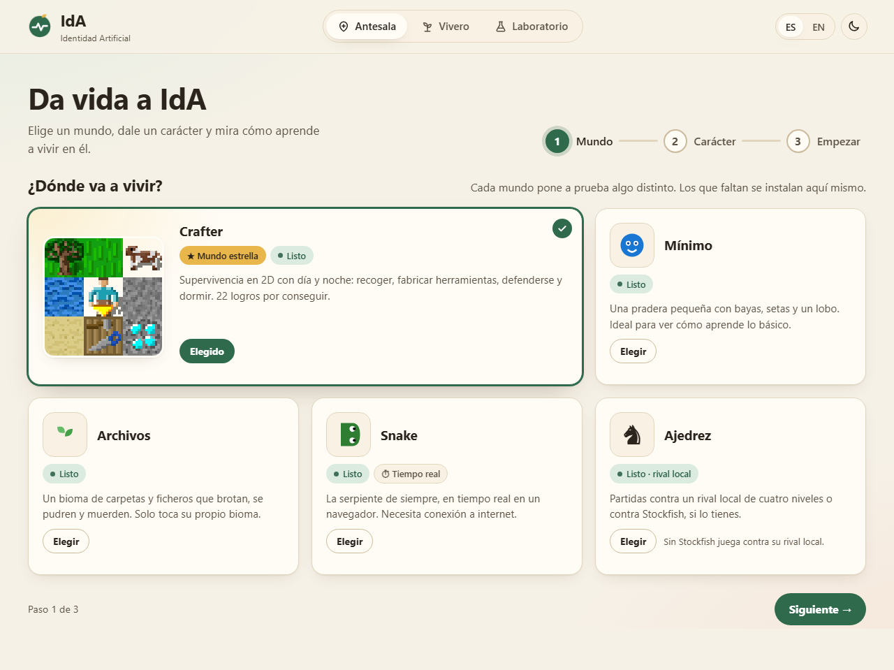

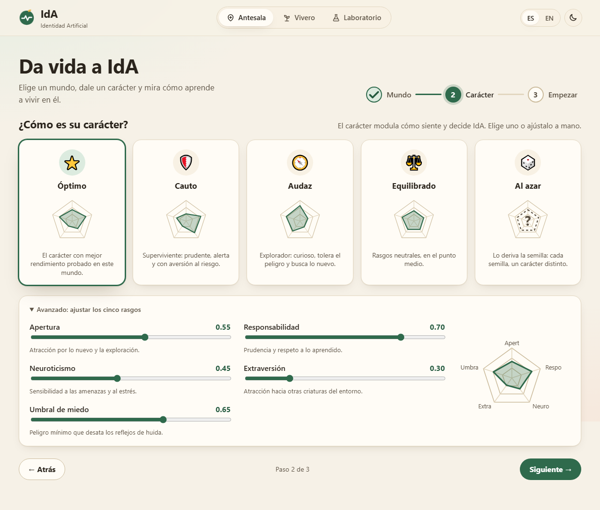

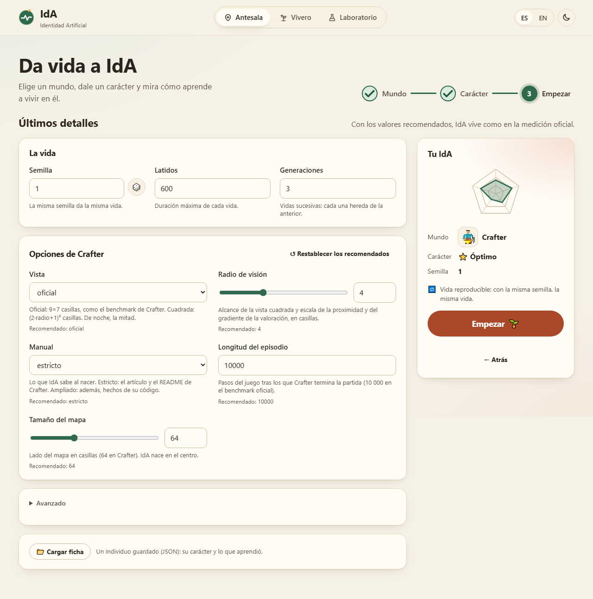

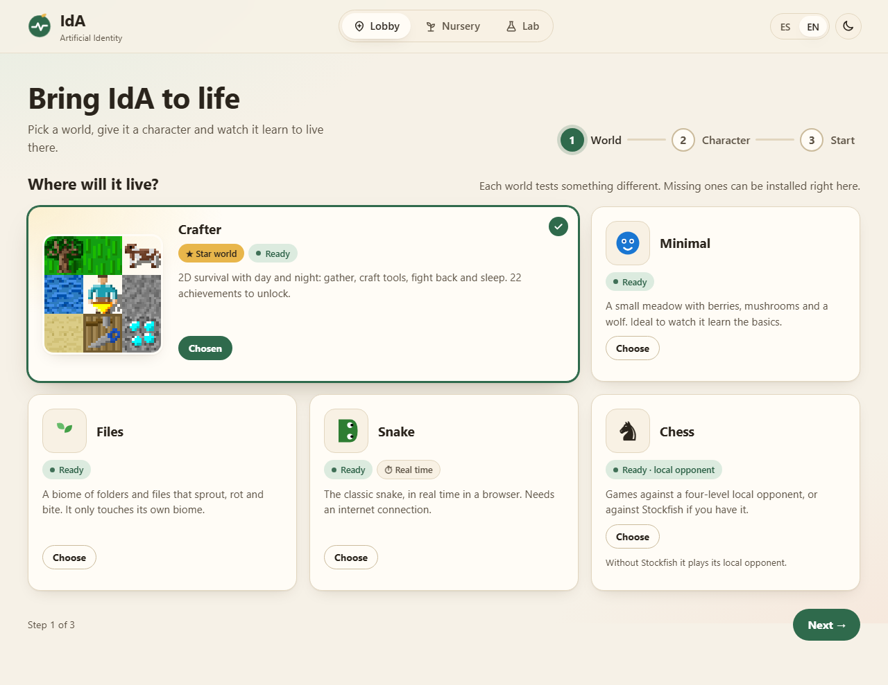

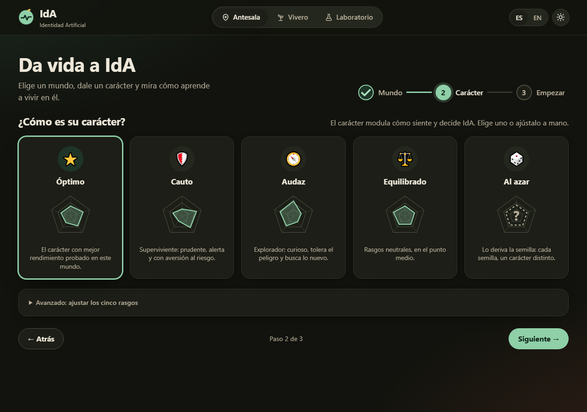

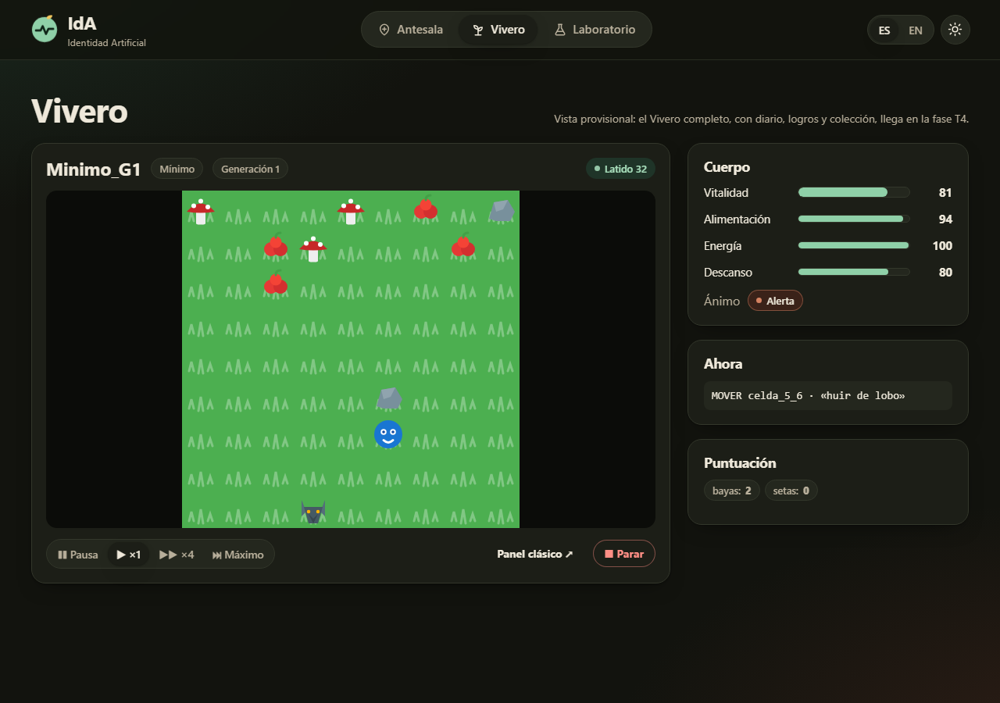

Otras: [paso 3 a 1024 px](img/t3_antesala_3_empezar_1024.png), [paso 3 en oscuro](img/t3_antesala_3_empezar_oscuro.png),
[Vivero a ×4](img/t3_vivero_minimo.png), [Vivero tras «Parar»](img/t3_vivero_parada.png),
[Laboratorio](img/t3_lab.png) y [visor de escena con i18n](img/t3_visor_escena.png).

## 12. Vivero de un vistazo (T4a)

Fijado en T4a (26/11/2026). `ida/telemetria/web/vistas/vivero.js`, con las frases en `web/frases.js`. Se suscribe a la
SSE al nivel cognitivo (`?nivel=cognitivo`): no necesita nada del completo.

| Tarjeta | De un vistazo | «Ver más» (panel lateral) | Campos del registro |
|---|---|---|---|
| Cuerpo y ánimo | vitalidad, alimentación, energía y descanso; ánimo; dormida o lo que lleva | química (dopamina, placer, estrés), valencia, indicadores viscerales, déficit de cada necesidad | `cuerpo`, `quimica`, `afecto`, `necesidades` |
| Ahora | la acción en frase con su motivo («Come una baya porque tiene hambre») y su plan y sistema | motivo tal como lo anota IdA, acción en bruto, candidatos del Tribunal (los 8 primeros, con el ganador), planes activos, reparto S1/S2/S3/Core de las últimas 100 acciones vistas, cambios de plan recientes | `accion`, `tribunal`, `estrategias`, hechos `estrategia` |
| Lo que sabe | 5 frases con el sprite de la clase: lo aprendido en esta vida primero; lo nuevo, resaltado unos segundos; las hipótesis con borde discontinuo | cifras (demostradas, hipótesis, refutadas, aciertos, sorpresas, heredados), cada saber con su fuente (manual, experiencia, herencia, biblioteca), confianza y, en los requisitos, cantidades y efecto; refutadas; sorpresas y dudas recientes | `saber` (20 de más confianza), `memoria`, hechos `aprende` (requisitos), `sorpresa`, `duda`, `refuta` |
| Logros y puntuación | logros conseguidos (n de 22 en Crafter), puntuación del mundo con sus etiquetas, últimos logros | todos los logros del mundo (conseguidos y pendientes) e historia de la vida (hasta 400 hechos) | `score`, hechos |
| Carácter | radar y los cinco rasgos | radar grande, rasgos con su descripción y cambio respecto a la generación anterior de la misma ejecución | `arquetipo`, `generacion` |
| Estirpe | desde T4b, la línea de tiempo de la estirpe, su mejor Score, *Guardar* y *Colección* (sección 13.4) | el linaje entero y la mutación de cada rasgo | `GET companeros/{m}`, `generacion` |

Al pie de cada detalle, «Abrir en el Laboratorio» lleva a `#/lab?seccion=<tarjeta>` (el Laboratorio dice de dónde se
viene). Desde T5a, también al latido que se estaba viendo (sección 14.3). Junto a la escena va el diario: los 7 hechos más recientes con icono y sprite (los cambios de
plan, muchos y técnicos, van al detalle de «Ahora»).

**Frases.** Ninguna sale del motor: la interfaz las forma con el tipo y los parámetros (O5). Las plantillas comunes
(una por tipo de hecho y variante, verbos en presente e infinitivo, relaciones con su género, planes por estrategia y
motivos por impulso o necesidad) están en `web/i18n/es.json` y `en.json`. Lo propio de cada mundo, en
`web/i18n/clases/<mundo>.json`: cada clase con artículo definido e indefinido («la madera» / «madera»; «the cow» / «a
cow») y su género en español, su sprite si su nombre no es el del índice (`wood` → `madera`) o su icono de texto (las
piezas de ajedrez), las frases de acción propias (`VERBO` o `VERBO:clase`: «tala un árbol», «captura un peón (e4d5)»),
los logros y las claves de la puntuación. `tests/test_frases_web.py` comprueba que toda clase que declara el código de
cada mundo (tablas del adaptador, manual de Crafter, índice de sprites) o que sale en una vida corta (mínimo, archivos,
Crafter y ajedrez; Snake necesita la web real) tiene etiqueta en los dos idiomas, y que cada tipo de hecho del catálogo,
verbo, relación, estrategia e impulso tiene plantilla.

**Límites conocidos.** La fuente «biblioteca» solo se distingue de «manual» en los requisitos (en las proposiciones el
registro da `autoridad`, que en las vidas de la aplicación es el manual, porque no usan biblioteca). Resueltos en T4b
(sección 13): los requisitos del manual que no cambian durante la vida ya salen en «Lo que sabe» (campo `requisitos`),
las cifras salen de toda la memoria (`resumen_saber`), el reparto entre sistemas cuenta desde el inicio de la vida y la
mutación del carácter sale del linaje.

**Capturas** (26/11/2026, Chromium de Playwright a 1280 px; servidor con datos en `F:\tmp\t4a\datos`; commit
`63191b9`; sin errores en la consola).

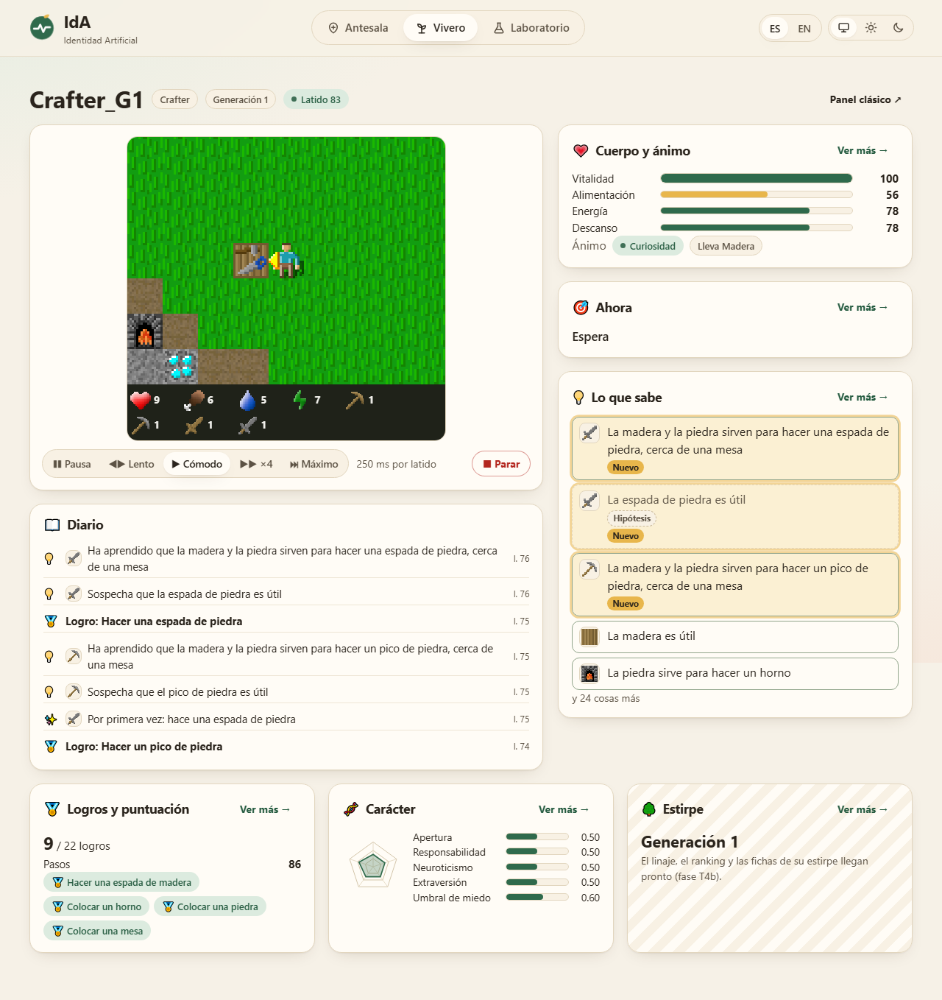

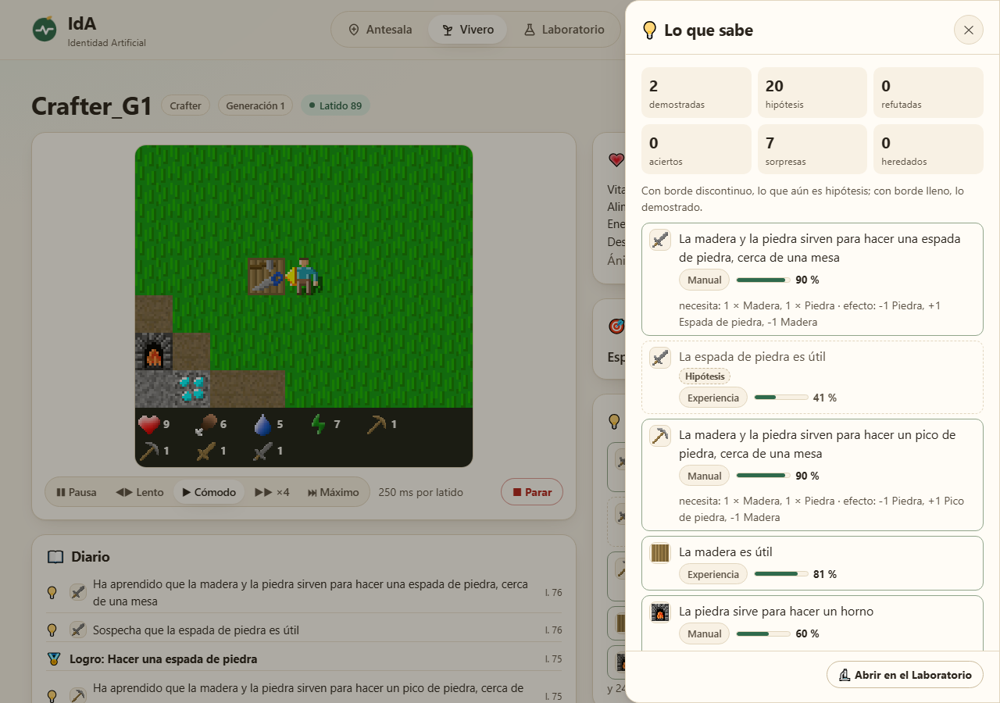

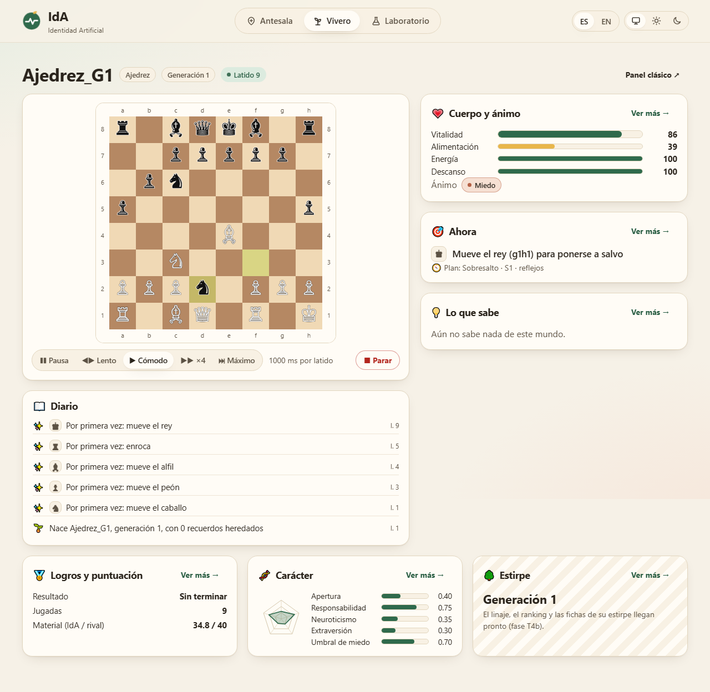

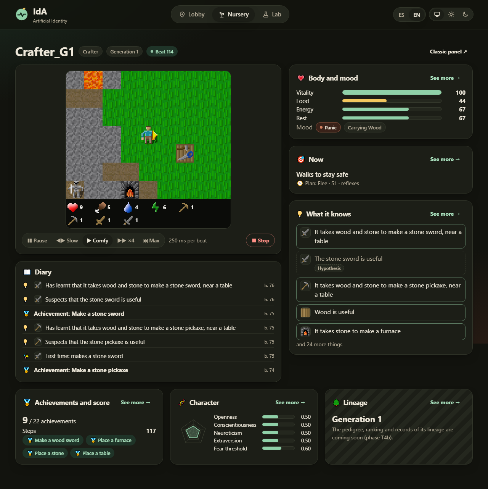

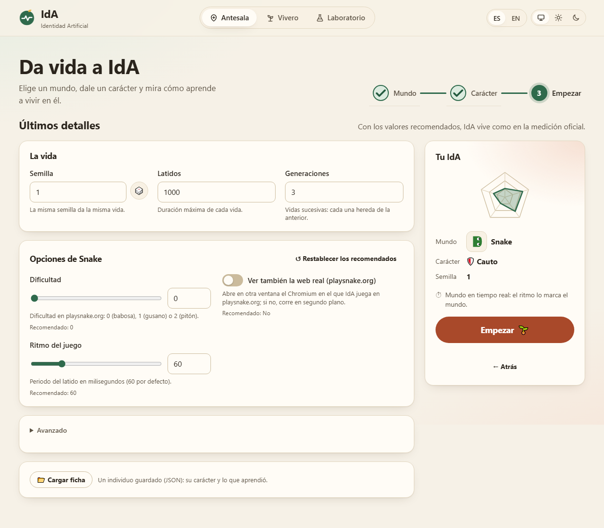

Otras: [detalle de Ahora](img/t4a_ver_mas_ahora.png), [de Cuerpo y ánimo](img/t4a_ver_mas_cuerpo.png),
[de Logros](img/t4a_ver_mas_logros.png), [de Carácter](img/t4a_ver_mas_caracter.png), [pausa con «Paso a
paso»](img/t4a_vivero_pausa.png), [mínimo](img/t4a_vivero_minimo.png), [archivos](img/t4a_vivero_archivos.png),
[presets con el teclado](img/t4a_presets_flechas.png) y [Laboratorio desde el Vivero](img/t4a_lab_desde_vivero.png).

## 13. Vivero: compañero, colección y fichas (T4b)

Fijado en T4b (26/11/2026). Desarrolla O9 y O10. El código: `ida/telemetria/vivero.py` (modelo, ficha v1, conversión,
archivo y borrado), las rutas en `api_v1.py`, la antesala en `web/vistas/antesala.js`, la tarjeta Estirpe en
`web/vistas/vivero.js` y la Colección en `web/vistas/coleccion.js`. **Regla de esta sección: nada de lo que el usuario
ha criado se borra ni se sobrescribe sin una confirmación expresa.**

### 13.1 Dónde vive cada cosa

```
<datos>/                       datos/ del proyecto o, con python -m ida --datos RUTA, RUTA
  <mundo>/                     el compañero de ese mundo: su estirpe viva (O9), como hasta ahora
    linaje.json                generaciones, último arquetipo y legado (ida/nucleo/linaje.py)
    memoria.db, -wal, -shm     lo vivido (ida/nucleo/persistencia.py)
    bioma/                     (archivos) es del mundo, no de la estirpe: no se archiva ni se mueve
  vivero/                      la colección
    indice.json                índice (se rehace leyendo fichas/ y estirpes/ si falta o no cuadra)
    fichas/<id>.json           fichas de individuo v1
    estirpes/<id>/             estirpes archivadas: sus linaje.json y memoria.db* y estirpe.json (metadatos)
```

- **Compañero** de un mundo = `<datos>/<mundo>/linaje.json` y `memoria.db*`. Cada «Empezar» lo continúa con una
  generación nueva (el ejecutor no cambia). Si no hay `linaje.json`, el mundo no tiene compañero.
- **Estirpe archivada** = esos mismos ficheros, copiados a `vivero/estirpes/<id>/`, con `estirpe.json` (`id`, `mundo`,
  `nombre`, `archivada` (fecha), `motivo` (`adoptar`, `empezar_de_cero` o `archivar`), `generaciones`, `mejor_score`,
  `ultimo`).
- **Identificadores**: `<mundo>-<AAAAMMDD>-<HHMMSS>-<6 hex al azar>`. La API solo acepta `^[a-z]+-\d{8}-\d{6}-[0-9a-f]{6}$`:
  ninguna ruta sale de `vivero/`.
- **Score** de una vida = el `fitness` que ya calcula `ida/historico.py` (`calcular_fitness`, por mundo; en Crafter,
  1000 × logros + pasos) y que ordena el linaje. No es la Score oficial de D17 (media geométrica sobre episodios), que no
  se puede dar por vida. *Mejor Score* de una estirpe o ficha = el máximo de sus vidas.
- Lo aprendido es de cada mundo: una ficha o estirpe de otro mundo no se puede adoptar.

### 13.2 Ficha de individuo v1 (O10)

```jsonc
{
  "tipo": "ida_ficha", "version": 1,
  "id": "crafter-20261126-101500-a1b2c3",
  "nombre": "Crafter_G3",                       // se puede renombrar; por defecto, el individuo
  "mundo": "crafter",
  "individuo": "Crafter_G3", "generacion": 3,
  "arquetipo": {"nombre": "IdA", "linaje": "Crafter", "generacion": 3, "padre": "Crafter_G2",
                "apertura": 0.55, "responsabilidad": 0.7, "neuroticismo": 0.45, "extraversion": 0.3, "umbral_miedo": 0.65},
  "legado": {},                                 // Memoria.legado(): lo que hereda su descendencia
  "vidas": [{"individuo": "Crafter_G1", "generacion": 1, "latidos": 812, "score": 4812.0, "causa_muerte": "zombi",
             "vivo": false, "logros": ["collect_wood"], "puntuacion": {}}],
  "mejor_score": 4812.0,
  "fecha": "2026-11-26T10:15:00",               // cuándo se guardó o se importó
  "commit": "63191b9…",                         // git rev-parse HEAD (local, sin red); null si no se puede leer
  "origen": "companero",                        // companero | importada | panel
  "avisos": []                                  // lo que faltaba al convertir una ficha antigua
}
```

`vidas` va en orden de generación; es lo que guarda el linaje (la retención de `historico.py` conserva hasta 20
generaciones, las de más Score, así que en estirpes largas hay huecos). El legado es el de la estirpe en el momento de
guardar: el que heredaría la generación siguiente.

**Guardar** hace una ficha del compañero: su último individuo (el de la vida que acaba de terminar) con el historial de
la estirpe.

**Fichas antiguas** (las que descarga `panel.html` y las que acepta la antesala de T3). Se convierten al importarlas;
lo que falta se apunta en `avisos` y la interfaz lo enseña:

| Antigua | Cómo se convierte | Lo que suele faltar (aviso) |
|---|---|---|
| `tipo: "ida_individuo_v1"` (descarga de un individuo o «Restaurar en antesala») | una vida con `latidos`, `puntuacion`, `vivo` y Score (`fitness` o recalculado); `arquetipo` y `legado` tal cual | causa de muerte, logros (salvo `puntuacion.logros`), fecha, commit, historial (solo una vida), legado (el de «Restaurar» va vacío: no hereda saber) |
| `tipo: "ida_linaje_completo_v1"` (descarga del linaje) | `vidas` = sus `generaciones`; individuo = la de mayor generación; `arquetipo_actual` y `legado` | fecha y commit |
| sin `tipo`, con `arquetipo`, `arquetipo_actual` o `generaciones`, y/o `legado` (lo que aceptaba T3) | como las anteriores | lo mismo |
| ficha v1 | se valida y recibe un `id` nuevo | — |

Una ficha sin carácter ni legado, o con un carácter fuera de rango, no se importa (`ficha_invalida`). El arquetipo se
completa con los campos de `Arquetipo` que falten (`linaje` = el nombre del mundo, `generacion` de la ficha, `padre`
nulo) y se descartan los que no son suyos.

### 13.3 Acciones y qué tocan en disco

| Acción | Qué hace | Lo que nunca hace |
|---|---|---|
| **Guardar** | crea `vivero/fichas/<id>.json` | no sobrescribe: si el fichero existiera, otro `id` |
| **Adoptar una ficha** | archiva el compañero (si lo hay) y escribe un `linaje.json` nuevo en `<datos>/<mundo>/` con el arquetipo, el legado y las vidas de la ficha; la ficha se queda en la colección | no borra el compañero anterior: queda como estirpe archivada (motivo `adoptar`) |
| **Adoptar una estirpe archivada** | archiva el compañero (si lo hay) y devuelve la estirpe a `<datos>/<mundo>/` (sale de `estirpes/`) | ídem |
| **Empezar de cero** (antesala y `POST vidas` con `tabula_rasa`) | archiva el compañero (motivo `empezar_de_cero`) y lanza la vida sin linaje | no hace `rmtree`. Solo la CLI (`--tabula-rasa`) conserva su conducta de siempre (borrar `<datos>/<mundo>`) |
| **Renombrar** | cambia `nombre` en la ficha o en `estirpe.json` (escritura atómica) | nada más cambia |
| **Exportar** | descarga la ficha (de una estirpe archivada o del compañero, la ficha que daría «Guardar») | no toca disco |
| **Importar** | convierte (13.2) y crea una ficha nueva | no sobrescribe |
| **Borrar** | dos pasos: `pedir` devuelve un testigo (un solo uso, 120 s, ligado a ese elemento) y lo que se perdería; `confirmar` con ese testigo borra la ficha o la estirpe archivada | sin testigo válido no borra. El compañero no se borra por la API: hay que archivarlo antes |

**Archivar** copia cada fichero de la estirpe a la carpeta nueva, comprueba que la copia tiene el mismo tamaño y solo
entonces quita los originales; si algo falla, los originales se quedan y la carpeta a medias se marca `incompleta` en su
`estirpe.json`. Escribir (fichas, índice, `estirpe.json`, `linaje.json` de una adopción) es atómico: fichero temporal y
`os.replace`. Con una vida de ese mundo en marcha, adoptar y archivar responden 409 `vida_en_curso` (la vida escribe
en esos ficheros); «Empezar de cero» desde la antesala para antes la vida, como cualquier lanzamiento con `reemplazar`.

**Ranking por mundo**: el compañero, sus estirpes archivadas y sus fichas, por mejor Score (de mayor a menor).

### 13.4 Antesala, Estirpe y Colección

- **Antesala, paso 3**: un bloque «Tu compañero» con tres opciones. *Continuar con tu compañero* (por defecto si
  existe; dice su generación y su mejor Score), *Adoptar de la colección* (fichas y estirpes de ese mundo, con su
  Score) y *Empezar de cero (se archiva)*. Sin compañero, solo las dos últimas. La carga de ficha de T3 pasa a ser
  «Importar a la colección» (la ficha importada queda elegida para adoptar). El carácter del paso 2 solo cuenta al
  empezar de cero o sin compañero: una estirpe que continúa hereda el de su padre con mutación (el ejecutor no cambia),
  y la antesala lo dice.
- **Tarjeta Estirpe** (Vivero): las generaciones en una línea de tiempo (individuo, Score, causa de muerte; la vida en
  curso al final), el mejor Score y los botones *Guardar* y *Colección*. Su «Ver más»: el linaje entero en tabla y la
  mutación de cada rasgo a lo largo de las generaciones (una línea por rasgo). Sale del linaje (`GET companeros/{m}`),
  no de lo visto en la página; se vuelve a pedir al empezar cada vida y al terminar.
- **Carácter**: el cambio respecto a la generación anterior sale también del linaje.
- **Colección** (`#/vivero/coleccion`): por mundo, el compañero, las estirpes archivadas y las fichas, con su ranking, y
  las acciones de 13.3 (adoptar, renombrar, exportar, importar y borrar con confirmación).

### 13.5 Registro: cierre, resumen del saber y requisitos (añadidos a v1)

Son campos nuevos: el registro sigue siendo v1 (sección 4).

| Campo | Nivel | Contenido |
|---|---|---|
| `cierre` | — | `true` solo en el **registro de cierre**: cuando una vida termina por muerte, después de `Organismo._aprender_de_la_muerte`, el ejecutor pide al observador un registro más con el mismo `latido`. Es el último registro de esa vida, con `memoria`, `resumen_saber` (y, en cognitivo, `saber` y `requisitos`) al día, `experiencia.aprendizaje` con lo que se apuntó al morir y `hechos` con lo que cambió en la memoria al morir (`aprende`, `peligro`, `duda`, `refuta`; nunca otra vez `muere`). Va a la grabación y a la SSE; no a la consola ni a `al_latir`, así que la salida de siempre no cambia |
| `resumen_saber` | vital | totales de toda la memoria: `proposiciones`, `demostradas`, `hipotesis`, `refutadas`, `heredadas` (proposiciones con la marca de herencia), `aciertos`, `sorpresas`, `requisitos` y `requisitos_confirmados`, y `fuentes` (`{manual, experiencia, herencia, biblioteca}`: de cuántos saberes, proposiciones y requisitos, es cada fuente) |
| `requisitos` | cognitivo | todos los requisitos de acción de la sección «requisitos» (si el mundo la monta), con la forma del hecho `aprende` de requisito (`verbo`, `clase`, `requiere`, `cerca`, `efecto`, `confirmado`, `fuente`, `confianza`): así «Lo que sabe» enseña también los del manual que no cambian en la vida |

Las cifras de «Lo que sabe» salen de `resumen_saber`, y «y N cosas más» = proposiciones no refutadas + requisitos −
las 5 que se ven. El diario enseña los hechos del cierre con «Al morir, …».

### 13.6 Etiquetas del cuerpo por mundo

Las cuatro barras del registro (`cuerpo`) son las constantes del `Soma`; lo que representan depende del mundo. Cada
`web/i18n/clases/<mundo>.json` declara en `cuerpo` las barras que se enseñan, con su etiqueta y una ayuda en es/en; una
barra que no tiene sentido en un mundo no se declara y no se enseña.

| Mundo | `vitalidad` | `alimentacion` | `energia` | `descanso` | De dónde sale |
|---|---|---|---|---|---|
| Crafter | Salud (salud del juego, 0–9) | Comida y bebida (la menor de las dos) | Energía (la del juego; sube durmiendo) | — (el adaptador le da la misma energía) | `MundoCrafter._vitales` (`vitales_propios`) |
| mínimo | Salud | Alimentación (bayas +20) | Energía | Descanso (duerme) | metabolismo del `Soma` |
| archivos | Salud | Alimentación (comida +8) | Energía (moverse cuesta 0,5 y atacar 2) | Descanso (duerme) | metabolismo del `Soma` |
| Snake | Vida (100 hasta chocar) | Saciedad (comida +25) | Energía (baja si pasa hambre) | — (no duerme: solo baja) | metabolismo del `Soma` |
| ajedrez | Material propio (100 × material / 39) | Balance de material (60 + 5 × diferencia) | — (fija en 100) | — (fija en 100) | `MundoAjedrez.observar` (`vitales_propios`) |

### 13.7 Reparto entre sistemas

El servidor cuenta el sistema de cada acción de la vida en curso desde su primer latido (como el diario) y lo manda en
el evento `diario`; el Vivero lo continúa con cada registro. «Ver más» de Ahora dice ya «desde el inicio de la vida».

## 14. Laboratorio: grabar, reproducir, Latido e Ingeniería (T5a)

Fijado en T5a (26/11/2026). La base del Laboratorio (O1): la vista experta que explica **cómo** funciona IdA latido a
latido. Todo sale del registro del latido v1 que ya publica el servidor (sección 4): no se pide nada al motor y nada de
esto cambia la conducta (O3). El código: `ida/telemetria/laboratorio.py` (directo, grabaciones, hilo de escritura),
`ida/telemetria/componentes.py` (mapa de Componentes para la API), las rutas en `api_v1.py`, y en `web/`:
`vistas/lab.js` (página, reproductor y grabaciones), `lab/fuentes.js`, `lab/linea.js`, `lab/latido.js`,
`lab/ingenieria.js` y `lab/catalogo.js`. T5b añadirá Epistemología, Biología y química, Análisis y comparación.

### 14.1 Grabar desde el Vivero y la antesala (O7)

- **Al lanzar:** «Avanzado → Grabar esta vida» en la antesala (`POST vidas` con `grabar: true`). Sin `nivel` explícito,
  la vida va con el nivel **completo** (el de la aplicación, sección 11).
- **En marcha:** «⏺ Grabar» en el Vivero (`POST vidas/actual/grabar`): graba desde el latido siguiente al último
  publicado. «■ Terminar grabación» (`POST vidas/actual/grabar/terminar`) la cierra; si no, se cierra sola al terminar o
  pararse la vida, después del registro de cierre (13.5). Una grabación a la vez.
- **Dónde:** `<datos>/grabaciones/<mundo>-<AAAAMMDD>-<HHMMSS>.jsonl.gz` (con `-2`, `-3`... si coincide el segundo). La
  API solo acepta identificadores `^[a-z]+-\d{8}-\d{6}(-\d{1,3})?$`: ninguna ruta sale de esa carpeta.
- **Formato:** el de siempre (`ida/telemetria/grabacion.py`, sección 4). La cabecera añade `origen: "vivero"` y
  `empieza_tras` (`{vida, latido}` del último registro antes de empezar, o `null` desde el primero). El primer registro
  de la grabación y el primero de cada vida llevan siempre su escena vigente, aunque no haya cambiado: el lector la
  reconstruye desde ahí (`grabacion.escenas`).
- **Sin coste para la vida:** `Telemetria.publicar` solo encola el registro; un hilo propio (`Laboratorio`) lo comprime
  para el directo y lo escribe en la grabación, en el orden de publicación. `tests/test_laboratorio.py` comprueba que una
  vida de mínimo hace las mismas acciones grabando y sin grabar.
- **Lista y borrado:** como la colección (13.3): `pedir` da un testigo de un solo uso (120 s) y lo que se borraría;
  `confirmar` con ese testigo borra. Mientras se escribe, una grabación no se abre, descarga ni borra
  (`grabacion_en_curso`).

### 14.2 El directo sin grabar

El servidor guarda los **últimos 2000 registros** de la vida lanzada en curso (`laboratorio.LATIDOS_DIRECTO`),
comprimidos con zlib de nivel 1 y con su escena vigente. **Por qué 2000:** un registro completo de Crafter ocupa de media
62 KB en JSON y 10,3 KB comprimido (máximo 12,1 KB; 120 latidos, semilla 31, plazo lógico 40, 26/11/2026), así que 2000
son unos 21 MB. Cubre la vida entera de lo que se lanza por defecto desde la antesala (300 latidos) y, a ritmo cómodo en
Crafter (250 ms por latido), algo más de 8 minutos de lo visto; más se graba. El índice (latido, vida, hechos, guillotina,
candidatos) y las medias de tiempo se mantienen al quitar los más antiguos.

### 14.3 Reproductor (`#/lab`)

| Fuente | De dónde salen el índice y cada latido |
|---|---|
| **En directo** | `GET vidas/actual/latidos[?desde=n]` (índice incremental, cada segundo) y `GET vidas/actual/latidos/{n}` |
| **Grabación de la lista** | `GET grabaciones/{id}/indice` y `GET grabaciones/{id}/latidos/{n}`: el servidor la lee una vez (descompresión incremental: una grabación cortada vale hasta su última línea entera, y lo dice) y guarda cada línea comprimida; dos grabaciones abiertas a la vez como mucho |
| **Fichero cargado** | en el navegador (`DecompressionStream` para `.gz`): `.jsonl.gz`, `.jsonl` o un registro `.json`; no se sube |

Línea de tiempo (SVG) con los hechos del índice: ★ logro, ● lo aprendido (y peligro, sorpresa, duda, refuta), ✕
muerte, ▲ nacimiento, raya roja en cada guillotina y raya discontinua entre vidas; al pasar, la frase del hecho
(`frases.js`, la del Vivero); al pulsar, va a ese latido. Debajo, un deslizador accesible con el teclado. Mandos: al
principio, atrás, reproducir/pausa, adelante, al final (en directo, «seguir el directo»), ir a un latido y velocidad
(0,5 a 8 latidos por segundo). La escena pequeña y el resumen del latido van en la columna lateral, fija al bajar.

**Desde el Vivero.** «Abrir en el Laboratorio» lleva a `#/lab?seccion=<tarjeta>&fuente=directo&vida=<v>&latido=<l>`: el
latido que se estaba viendo (si sigue en la memoria del directo) y el paso que explica esa tarjeta: Cuerpo y ánimo →
Core·Sentir; Ahora → Tribunal; Lo que sabe → Plasticidad; Logros → Cierre; Carácter y Estirpe → Onda, con el aviso de que
su vista propia es de T5b.

### 14.4 Vista «Latido»

Los ocho pasos de D1 en un SVG, para el latido elegido. La Onda (un punto) los recorre y se detiene en cada uno en
proporción a su tiempo medido; con `prefers-reduced-motion`, sin animación.

| Paso (D1) | Qué enseña | Campos del registro |
|---|---|---|
| 1 Onda | latido, vida, si es el registro de cierre | `latido`, `vida`, `cierre` |
| 2 Core·Sentir | piezas en bruto y tiempo (observar + sentir) | piezas de los sensores del Core, `fases` `percibir` y `sentir` |
| 3 Preatención | piezas anotadas (modificadas) y tiempo; borde discontinuo: no paga atención | `piezas[].registro` (`modificar` por un preatentivo), `fases` `preatencion`, `tiempos_ms` `preatencion:*` |
| 4 Plasticidad | Componentes plásticos montados, lo aprendido en el latido, tiempo del paso | `componentes.toml` (`aprende`), `hechos`, `experiencia.aprendizaje`, `fases` `aprender` |
| 5 Regulación | plazo, amplitud y potencia del latido | `ritmo.plazo_ms`, `ritmo.amplitud[1]`, `ritmo.potencia[1]` |
| 6 S1, S2, S3 | tiempo por módulo, amplitud y potencia consumidas, lo que quedaba al entrar, piezas creadas, candidatos, estrategia activa, guillotina | `tiempos_ms`, `onda.consumo`, `onda.restante`, `tribunal.candidatos`, `estrategias`, `ritmo.guillotina` |
| 7 Tribunal | los candidatos con base, activa, proactiva, plus y total, y el ganador | `tribunal` |
| 7 Actuar | acción, primitivas ejecutadas, éxito y tiempo | `accion`, pieza `Accion` de `ef` (`carga.primitivas`), `fases` `actuar` |
| 8 Cierre | hechos de vida, episodio y expectativa | `hechos`, `experiencia` |

**Piezas y autoría.** Cada pieza de `ef` va al paso de su autor (`Pieza.origen`): los sensores del Core a Sentir, `S1.*`
a S1 (salvo los preatentivos, a Preatención), `CORE.Organismo` (la sorpresa al contrastar) a Plasticidad,
`CORE.Tribunal` al Tribunal y `CORE` (la acción ejecutada) a Actuar. En el detalle de cada paso: **salen** (las que crea),
**modifica** (las de otros que toca, del registro de la pieza en ese latido) y **le entran** (las de pasos anteriores de
las que se formaron las suyas, por `entradas`). Al pulsar una pieza, su registro entero; al pulsar un autor o un
Componente, su ficha.

**Límites.** El registro mide la plasticidad entera, no cada Componente que aprende (salen sin tiempo propio). La
regulación se calcula al crear la Onda en la fase A (D12): no tiene tiempo aparte. «Le entran» solo ve las `entradas`
declaradas: no hay registro de lecturas. Con un registro cognitivo (sin `piezas` ni `tiempos_ms`), la vista lo dice y
enseña lo que hay.

### 14.5 Vista «Ingeniería»

El mapa de Componentes de cada sistema (Core, S1, S2, S3 y cuerpo) sale de `GET componentes` (`componentes.toml`, la
misma fuente que los diagramas 06 y 07, con la misma regla de montaje: lo comprueba `tests/test_laboratorio.py`). Por
defecto enseña lo que monta el mundo de la vida; lo demás, a petición y en gris. Cada Componente lleva su tiempo en el
latido (barra, escala logarítmica: el Actuador al mover tarda milisegundos y casi todos los demás, microsegundos) y la
media de la fuente (raya); preatentivos (◐) y plásticos (✱) marcados; estrategias con la activa y la ejecutada; la
guillotina en el sistema donde cortó y «sin turno» en los siguientes. El Actuador mide por verbo
(`CORE.Actuador_<VERBO>`) y se suma.

### 14.6 Análogo biológico y descripción (O13)

`componentes.toml` gana dos campos en los 74 elementos: `analogo = {es, en}` (la correspondencia neurocientífica o
biológica: estructura, circuito o proceso) y `descripcion = {es, en}` (qué hace en IdA, para alguien no técnico).
`herramientas/mapa_componentes.py` los valida (tablas `{es, en}` de texto; descripción no vacía; análogo vacío en los dos
idiomas o en ninguno) y no los saca en 06 ni en 07. Tres análogos están vacíos a propósito, porque no hay uno honesto:
`SeguirEnMovimiento` (último recurso para mundos que no dejan esperar), `Sujeto` (paso de representación interno de S2)
y `Geometria` (geometría de la rejilla, herramienta de ingeniería). Los que son aproximados lo dicen («análogo
aproximado»: `Peticion`).

**Ficha de Componente** (en el lateral, desde Latido e Ingeniería): nombre, sistema y módulo, clase (general, opcional,
del cuerpo o del mundo, con su dueño), preatentivo o plástico, análogo, qué hace, su tiempo en el latido y su media,
la decisión de diseño (`D<n>` con su título y su texto de `docs/DISENO_COMPONENTES.md`, en español) o «anterior a la
reorganización», si el mundo lo monta y la nota técnica.

### 14.7 Capturas

26/11/2026, Chromium de Playwright a 1280 px (la del latido, 1280 × 1500; una, 1024 px); servidor con datos en
`F:\tmp\t5a\datos`; grabación de Crafter lanzada por la API (semilla 31, plazo lógico 40, 242 registros, nivel
completo); latido 57, con tres candidatos en el Tribunal; sin errores en la consola del navegador.

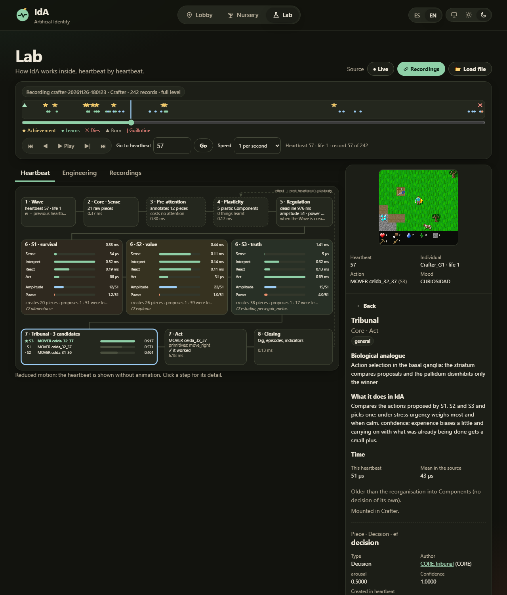

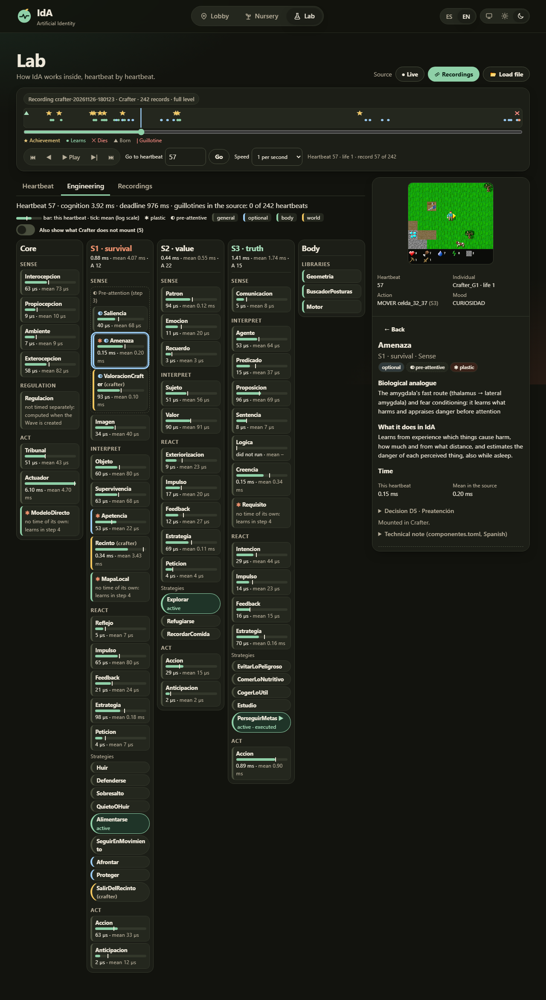

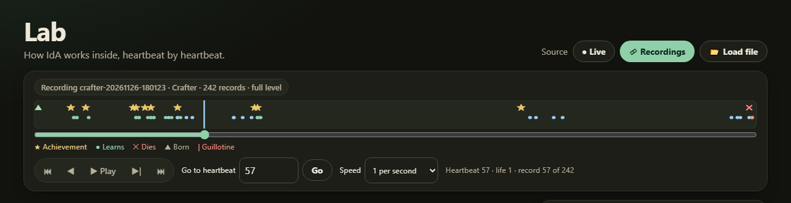

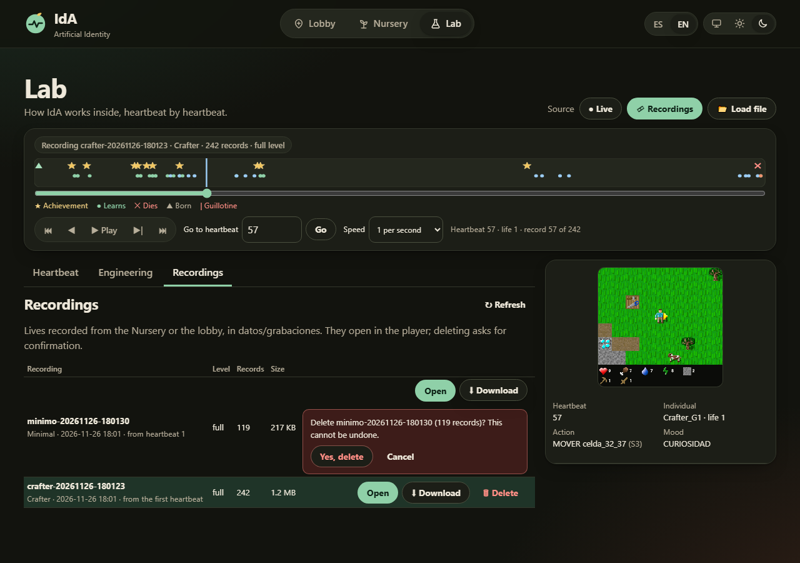

Otras: [la pieza bajo la ficha](img/t5a_latido_pieza_en_oscuro.png), [preatención y Saliencia](img/t5a_latido_saliencia_en_oscuro.png),
[Latido en español con S3 abierto](img/t5a_latido_es.png), [Ingeniería en español](img/t5a_ingenieria_es.png),
[desde «Ahora» del Vivero, en directo](img/t5a_desde_vivero_es.png) y [a 1024 px](img/t5a_latido_1024_en_oscuro.png).
